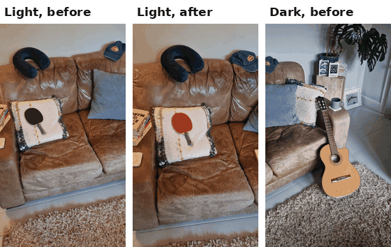
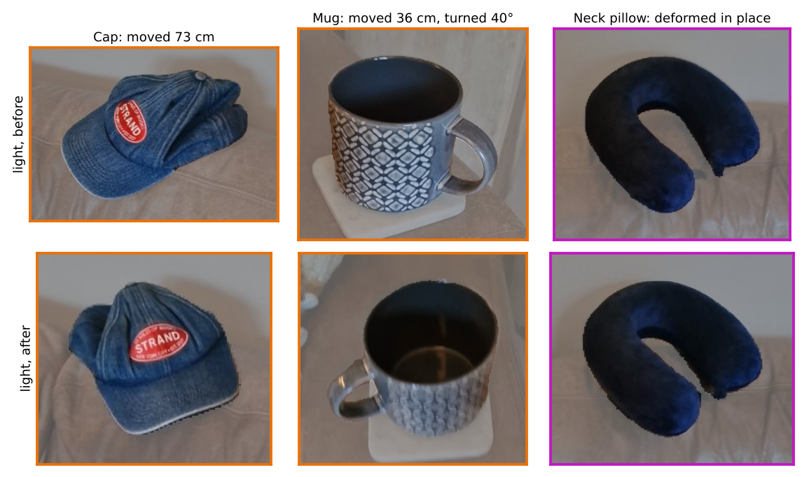
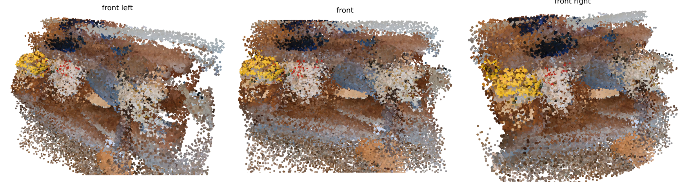
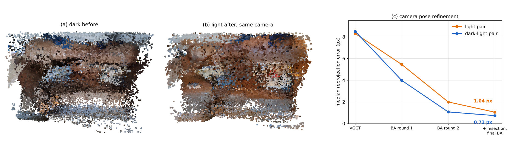
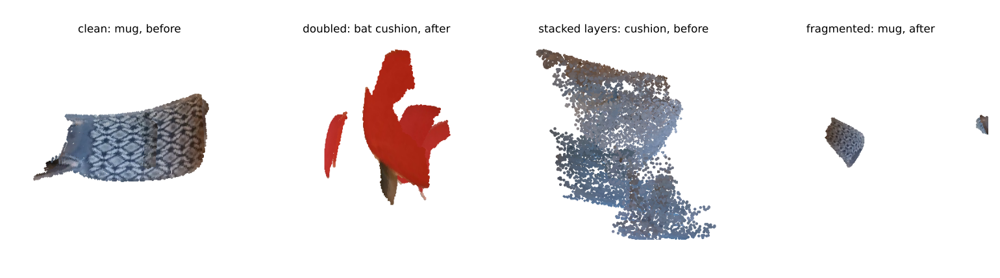
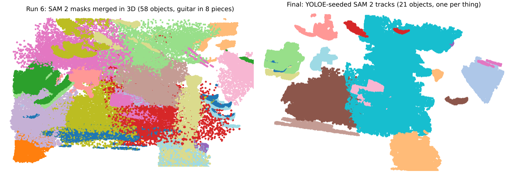
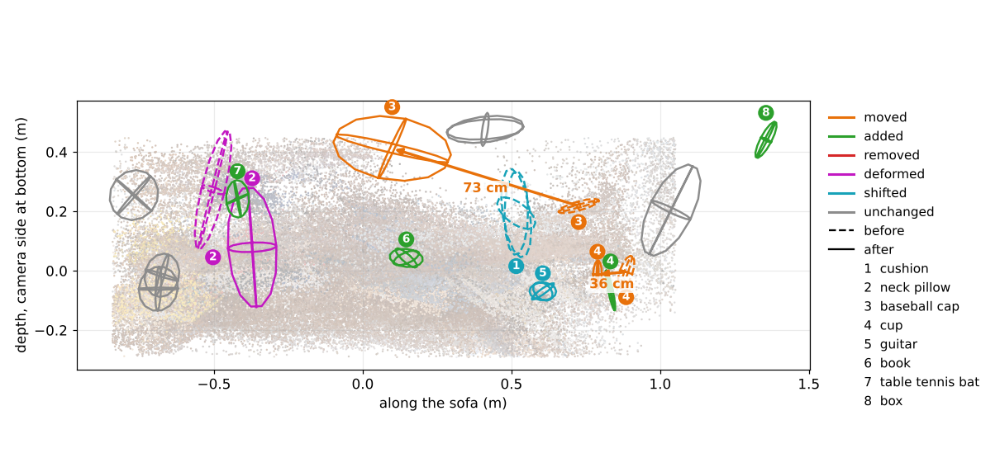
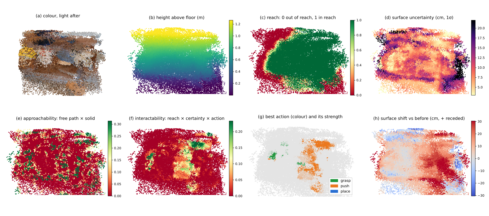
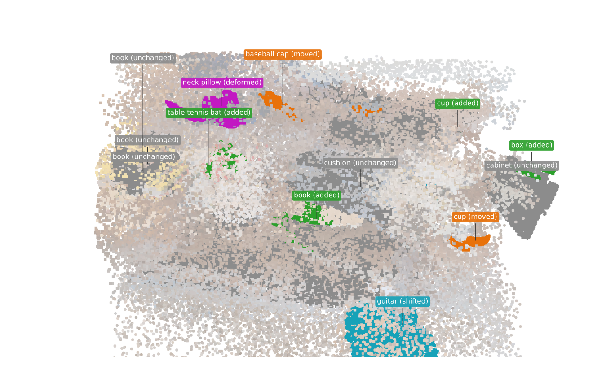
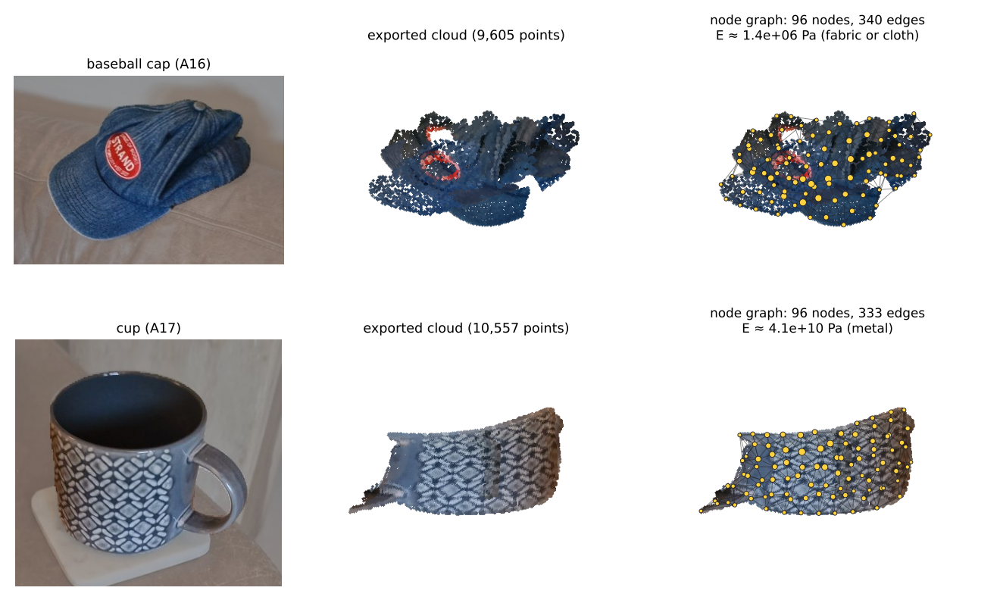

# UncertainScene: Object-Level Scene Change with Uncertainty from Two Handheld Phone Videos

## Abstract

A robot returning to a room must know what has changed since it last looked, how sure it can be, and what it can now
do with each object. This work tests whether **two casual handheld phone sweeps of the same scene, one before and one
after, are enough to recover object-level changes in 3D with stated uncertainty**, and to export every object as a
simulation-ready asset.

**Setting.** A living-room sofa scene is filmed in about 60 s per sweep with one phone, with no depth sensor, markers,
tape measure or known camera height. The pipeline places both sweeps in one 3D frame, cuts the scene into whole named
objects, decides for each object whether it moved, was added, was removed, deformed or stayed, and states how far, in
which direction and how sure. Every object is exported as a coloured point cloud with a node graph, a convex hull and
a stiffness estimate, and robot heat maps (reach, height, approachability, best action) are computed on the scene.

On the best same-lighting pair, camera poses are refined from **8.3 to 1.0 px** reprojection error, the two sweeps
are re-aligned to a **1.9 cm** surface gap, the cap is found to have moved **73 cm (90% range 67–79 cm)** and the mug
**36 cm (34–38 cm), turned 40°**, and the neck pillow is identified as **deformed in place**, not moved. Through a
change of lighting the moved vase and the flipped bat cushion are still found, at the cost of wrong names.

**Key findings**

| question | answer | evidence |
|---|---|---|
| Can two handheld sweeps share one frame? | Yes, to about 1 px and 2–3 cm | reprojection 8.3 → 1.04 px; surface gap 5.2 → 1.9 cm (light pair), 10.2 → 2.8 cm (dark-light pair) |
| Are objects found whole and named? | Mostly | 58 fragments (run 6) → 21 objects, 16 named by an open-vocabulary detector |
| Are moves measured with uncertainty? | Yes, for rigid objects | cap 73 cm (67–79), mug 36 cm (34–38) and turned 40 ± 2° |
| Is deformation told apart from movement? | Yes, on the neck pillow | shape difference 4.2 cm against 3.0 cm pair noise; soft per the Rigidity Copilot |
| Does it survive a lighting change? | Partly | 15 objects matched both ways; vase and bat cushion found but misnamed |
| How many false alarms when nothing changed? | 4 of 12 objects | dark-dark pair |
| Are the stated uncertainties honest? | Not yet | consistency statistic far above 3; objects about 1.4x too large in metric size |

<p align="center"></p>

*Figure 1. The three sweeps used: light before, light after and dark before (frames as recorded, played together).
The objects moved between sweeps; the dark sweep adds a lighting change.*

## Contents

1. [Quick start](#quick-start)
2. [Problem statement and data](#1-problem-statement-and-data)
3. [Representation: point cloud rather than Gaussian splats](#2-representation-point-cloud-rather-than-gaussian-splats)
4. [One frame for two handheld sweeps](#3-one-frame-for-two-handheld-sweeps)
5. [Whole objects, names and identity](#4-whole-objects-names-and-identity)
6. [Metric scale from predictions only](#5-metric-scale-from-predictions-only)
7. [Change with uncertainty](#6-change-with-uncertainty)
8. [Physical properties: Rigidity Copilot and deformation](#7-physical-properties-rigidity-copilot-and-deformation)
9. [Robot heat maps](#8-robot-heat-maps)
10. [Exported assets](#9-exported-assets)
11. [Conclusion, impact and outlook](#10-conclusion-impact-and-outlook)
12. [How to run](#11-how-to-run)
13. [References](#references)

## Quick start

```bash
pip install -e ".[dev]"                     # pipeline, tests and figure tools
python -m uncertainscene.prep               # videos -> frames in data/frames/
python -m pytest                            # unit and end-to-end tests (networks faked)
python docs/figures/make_figures.py         # redraws every figure here from saved outputs
```

Experiments run on Colab (T4) through one notebook, `notebooks/scene01_change_heatmaps.ipynb`. See
[How to run](#11-how-to-run).

| pair name used throughout | definition |
|---|---|
| **Light pair** | light before (take a) vs light after (take a); run 12, step `1e-changes`, 16 Oct (Colab session colab-becc) |
| **Dark-light pair** | dark before (take a) vs light after (take a); run 11, step `1d-objects`, 15–16 Oct (colab-835c) |
| No-change pair | dark before, takes a and b, nothing moved; run 11 (colab-835c) |
| Run 6 | light pair as processed on 13 Oct, before whole-object tracking; used only as the segmentation baseline |

The dark-light pair of run 12 was stopped by the memory guard at 19:26 on 16 Oct before it produced results, so run 11
is the best verified dark-light result.

## 1. Problem statement and data

### 1.1 Why handheld video

A phone sweep is the cheapest scan a person or a robot's head camera can make: no rig, no calibration, no fixed
viewpoint. The price is that every quantity that a fixed camera gets for free (pose, scale, gravity, which surfaces
were seen) must be estimated, and each estimate carries error into every change decision.

### 1.2 Data

Seven sweeps of one sofa scene (`data/recordings.json`), phone held portrait (2160x3840, 30 fps, about 60 s), extracted
at 6 fps (about 370 frames per sweep): three dark *before*, two light *before*, two light *after*. Between *before*
and *after*, the cap, mug, glass vase, neck pillow, grey cushion, guitar, book stack and a hat were moved or
disturbed, and the bat cushion was turned over from its black to its red side. No answer key with measured positions
exists, so results are judged against this list and against a no-change pair, never tuned on either.

The scene contains the difficulties a home robot meets: small objects next to large ones (a mug on a sofa arm), a
change of appearance with no change of place (the flipped cushion), deformable objects (pillow, cushions), a full
lighting change, transparent glass, and large areas seen in only one sweep.

<p align="center"></p>

*Figure 2. Three of the changes, as exported asset photos from the light pair: the cap moved, the mug moved and
turned, the neck pillow changed shape in place.*

### 1.3 Objective

The goal is a **perception layer that turns two sweeps into an object-level, uncertainty-aware scene description**
that a robot or a simulator can use directly: for every object, what it is, where it is with a 90% region, whether and
how it changed, how stiff it is, what a gripper could do with it, and an exportable asset. Locating change is the
minimum; the assets, node graphs and heat maps make the output actionable.

**Where this sits relative to a world-action model.** A world-action model (WAM) that predicts actions from pixels
could in principle absorb all of this implicitly. An explicit layer is preferred here for three reasons: its outputs
are *checkable* (a 73 cm move with a range can be verified, a hidden state cannot), its uncertainty is *usable*
(a planner can refuse to grasp an object it is unsure of), and its assets *transfer* to any simulator or robot. The
two combine naturally: the explicit layer can generate simulation scenes on which a WAM is trained or tested, and
its object list can condition a WAM where a learnt policy is preferred.

## 2. Representation: point cloud rather than Gaussian splats

Gaussian splats were built and tested first (`recon/splat.py`, gsplat). On the light pair they rendered held-out
frames at only **18.3 / 18.9 dB PSNR** (3D Gaussian splatting [7]), and comparing *before* and *after* renders from the same camera flagged
**1.5%** of pixels against **1.0%** with nothing changed, while depth differed by more than 5 cm on 89.5% of pixels.
Splats explain pose error with floaters and blur, which a change detector then reads as change; they also cost a
CUDA build and most of a Colab session's RAM. Floater pruning, opacity resets and refined poses during training
raised render quality only from 17.7 to 18.3 dB; removing floaters after training was not pursued.

The point cloud, lifted directly from per-frame depth, keeps every point tied to the frame, mask and pose it came
from, so pose uncertainty, object membership and visibility can be traced point by point. It is also the natural
input to the target form, **objects as node graphs**, which simulators and physics-informed models consume.

<p align="center"></p>

*Figure 3. The light-after point cloud (120 000 of 600 000 points, as saved for the viewer), front left, front and
front right. Books (yellow, left arm), bat cushion, grey cushion, white cushion and guitar (front right) are visible.*

> **Summary.** Splats were dropped: their rendering error was as large as the changes. A point cloud with per-point
> provenance supports uncertainty and object assets directly.

## 3. One frame for two handheld sweeps

### 3.1 The core difficulty: pose error looks like change

Every change decision compares a surface in one sweep with the same place in the other. A 1° pose error at 2 m
displaces a surface by 3.5 cm, the size of a mug, so the poses decide what can be detected at all. Four steps
address this; each is standard in its parts, and the combination and the pose-uncertainty weighting are this work's.

### 3.2 Joint feed-forward reconstruction

VGGT [1] predicts poses, depth and confidence for about 54 frames in one forward pass. All frames of both sweeps
(about 740) are split into chunks that share a fixed set of **anchor frames from both sweeps**; identical anchor images
give dense 3D correspondences, and each chunk is mapped into the first by a trimmed similarity fit (Umeyama). Worst
anchor residual: 0.0061 scene units on the light pair. Both sweeps therefore land in one frame without a separate
registration step. VGGT was chosen over pairwise models (MASt3R, DUSt3R), which need a global alignment over
hundreds of pairs, and over structure-from-motion from scratch, which needs many more matches on textureless leather;
neither alternative was run.

### 3.3 Bundle adjustment from VGGT poses, with resection

VGGT works at 518 px and leaves about 8 px reprojection error at full frame size. The poses are refined by classical
bundle adjustment [8]: RootSIFT features on every frame, pairs chosen by camera proximity and time, matches kept only
where a RANSAC fundamental matrix agrees (independent of VGGT), tracks triangulated, then a joint robust (Huber)
adjustment of all poses, all points and **one focal length shared by both sweeps** (same phone and lens; separate
focals trade against depth and leave the sweeps at different scales):

$$
\min_{\{R_f, t_f\},\, f,\, \{X_j\}} \sum_{(f, j)} \rho_{\text{Huber}}\!\left( \left\lVert \pi\!\left(K_f (R_f X_j + t_f)\right) - u_{fj} \right\rVert \right)
$$

Frames with fewer than 30 adjusted points are re-matched more widely and **resected** (PnP with RANSAC, then
Levenberg–Marquardt) against points from the other frames, or moved by their time neighbours' correction when under 8
matches; one final joint adjustment follows. Each frame then gets a **measured pose uncertainty**, the image error
its pose alone adds to any point:

$$
\sigma_f = \min\!\left( \sqrt{ s_f^2 \tfrac{6}{n_f} + \max\!\left(s_f^2 - s^2, 0\right) },\ \sigma_{\text{VGGT}} \right)
$$

where $s_f$ is the frame's residual spread, $n_f$ its number of points (6 pose parameters fitted from $n_f$ points), $s$
the spread of the whole problem and $\sigma_{\text{VGGT}}$ the starting error. This is new here: $\sigma_f$ widens
every object position measured in that frame, weights its change votes by $1/(1+\sigma_f^2)$ and down-weights it in
triangulation, so **an unsure pose cannot move a result much** (unit test: a 5 cm-off view from a shaky camera moves a
fused position by under 1 mm).

### 3.4 Re-alignment on objects that did not move

Points seen in both sweeps tie them together, but after bundle adjustment the sweeps still sat 12–16 cm, 7° and up to
10% in scale apart, enough for an unmoved object to stop overlapping itself. The after sweep is therefore re-aligned
onto the before sweep on the **object pairs classified unchanged** (furniture included, moved objects excluded) by a
trimmed similarity ICP: each iteration fits

$$
\min_{c, R, t} \sum_{i \in \text{best } 80\%} \left\lVert X^A_i - \left(c R X^B_i + t\right) \right\rVert^2
$$

over nearest-neighbour correspondences, and the correction is applied to the after cameras and depth maps so that
everything is rebuilt in the corrected frame. Trimming keeps one wrong "unchanged" from pulling the fit.

| pair | correction | median surface gap before → after |
|---|---|---|
| Light pair | 16.2 cm, 7.1°, −10% scale | 5.2 → **1.9 cm** |
| Dark-light pair | 12.3 cm, 7.0°, +1% scale | 10.2 → **2.8 cm** |
| No-change pair | 3.6 cm, 6.4°, −4% scale | 5.1 → 3.2 cm |

### 3.5 Pose groups and ghost copies

A group of frames whose poses sit off together places an object twice, a few tens of centimetres apart. Each object's
views are compared pairwise: the translation that best lands one view's points on another's (trimmed ICP) is near zero
for agreeing poses and equals the group's offset otherwise. Views linked by small shifts form groups; a group other
than the largest is dropped as a **ghost copy** when one shift of more than twice the link distance lands it clearly
better than no shift, and only when it was seen from where the main group's cameras looked (two ends of a long sofa can
look alike shifted). On the light pair this removed **28 copies 35–172 cm off**.

<p align="center"></p>

*Figure 4. Dark-light pair (run 11): (a) dark before and (b) light after rendered from the same virtual camera after
re-alignment. (c) Median reprojection error through pose refinement for both pairs (VGGT, two adjustment rounds, then
resection and a final adjustment).*

What remains imperfect is visible in the exported assets (Figure 5): some objects of the after sweep still show
doubled or stacked surfaces, and refinement raised the number of camera-path jumps from 0 to 10 per sweep (light) and
from 2 to 25 (dark), so a few frames are confidently wrong.

<p align="center"></p>

*Figure 5. Exported assets of the light pair: a clean object and three pose failures. The bat cushion appears twice,
the grey cushion as stacked parallel layers, and the after-sweep mug is fragmented after ghost-copy removal.*

**Tested and not kept.** A motion-based misalignment term (run 6) read noisy points as a 14 cm offset; a guarded
bundle adjustment without resection left 146 of 735 frames on VGGT's 8 px poses.

> **Summary.** Feed-forward reconstruction gives a shared frame; bundle adjustment with resection brings it to about
> 1 px; re-alignment on unchanged objects brings the sweeps to 2–3 cm; and every frame's measured pose uncertainty
> limits its influence. Pose groups remain the largest source of error.

## 4. Whole objects, names and identity

### 4.1 Segmentation: whole objects, one identity through each sweep

Single-frame masks split objects: in run 2, 1107 of 1122 objects were seen in a single view only, and in run 6 the guitar
was in 8 pieces. The final pipeline uses three models in sequence:

1. **YOLOE** [3], an open-vocabulary detector prompted with a household vocabulary, finds whole object instances with
   names.
2. **SAM 2** [2] (Hiera-S, video predictor) tracks each instance through the sweep, seeded first by YOLOE and then by
   automatic masks for anything left, so all masks of one object share one track. Automatic masks inside a detected
   object are parts and do not seed tracks.
3. Tracks are joined when they keep lying inside one detected instance, when a smaller CLIP-named piece touches a
   larger detector-named object of the same name, or when one track lost and found again overlaps in 3D and is never
   visible at the same time as the other. Differently named tracks never join.

Each mask is lifted to 3D with its frame's depth, keeping only points from frames with a sure pose and in cells at
least two views agree on; detached pieces under 15% of the largest are cut.

<p align="center"></p>

*Figure 6. After sweep, every object painted one colour. Left: run 6, masks merged in 3D (58 objects over both
sweeps; walls, sofa and guitar in many pieces). Right: light pair, YOLOE-seeded SAM 2 tracks (21 objects over both
sweeps).*

### 4.2 Names and semantic context

Names come from detector votes over all views where a track overlaps an instance. CLIP ViT-L/14 [4] is the fallback
and supplies an embedding per object, the mean over up to four masked views. A CLIP-only name below **0.5** confidence
marks the object *unsure*: it stays in the scene (no hole) but receives no robot actions and casts no scale vote.
Names must also fit the measured size (a 1.2 m "neck pillow" is a sofa seat; "book" at 49 cm became "box").
Context is computed from geometry, not language: *on top of* (an object's lowest points rest on another's surface)
and *next to* (closest points within a few centimetres), giving sentences such as "from next to the sofa and the
cushion to on top of the sofa".

Alternatives: CLIP alone gave weak names (0.1–0.3) and "skirting board" for many pieces. Grounding DINO was
considered but not run: it is slower, and YOLOE runs in real time and ships its weights on GitHub.

### 4.3 Same object across sweeps

A *before* and an *after* object are the same object when appearance (DINOv2 [5] patch features pooled over the
masked pixels) and name agree, and the pairing must **agree both ways**: B's best partner of A must have A as its
best partner. One-sided objects pair with a surely named object of the same name in the other sweep: same place means
unchanged, else moved. On the dark-light pair **15 objects** were paired both ways.

### 4.4 Where the SAM 2 masks are used

| stage | how masks enter |
|---|---|
| object points | only depth points inside an object's masks, in frames where it was tracked |
| names | detector votes and CLIP on masked crops, background greyed out |
| same object / moved | appearance pooled over masked pixels; masked clouds compared |
| position and its range | each view's measurement from the masked region; mask wobble widens it |
| deformation, scale check, assets | the masked cloud |
| not masked | point-level change map, heat maps, camera poses |

> **Summary.** Detector-seeded video tracking turned fragments into whole objects with one identity per sweep; names
> are kept only where they are sure and fit the measured size.

## 5. Metric scale from predictions only

A monocular reconstruction has no units. Phone height, tape measures and known markers were ruled out: the phone's
height changes through a sweep, and a deployable system cannot rely on them. The scale $s$ (metres per scene unit) is
the **mode of a posterior over log scale** combining two predictions:

$$
p(\log s) \;\propto\; \mathcal{N}\!\left(\log s;\ \mu_{\text{depth}},\ \sigma_{\text{depth}}^2\right) \prod_{o} \left[ 0.9 \sum_{k=1}^{3} p_{o,k}\, \mathcal{N}\!\left(\log s;\ \log \tfrac{L_{k}}{\ell_o},\ \sigma_{k}^2 + \sigma_{\text{rec}}^2\right) + 0.1\, \mathcal{U} \right]
$$

The first term is Depth Anything V2 Metric Indoor [6] against VGGT depth on confident pixels of 80 frames, with a 10%
model-bias prior that more frames cannot shrink. Each object $o$ of the before sweep votes with a mixture over its top
three names, with typical size $L_k$ and product-to-product spread from a size table, against its measured extent
$\ell_o$; the uniform 10% absorbs wrong names. Mislabelled objects therefore cannot drag the scale, and a "guitar or
ukulele" vote is settled by the depth model. The method is new as a combination; each cue is standard.

| pair | metric depth | objects | combined (90% range) | size check: measured / typical |
|---|---|---|---|---|
| Light pair | 2.60 | 2.08 (4 objects) | **2.32 (2.06–2.61)** | 1.39, 4 of 8 fit |
| Dark-light pair | 2.76 | 0.90 (11 objects) | 2.50 (2.24–2.77) | – |

The phone-height cue would have given 3.90 on the light pair. The size check after the fact says objects still come
out about 1.4x too large, so the residual bias of the depth model is the next target. The trade-off is deliberate:
the method needs no calibration, works on any frame, does not drift, and runs in real time on a robot; it is less
accurate than a tape measure.

## 6. Change with uncertainty

### 6.1 Visibility-aware evidence

Each object's points are tested against every camera of the other sweep. Where that camera's depth matches, the
surface is still there; where it is clearly deeper, the camera **looks straight through** where the object was, which
is evidence of absence; where it is shallower, something is in front and there is no evidence. Unobserved places are
never reported as change: "removed" or "added" needs the other sweep to have looked at the spot in enough frames, else
the verdict is *can't tell*. Thresholds come from the same test within one sweep, where nothing can have changed
(97.5th percentile of that object-level null), so no labels are used.

### 6.2 Position and its uncertainty

Each view of an object measures its centre with a covariance from VGGT's depth confidence along the viewing ray, SAM
2's mask wobble across the ray and the frame's pose uncertainty. Views are fused by a Kalman filter with a static
state, and a 90% region follows from the chi-square quantile. Views from one 48-frame stretch count once, and the
fused region never undercuts the views' own scatter. Median 90% radius on the light pair: **±5.0 cm** (one view
alone ±1.0 cm; scatter check ±4.4 cm).

The normalised innovation squared, which averages 3 for honest uncertainties in 3D, is reported but not used to
rescale. It is **37 000** on the light pair: the per-view covariances are far too small, and the region quoted above
is held up only by the scatter floor.

### 6.3 How sure a move is

A move is probable when the distance $d$ between the two clouds exceeds both position uncertainties and the residual
misalignment of the sweeps:

$$
p_{\text{beyond}} = F_{\chi^2_3}\!\left( \frac{d^2}{\sigma_A^2 + \sigma_B^2 + \sigma_{\text{align}}^2} \right),
\qquad
P(\text{moved}) = p_{\text{real},A}\; p_{\text{real},B}\; p_{\text{same}}\; p_{\text{beyond}}
$$

with $\sigma = r_{90}/2.5$, $p_{\text{real}} = 1 - 0.5^{n/4}$ growing with the $n$ views an object was tracked in, and
$p_{\text{same}}$ from appearance and name. Every factor is shown beside each verdict, so a low value can be traced
to its cause. These are model probabilities, not calibrated on an answer key.

### 6.4 Results

<p align="center"></p>

*Figure 7. Light pair from above: each object's 90% position region (dashed before, solid after), coloured by
verdict, with the two measured moves. "Cup" added (4, green) is the glass vase.*

| object | verdict (light pair) | measured | sure | assessment |
|---|---|---|---|---|
| cap | moved | 73 cm (67–79), turned 18 ± 3°, onto the sofa | 55% | correct |
| mug | moved | 36 cm (34–38), turned 40 ± 2° | 67% | correct |
| neck pillow | deformed | shape differs 4.2 cm vs 3.0 cm noise; soft | 66% | correct |
| grey cushion, guitar | shifted | surface moved about 22 cm | – | correct |
| bat cushion | "table tennis bat" added | red side now visible | 0% | found, wrong verb |
| glass vase | "cup" added | – | 0% | found, wrong name and verb |
| skirting board, box | removed, added | – | 30%, 50% | false alarms |
| hat, book stack | – | – | – | missed (before sweep kept 6 objects) |

Every "added" verdict on the light pair shows 0–1% sure: the see-through factor for added objects is computed in the
wrong direction, a known fault that does not change the verdicts. The before sweep kept only 6 objects because
ghost-copy removal also cut parts of the sofa, table and rug.

**Through a lighting change.** On the dark-light pair (run 11) the glass vase is found moved 146 cm (named "cup") and
the bat cushion moved 19 cm (named "lamp"); the cap is called added rather than moved, and a cabinet is a false
"added". Lighting mainly hurts the tie between sweeps: **258** bundle-adjusted points are seen in both sweeps against
2194 in the light pair, and surface uncertainty rises from 8.0 to 9.7 cm. Object-level matching is more robust than
point features, with 15 objects paired both ways against 8.

| measure | light pair | dark-light pair | no-change pair |
|---|---|---|---|
| reprojection error, median | 1.04 px | 0.73 px | 0.92 px |
| points seen in both sweeps | 2194 | 258 | 1714 |
| surface gap after re-alignment | 1.9 cm | 2.8 cm | 3.2 cm |
| objects paired both ways | 8 | 15 | 14 |
| position, median 90% radius | 5.0 cm | 7.0 cm | 7.3 cm |
| objects flagged changed | 9 of 16 | 6 of 16 | 4 of 12 (false) |

> **Summary.** Moved rigid objects are found with tight ranges and pose words; deformation is separated from
> movement; lighting costs shared features and names more than detections. Names on unusual objects, added-object
> confidence and honest per-view covariances are the open problems.

## 7. Physical properties: Rigidity Copilot and deformation

### 7.1 Rigidity Copilot

Stiffness cannot be seen in two sweeps without forces, so it is queried. The Rigidity Copilot asks CLIP, on the mean
embedding of an object's masked views, what it is made of (ten household materials, each with a Young's modulus range
from engineering tables) and whether it is soft or hard. The expected modulus is the probability-weighted geometric
mean over materials, with a range spanning the top material and any above 10%:

$$
\log E = \sum_m p_m \log E_m, \qquad \text{rigidity} = \tfrac{1}{2}\left(r_{\text{material}} + P(\text{hard})\right), \qquad k_{ij} \approx E\, L_{ij}
$$

Each edge of the object's node graph receives a spring constant from a cubic-lattice approximation with node
spacing $L_{ij}$. The Copilot is a prior from appearance, and the measured strain between sweeps is stored beside it
as a check.

The idea parallels the **Stiffness Copilot** [9], where a vision policy predicts the impedance a robot should use from
wrist-camera images. There, stiffness is set for the *robot's* contact; here, it is estimated for the *object*. The
two could work in tandem: the object's expected stiffness and its range would bound how firmly a gripper may press,
and the robot's measured impedance during contact could in turn correct the object's prior. This link is proposed,
not tested.

| object (light pair) | material (CLIP) | rigidity 0–1 | Young's modulus |
|---|---|---|---|
| neck pillow | soft foam or stuffing | 0.27 | 2.0e5 Pa |
| cushion | soft foam or stuffing | 0.42 | 4.9e5 Pa |
| cap | fabric or cloth | 0.59 | 1.4e6 Pa |
| table tennis bat | rubber | 0.72 | 2.3e8 Pa |
| guitar | wood | 0.77 | 1.4e9 Pa |
| box | paper or cardboard | 0.84 | 2.5e9 Pa |
| mug | metal (actually ceramic) | 0.92 | 4.1e10 Pa |

The ordering soft to rigid is right; the mug's material is wrong but its rigidity is not, which is what contact needs.

### 7.2 Deformation: changed shape, not changed place

An object in the same place whose shape differs by more than this pair's *own* unchanged objects differ (3.0 cm on the
light pair, a label-free null) is a deformation candidate, and the Copilot decides whether that is plausible:

$$
P(\text{deformed}) = \frac{(1-r)\left(0.9\,p_e + 0.1\,(1-p_e)\right)}{(1-r)\left(0.9\,p_e + 0.1\,(1-p_e)\right) + r\left(0.1\,p_e + 0.9\,(1-p_e)\right)}
$$

where $p_e$ is the evidence that the shape differs and $r$ the Copilot's rigidity. A squashed cushion is accepted; a
mug that appears to change shape is put down to reconstruction. The neck pillow is the one object found deformed (4.2
cm against 3.0 cm, rigidity 0.27, 66%). This matters for long-horizon tasks: a robot that tidies a sofa must know that
a cushion was squashed, not swapped, and that its shape will not return by itself.

**Link to physics-informed simulation.** NEXUS [10] represents each object as a structural graph with contact graphs
between objects and learns energy and dissipation terms to roll out contact-rich dynamics. The exported assets here
have exactly that form (node graph, rest lengths, stiffness with range, contacts with "rests on"), measured from two
phone sweeps of an unseen room. This is the bridge from perception to a physics-aware world model: a humanoid entering
a new home could scan it, export its objects as graphs and simulate or plan interactions before touching anything.

> **Summary.** Stiffness is inferred as a prior with a range and checked where strain is measurable; deformation is
> reported only where shape change exceeds the pair's own noise and the material allows it.

## 8. Robot heat maps

A mobile robot with an arm of 0.85 m reach from a 0.75 m mount is assumed to drive to any free floor spot. On every
point of the after sweep:

$$
\text{reach} = \mathrm{clip}\!\left(\frac{0.85 - d}{0.1} + 0.5,\ 0,\ 1\right), \qquad
\text{interact} = \text{reach} \times \text{approach} \times \frac{1}{1 + (u/3\,\text{cm})^2}
$$

where $d$ is the distance in metres to the nearest shoulder position over free floor, *approach* the share of gripper
approach directions with free space in front of a solid surface (solidity removes floating points, which would
otherwise score highest), and $u$ the surface uncertainty. Per object, **grasp** (fits a 12 cm gripper, nothing on
top, rigid or with thin parts), **push** (movable but too big to grasp) and **place** (free upward surfaces in reach)
are each normalised to the scene, and the best action is the largest raw score.

<p align="center"></p>

*Figure 8. Light pair, after sweep, one front view: (a) colour, (b) height above the floor, (c) reach, (d) surface
uncertainty, (e) approachability, (f) interactability, (g) best action, (h) surface shift against the before sweep.
Colour ranges are the 2nd–98th percentiles; panels (d)–(h) are median-smoothed over 16 neighbouring points for display.*

The maps behave as intended: the sofa back sits at about 1.2 m (consistent with the 1.4x size bias of Section 5), 61%
of the surface is in reach (the left end is not reachable from the free floor), uncertainty concentrates at the
edges and the back, grasp is strongest on the glass vase, the bat cushion and the card on the seat, and push on the
grey cushion and the guitar. Place is sparse because few free upward surfaces remain on a cluttered sofa.
Interactability stays low (top 0.3) because a surface uncertainty of 5–10 cm cuts it to between a quarter and a
tenth; this is the honest consequence of the reconstruction noise.

<p align="center"></p>

*Figure 9. Light pair, after sweep: every object coloured by its verdict, on the faded scene. "Cup (added)" is the
glass vase, "table tennis bat (added)" the cushion turned to its red side, "book (added)" the card on the seat.*

## 9. Exported assets

Each object is exported (`assets/<id>.ply`, `.json`, `_hull.obj`) as a coloured point cloud in its own frame with a
pose (world = R · local + t), so it can be moved and turned in a simulator; a node graph of 96 farthest-point nodes
weighted by the share of points nearest them, edges to nearest neighbours with rest length and Copilot spring constant;
a convex hull; contacts with other objects; nearest-neighbour pieces at three radii so a merged asset can be split;
and its change record.

<p align="center"></p>

*Figure 10. Two exported assets of the light pair: photo crop, exported cloud, node graph (node size = weight) with
the Copilot's modulus.*

**Cap (A16):** "The baseball cap (98% sure of the name, detector) moved 73 cm (90%: 67 to 79 cm) to the left and
towards the camera and down, from next to the sofa and the cushion to on top of the sofa, next to the sofa and the
skirting board, turned about 18 deg (+/- 3) about the vertical, was tilted about 15 deg, now tilted about 10 deg. 55%
sure it moved." Hull volume 3.7 L, fabric, rigidity 0.59.

**Mug (A17):** "The cup (98% sure of the name, detector) moved 36 cm (90%: 34 to 38 cm) towards the camera and down
and to the left, from next to the chair and the side table to next to the guitar case and the sofa, turned about 40
deg (+/- 2) about the vertical, was tilted about 17 deg, now lying flat. 67% sure it moved."

> **Summary.** Clean objects export as usable assets with pose, graph, stiffness and a sentence; pose groups (Figure
> 5) still corrupt some after-sweep assets.

## 10. Conclusion, impact and outlook

### 10.1 Conclusion

Two handheld phone sweeps suffice to build an object-level change description with ranges: poses at about 1 px, sweeps
aligned to 2–3 cm, whole tracked objects, moves measured to a few centimetres with turn and pose, deformation separated
from movement and checked against an inferred stiffness, and assets exported as node graphs. Metric scale comes from
predictions alone. The weak points are pose groups, names on unusual objects, added-object confidence and per-view
covariances that are far too small.

### 10.2 How the parts fit together

Every stage passes its uncertainty on: pose uncertainty weights positions and votes; positions and alignment set how
far an object must move to count; coverage decides whether "removed" may be said at all; name confidence decides
whether an object may be acted on; the Copilot decides whether a shape change is believable; and surface uncertainty
lowers interactability. A robot therefore receives not only *what changed* but *how much to trust it*, which decides
whether it acts, looks again or asks.

### 10.3 Transfer to robots and model trade-offs

All models are off-the-shelf and frozen: VGGT, SAM 2, YOLOE, CLIP, DINOv2 and Depth Anything run on one T4, and no
component was trained on this scene, so the pipeline transfers to new rooms without data. The cost is speed: a pair
takes 45–170 minutes on Colab, dominated by SAM 2 tracking and bundle adjustment, so it suits a robot's idle time
(scan, then update its scene model) rather than its control loop. For on-board use the chosen models already have
lighter variants (SAM 2 tiny, YOLOE small), and a robot head camera with known intrinsics and odometry would replace
most of the pose refinement. The outputs are robot-agnostic: positions in metres, assets in standard formats, and heat
maps parameterised by reach, mount height and gripper width.

### 10.4 Limitations and next steps

One scene, no measured answer key, and one dark-light pair. Next: write the answer key and score precision and
recall; fix the added-object factor and calibrate per-view covariances on the no-change pair; constrain pose groups
during adjustment rather than removing copies afterwards; and re-run the dark-light pair with the current pipeline.

## 11. How to run

### 11.1 Frames

Place the videos as named in `data/recordings.json` and run `python -m uncertainscene.prep` (frames in `data/frames/`,
6 fps in `data/frames_6fps/`).

### 11.2 Pipeline on Colab

Open `notebooks/scene01_change_heatmaps.ipynb` on branch `exp/change/scene01-heatmaps` in Colab (T4 GPU; add
`GITHUB_TOKEN` as a Colab secret), choose `STREAM = "light"` or `"dark"` and Run all. The first cell checks GitHub
with a real test push; each step (`uncertainscene.infra.Run`) declares its RAM, disk and time needs, pushes its results
to `results/change/<run_id>/<step>/` and is skipped when already done, so a session can resume after a disconnect.

### 11.3 Outputs per step

`report.md` (verdicts in words, scale check, masking stages), `scene_report.md` (object inventory and simulator
ranges), `objects.json`, `changes.json`, `metrics.json`, `assets/` (one `.ply`, `.json`, `_hull.obj` per object, plus
`scene_graph.json`) and `viewer.html` (3D viewer with heat-map layers). Results of all runs are collected in
[results/change/RESULTS.md](results/change/RESULTS.md); the research log is [RESEARCH.md](RESEARCH.md).

### 11.4 Figures

`python docs/figures/make_figures.py` redraws every figure here from the saved viewer scenes and assets of the runs
named in [Quick start](#quick-start), with a small z-buffered point renderer (`docs/figures/render.py`).

## References

1. Wang et al. *VGGT: Visual Geometry Grounded Transformer.* CVPR 2025. [arXiv:2503.11651](https://arxiv.org/abs/2503.11651)
2. Ravi et al. *SAM 2: Segment Anything in Images and Videos.* 2024. [arXiv:2408.00714](https://arxiv.org/abs/2408.00714)
3. Wang et al. *YOLOE: Real-Time Seeing Anything.* 2025. [arXiv:2503.07465](https://arxiv.org/abs/2503.07465)
4. Radford et al. *Learning Transferable Visual Models From Natural Language Supervision (CLIP).* ICML 2021. [arXiv:2103.00020](https://arxiv.org/abs/2103.00020)
5. Oquab et al. *DINOv2: Learning Robust Visual Features without Supervision.* 2023. [arXiv:2304.07193](https://arxiv.org/abs/2304.07193)
6. Yang et al. *Depth Anything V2.* NeurIPS 2024. [arXiv:2406.09414](https://arxiv.org/abs/2406.09414)
7. Kerbl et al. *3D Gaussian Splatting for Real-Time Radiance Field Rendering.* SIGGRAPH 2023. [arXiv:2308.04079](https://arxiv.org/abs/2308.04079)
8. Schönberger and Frahm. *Structure-from-Motion Revisited.* CVPR 2016. [CVF Open Access](https://openaccess.thecvf.com/content_cvpr_2016/html/Schonberger_Structure-From-Motion_Revisited_CVPR_2016_paper.html)
9. Wang et al. *Stiffness Copilot: An Impedance Policy for Contact-Rich Teleoperation.* 2026. [arXiv:2603.14068](https://arxiv.org/abs/2603.14068)
10. Ying et al. *NEXUS: Neural Energy Fields for Physically Consistent Contact-Rich 3D Object Dynamics.* 2026. [arXiv:2606.15015](https://arxiv.org/abs/2606.15015)
