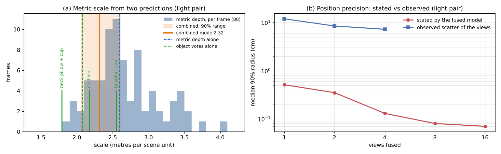
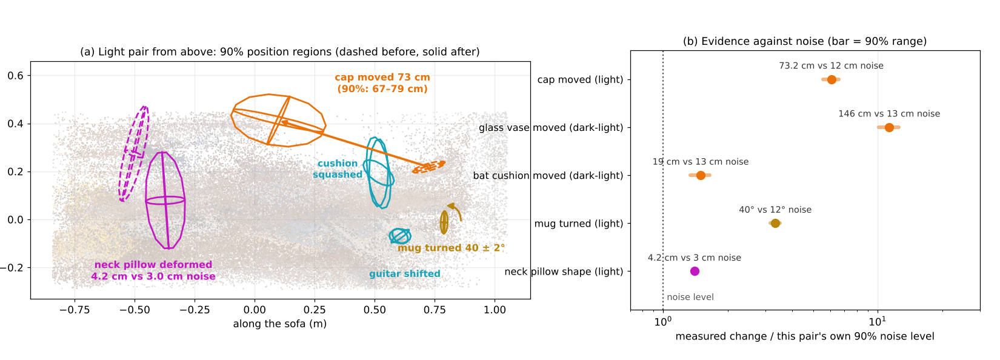
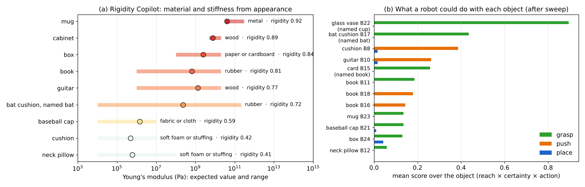
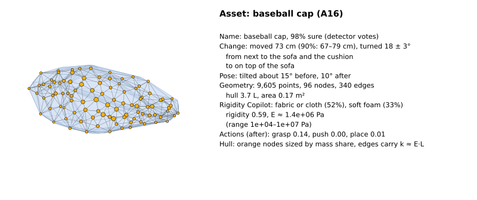
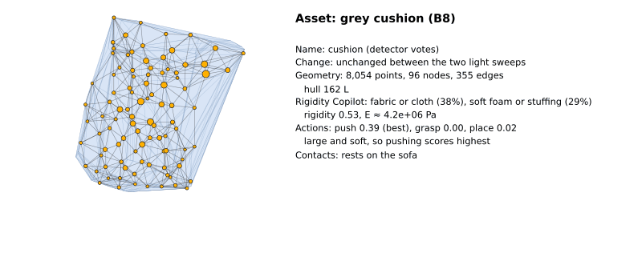
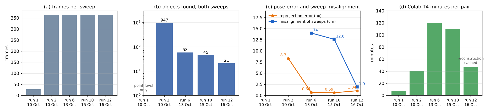

# UncertainScene: Object-Level Scene Change with Uncertainty from Two Handheld Phone Videos

## Abstract

A robot returning to a room must know what has changed since it last looked, how sure it can be, and what it can now
do with each object. This work tests whether **two casual handheld phone sweeps of the same scene, one before and one
after, are enough to recover object-level changes in 3D with stated uncertainty**, and to export every object as a
simulation-ready asset with physical properties.

**Setting.** A living-room sofa scene is filmed in about 60 s per sweep with one phone, with no depth sensor, markers
or tape measure. The pipeline places both sweeps in one 3D frame, cuts the scene into whole named objects, decides for
each object whether it moved, turned, was added, was removed, deformed or stayed, and states how far, in which
direction and how sure, in a sentence a person can read. Every object is exported as a coloured point cloud with a
node graph, a convex hull and a stiffness estimate from a **Rigidity Copilot**, and robot heat maps (reach, height,
approachability, uncertainty, best action) are computed on the scene.

On the best same-lighting pair, camera poses are refined from **8.3 to 1.0 px** reprojection error, the two sweeps are
re-aligned to a **1.9 cm** surface gap, the cap is found to have moved **73 cm (90% range 67–79 cm)** onto the sofa,
the mug to have **turned about 40° in place**, and the neck pillow to have **deformed in place** rather than moved.
Through a change of lighting the moved glass vase (146 cm) and bat cushion (19 cm) are still found.

**The results are not yet accurate enough for deployment, and the main reason is compute.** Every run had to fit one
free Colab T4 session, so clouds were saved at a fifth of their density, frames were processed in chunks and the
light pair was run in full only once at the final settings. Each increase in compute so far bought a clear gain
(Figure 14); the methods are designed so that more views and denser clouds tighten every range automatically.

**Key findings**

| question | answer | evidence |
|---|---|---|
| Can two handheld sweeps share one frame? | Yes, to about 1 px and 2–3 cm | reprojection 8.3 → 1.04 px; surface gap 5.2 → 1.9 cm (light pair), 10.2 → 2.8 cm (dark-light pair) |
| Are objects found whole and named? | Mostly | 947 fragments (run 2) → 58 (run 6) → 21 whole objects, 16 named by an open-vocabulary detector |
| Are moves measured with uncertainty? | Yes, for rigid objects | cap 73 cm (67–79 cm), 6x its own noise level; mug turned 40 ± 2°, 3x its noise |
| Is deformation told apart from movement? | Yes, on the neck pillow | shape difference 4.2 cm against 3.0 cm pair noise; soft per the Rigidity Copilot |
| Does it survive a lighting change? | Partly | 15 objects matched both ways; vase and bat cushion found moved but misnamed |
| How many false alarms when nothing changed? | 4 of 12 objects | dark-dark pair |
| Are the stated uncertainties honest? | Not yet | per-view ranges about 20x too small; objects about 1.4x too large in metric size |
| What limits accuracy most? | Point density and views, set by compute | 120 000 of 600 000 points saved; 258 points shared across the lighting change |

<p align="center"></p>

*Figure 1. The three sweeps used: light before, light after and dark before (frames as recorded, played together).
Objects were moved, turned and squashed between sweeps; the dark sweep adds a lighting change.*

## Contents

1. [Quick start](#quick-start)
2. [Problem statement and data](#1-problem-statement-and-data)
3. [Design choices and trade-offs](#2-design-choices-and-trade-offs)
4. [One frame for two handheld sweeps](#3-one-frame-for-two-handheld-sweeps)
5. [Whole objects, names and identity](#4-whole-objects-names-and-identity)
6. [Metric scale from predictions only](#5-metric-scale-from-predictions-only)
7. [Change with uncertainty](#6-change-with-uncertainty)
8. [Physical properties: Rigidity Copilot and deformation](#7-physical-properties-rigidity-copilot-and-deformation)
9. [Robot heat maps](#8-robot-heat-maps)
10. [Exported assets](#9-exported-assets)
11. [Why the results are not yet perfect](#10-why-the-results-are-not-yet-perfect)
12. [Conclusion, impact and outlook](#11-conclusion-impact-and-outlook)
13. [How to run](#12-how-to-run)
14. [References](#references)

## Quick start

```bash
pip install -e ".[dev]"                     # pipeline, tests and figure tools
python -m uncertainscene.prep               # videos -> frames in data/frames/
python -m pytest                            # unit and end-to-end tests (networks faked)
python docs/figures/make_figures.py         # redraws every figure here from saved outputs
```

Experiments run on Colab (T4) through one notebook, `notebooks/scene01_change_heatmaps.ipynb`. See
[How to run](#12-how-to-run).

| pair name used throughout | definition |
|---|---|
| **Light pair** | light before (take a) vs light after (take a); run 12, step `1e-changes`, 16 Oct (Colab session colab-becc) |
| **Dark-light pair** | dark before (take a) vs light after (take a); run 11, step `1d-objects`, 15–16 Oct (colab-835c) |
| No-change pair | dark before, takes a and b, nothing moved; run 11 (colab-835c) |
| Run 6 | light pair as processed on 13 Oct, before whole-object tracking; used only as the segmentation baseline |

The dark-light pair of run 12 was stopped by the memory guard on 16 Oct before it produced results, so run 11 is the
best verified dark-light result.

## 1. Problem statement and data

### 1.1 The problem: a robot that comes back to a changed room

Homes change constantly and without notice. Between two visits a person moves a cup, drops a cap on the sofa, squashes
a cushion or puts a vase away. A humanoid or mobile manipulator that plans on the room as it last saw it will reach
for objects that are gone, collide with objects that are new and press on soft objects as if they were rigid. Before
it acts it therefore needs four answers: *what changed*, *how sure is that*, *what is each object made of*, and *what
can be done with it from where the robot can stand*.

A phone sweep, or the head camera of a robot walking past, is the cheapest scan that can provide them: no rig, no
calibration, no fixed viewpoint. The price is that every quantity a fixed camera gets for free (pose, scale, gravity,
which surfaces were seen) must be estimated, and each estimate carries error into every change decision. The central
design rule of this work follows from that: **every stage estimates its own uncertainty and passes it on**, so that a
change is only reported when it is larger than the errors that could have produced it.

### 1.2 Data

Seven sweeps of one sofa scene (`data/recordings.json`), phone held portrait (2160x3840, 30 fps, about 60 s), extracted
at 6 fps (about 370 frames per sweep): three dark *before*, two light *before*, two light *after*. Between *before* and
*after*, the cap, glass vase, neck pillow, grey cushion, guitar, book stack and a hat were moved or disturbed, the mug
was turned in place, and the bat cushion was turned over from its black to its red side. No answer key with measured
positions exists, so results are judged against this list and against a no-change pair, never tuned on either.

The scene contains the difficulties a home robot meets: small objects next to large ones (a mug on a sofa arm), a
change of appearance with no change of place (the flipped cushion, the turned mug), deformable objects (pillow,
cushions), a full lighting change, transparent glass, and large areas seen in only one sweep.

<p align="center"></p>

*Figure 2. Three of the changes, as exported asset photos from the light pair: the cap moved, the mug turned in place,
the neck pillow changed shape in place.*

### 1.3 Objective

The goal is a **perception layer that turns two sweeps into an object-level, uncertainty-aware scene description**
that a robot or a simulator can use directly: for every object, what it is, where it is with a 90% region, whether and
how it changed, how stiff it is, what a gripper could do with it, and an exportable asset. Locating change is the
minimum; the assets, node graphs and heat maps make the output actionable.

## 2. Design choices and trade-offs

Each choice below answers a constraint of the problem: casual capture, no labels, one free GPU, and an output that a
robot must be able to trust and act on. Alternatives are named with the reason they were not taken.

### 2.1 An explicit scene layer next to world-action models

A world-action model (WAM) that maps pixels directly to actions could in principle absorb scene change implicitly. An
explicit layer is chosen here for four reasons. Its outputs are **checkable**: a 73 cm move with a range can be
verified with a tape measure, a hidden state cannot. Its uncertainty is **usable**: a planner can refuse to grasp an
object whose name or position it is unsure of, and can decide to look again instead. Its assets **transfer** to any
simulator or robot body, whereas a WAM is tied to the embodiment it was trained on. And it needs **no robot data**,
which is the scarcest resource in home robotics.

The two are complementary rather than competing. The explicit layer can generate simulation scenes, with real object
shapes, stiffness and placements, on which a WAM is trained or tested; its object list and change sentences can
condition a WAM as a compact memory of the room; and a WAM's actions can be checked against the layer's reach and
uncertainty maps before execution.

### 2.2 Point clouds and node graphs as the representation

Two families of 3D representation were available: a **point cloud** lifted from per-frame depth, and a radiance field
such as **3D Gaussian splatting** [7]. The point cloud was chosen for five reasons tied to the objective:

1. **Provenance.** Every point stays tied to the frame, mask and camera pose it came from, so pose uncertainty, object
   membership and visibility ("did the other sweep look here?") can be traced point by point. A change verdict is
   only as good as this bookkeeping.
2. **Uncertainty.** Depth confidence, mask wobble and pose error attach to points directly; a splat's position mixes
   geometry with view-dependent appearance, which makes a per-point error budget much harder to state.
3. **Physics.** The target form is an object as a **node graph with stiffness and contacts**, the input that
   physics-informed dynamics models such as NEXUS [10] consume. A point cloud converts to that form directly; a splat
   scene must first be converted back to geometry.
4. **Deployability.** Lifting depth needs no per-scene optimisation, no CUDA rasteriser build and little memory, so the
   same code runs on a free Colab GPU and could run on a robot's computer. Splat training is a per-scene optimisation
   of minutes to hours.
5. **Robustness to pose error.** An optimised appearance model absorbs pose error into its own parameters; an explicit
   cloud keeps the error visible, where it can be measured and corrected (Section 3).

Splats remain an attractive next step on top of this layer rather than instead of it. Once poses and objects are
fixed, a per-object splat trained on the same masks would give **photoreal renders of each asset**, view synthesis
for checking a change from a new viewpoint, and appearance for training vision policies in simulation, while the
node graph keeps carrying the physics.

<p align="center"></p>

*Figure 3. Light pair, after sweep (run 12): the saved scene cloud (120 000 of 600 000 points) plus every object asset
at full density, from front left, front and front right. Sparse stray points (mean distance to the 8 nearest points
above its 75th percentile) are hidden for display. Books (yellow, left), bat cushion (red), neck pillow and cap (dark
blue, back), grey cushion and guitar (front right) are visible. The sparse, patchy sofa is the density limit of
Section 10.*

### 2.3 Frozen foundation models instead of training

No model in the pipeline was trained or fine-tuned on this scene. Every network is an off-the-shelf foundation model
used frozen, and every threshold is set from the data itself (Section 2.5). This trades peak accuracy on one scene for
**transfer to any room with no data collection**, which is the condition a home robot actually faces. It also keeps
each component replaceable: when a better depth or segmentation model appears, it drops in without retraining.

| role | model chosen | why this one | alternative and why not |
|---|---|---|---|
| poses and depth for all frames | VGGT-1B [1] | one forward pass gives poses, depth and confidence for about 54 frames | MASt3R / DUSt3R need a global alignment over hundreds of image pairs; structure-from-motion from scratch needs many matches on textureless leather |
| pose refinement | bundle adjustment [8], RootSIFT + RANSAC | classical, well understood, independent of VGGT | none; VGGT alone leaves about 8 px of error |
| whole objects with names | YOLOE-11L [3] | open-vocabulary, real time, weights on GitHub | Grounding DINO: slower, not run |
| one identity per object through a sweep | SAM 2.1 Hiera-S [2] | video tracking keeps masks of one object together | per-frame masks split objects (run 2: 947 fragments); the small backbone keeps a pair within one T4 session |
| fallback names and embeddings | CLIP ViT-L/14 [4] | zero-shot names and material queries from one model | CLIP alone gave weak names (0.1–0.3) |
| same object across sweeps | DINOv2-small [5] | appearance features robust to lighting | CLIP embeddings are tuned to names, not instances |
| metric scale | Depth Anything V2 Metric Indoor Large [6] | indoor metric depth from a single image | known heights or markers: not available to a deployed robot |

### 2.4 Probabilities that can be traced, not single scores

Every verdict is a product of named factors (Section 6.3): is the object real, is it the same object, is the
difference beyond the noise, did the other sweep look there. A single learned "changed" score would be simpler and
possibly sharper, but when it is wrong nobody can say why. With named factors, a low confidence is traced to its cause
in one line of the report, for example "real object 58%, spot covered 100%, see-through 0%", which is how the
added-object fault of Section 6.4 was found. The price is that the factors are model probabilities, not calibrated
ones, until an answer key exists.

### 2.5 Label-free thresholds from the data's own noise

Every threshold that separates change from noise is set from a **null that cannot contain change**: the same test run
within one sweep, or on the objects of this pair classified unchanged. A deformation must exceed the 3.0 cm by which
unchanged objects of this pair differ; a move must exceed both position regions plus the sweeps' residual
misalignment. Thresholds therefore adapt to how good each pair's reconstruction is: a worse pair automatically needs
larger changes before reporting them. The alternative, thresholds tuned on known changes, would look better on this
scene and fail on the next.

### 2.6 Compute against density: the governing trade-off

Every run had to fit one free Colab session: one T4 GPU with 15 GB, about 12 GB of RAM and a session that may end at
any time. This decided more of the results than any method choice. VGGT sees about 54 frames per pass, so the 740
frames of a pair are processed in chunks tied by shared anchor frames; SAM 2 runs in its small variant; the saved
scene keeps 120 000 of 600 000 points; and the first three attempts of the final light pair were stopped by memory
before the fourth completed. The pipeline was therefore built to **degrade gracefully**: each step declares its RAM,
disk and time needs, pushes its results and is skipped when already done, and since 16 Oct a memory guard steps down
to lighter settings instead of stopping. Section 10 shows what each increase in compute bought.

### 2.7 Scan, then act

A full pair takes 45–155 minutes on a T4. The layer is therefore designed for a robot's idle time (scan a room, update
the scene model, then act on it) rather than for its control loop. This is also how a person works in an unfamiliar
home: look around first, then reach. For on-board use, lighter variants of every model exist, and a robot with known
camera intrinsics and odometry would replace most of the pose refinement, the slowest stage.

> **Summary.** An explicit, uncertainty-carrying layer of point clouds and node graphs, built from frozen models and
> label-free thresholds, trades peak accuracy on one scene for checkability, transfer and deployability. Compute, not
> method, set the current accuracy.

## 3. One frame for two handheld sweeps

### 3.1 The core difficulty: pose error looks like change

Every change decision compares a surface in one sweep with the same place in the other. A 1° pose error at 2 m
displaces a surface by 3.5 cm, the size of a mug, so the poses decide what can be detected at all. Four steps address
this; each is standard in its parts, and the combination and the pose-uncertainty weighting are this work's.

### 3.2 Joint feed-forward reconstruction

VGGT [1] predicts poses, depth and confidence for about 54 frames in one forward pass. All frames of both sweeps (about
740) are split into chunks that share a fixed set of **anchor frames from both sweeps**; identical anchor images give
dense 3D correspondences, and each chunk is mapped into the first by a trimmed similarity fit (Umeyama, standard).
Worst anchor residual: 0.0061 scene units on the light pair. Both sweeps therefore land in one frame without a separate
registration step, which is what makes a lighting change survivable: the anchors tie the sweeps even where feature
matches between them fail.

### 3.3 Bundle adjustment from VGGT poses, with resection

VGGT works at 518 px and leaves about 8 px reprojection error at full frame size. The poses are refined by classical
bundle adjustment [8]: RootSIFT features on every frame, pairs chosen by camera proximity and time, matches kept only
where a RANSAC fundamental matrix agrees (independent of VGGT), tracks triangulated, then a joint robust (Huber)
adjustment of all poses, all points and **one focal length shared by both sweeps** (same phone and lens; separate
focals trade against depth and leave the sweeps at different scales). The objective is standard:

```math
\min_{R_f,\, t_f,\, f,\, X_j} \; \sum_{(f, j)} \rho_{\mathrm{Huber}}\left( \left\lVert \pi\left(K_f (R_f X_j + t_f)\right) - u_{fj} \right\rVert \right)
```

Frames with fewer than 30 adjusted points are re-matched more widely and **resected** (PnP with RANSAC, then
Levenberg–Marquardt) against points from the other frames, or moved by their time neighbours' correction when under 8
matches; one final joint adjustment follows. Each frame then gets a **measured pose uncertainty**, the image error its
pose alone adds to any point:

```math
\sigma_f = \min\left( \sqrt{ s_f^2 \, \frac{6}{n_f} + \max\left(s_f^2 - s^2,\ 0\right) },\ \ \sigma_{\mathrm{VGGT}} \right)
```

where $s_f$ is the frame's residual spread, $n_f$ its number of points (6 pose parameters fitted from $n_f$ points),
$s$ the spread of the whole problem and $\sigma_{\mathrm{VGGT}}$ the starting error. The first term is the standard
parameter-estimation error; the second is the excess misfit of this frame over the rest. **This weighting is new
here**: $\sigma_f$ widens every object position measured in that frame, weights its change votes by
$1/(1+\sigma_f^2)$ and down-weights it in triangulation, so an unsure pose cannot move a result much (unit test: a
5 cm-off view from a shaky camera moves a fused position by under 1 mm).

### 3.4 Re-alignment on objects that did not move

Points seen in both sweeps tie them together, but after bundle adjustment the sweeps still sat 12–16 cm, 7° and up to
10% in scale apart, enough for an unmoved object to stop overlapping itself. The after sweep is therefore re-aligned
onto the before sweep on the **object pairs classified unchanged** (furniture included, moved objects excluded) by a
trimmed similarity ICP. Each iteration fits, over nearest-neighbour correspondences $i$ ranked by residual,

```math
\min_{c,\, R,\, t} \; \sum_{i \,\in\, \text{best 80 percent}} \left\lVert X^A_i - \left(c R X^B_i + t\right) \right\rVert^2
```

and the correction is applied to the after cameras and depth maps so that everything is rebuilt in the corrected
frame. Trimming keeps one wrong "unchanged" from pulling the fit. The similarity fit itself is standard; aligning on
*objects judged unchanged* rather than on all points is the choice that matters, because moved objects would otherwise
pull the sweeps toward each other and hide their own move.

| pair | correction | median surface gap before → after |
|---|---|---|
| Light pair | 16.2 cm, 7.1°, −10% scale | 5.2 → **1.9 cm** |
| Dark-light pair | 12.3 cm, 7.0°, +1% scale | 10.2 → **2.8 cm** |
| No-change pair | 3.6 cm, 6.4°, −4% scale | 5.1 → 3.2 cm |

### 3.5 Pose groups and ghost copies

A group of frames whose poses sit off together places an object twice, a few tens of centimetres apart. Each object's
views are compared pairwise: the translation that best lands one view's points on another's (trimmed ICP) is near
zero for agreeing poses and equals the group's offset otherwise. Views linked by small shifts form groups; a group
other than the largest is dropped as a **ghost copy** when one shift of more than twice the link distance lands it
clearly better than no shift, and only when it was seen from where the main group's cameras looked (two ends of a
long sofa can look alike shifted). On the light pair this removed **28 copies 35–172 cm off**.

<p align="center"></p>

*Figure 4. Dark-light pair (run 11): (a) dark before and (b) light after rendered from the same virtual camera after
re-alignment. (c) Median reprojection error through pose refinement for both pairs (VGGT, two adjustment rounds, then
resection and a final adjustment).*

What remains imperfect is visible in the exported assets (Figure 5): some objects of the after sweep still show
doubled or stacked surfaces, and refinement raised the number of camera-path jumps from 0 to 10 per sweep (light)
and from 2 to 25 (dark), so a few frames are confidently wrong.

<p align="center"></p>

*Figure 5. Exported assets of the light pair (run 12): a clean object and three pose failures. The bat cushion appears
twice, the grey cushion as stacked parallel layers, and the after-sweep mug is fragmented after ghost-copy removal.*

**Tested and not kept.** A motion-based misalignment term (run 6) read noisy points as a 14 cm offset; a guarded
bundle adjustment without resection left 146 of 735 frames on VGGT's 8 px poses.

> **Summary.** Feed-forward reconstruction gives a shared frame; bundle adjustment with resection brings it to about
> 1 px; re-alignment on unchanged objects brings the sweeps to 2–3 cm; and every frame's measured pose uncertainty
> limits its influence. Pose groups remain the largest source of error.

## 4. Whole objects, names and identity

### 4.1 Segmentation: whole objects, one identity through each sweep

A robot acts on objects, not pixels, so a change must be reported per whole object. Single-frame masks split objects:
in run 2, 1107 of 1122 objects were seen in a single view only, and in run 6 the guitar was in 8 pieces. The final
pipeline uses three models in sequence:

1. **YOLOE** [3], an open-vocabulary detector prompted with a household vocabulary, finds whole object instances with
   names.
2. **SAM 2** [2] (Hiera-S, video predictor) tracks each instance through the sweep, seeded first by YOLOE and then by
   automatic masks for anything left, so all masks of one object share one track. Automatic masks inside a detected
   object are parts and do not seed tracks.
3. Tracks are joined when they keep lying inside one detected instance, when a smaller CLIP-named piece touches a
   larger detector-named object of the same name, or when one track lost and found again overlaps in 3D and is never
   visible at the same time as the other. Differently named tracks never join.

Each mask is lifted to 3D with its frame's depth, keeping only points from frames with a sure pose and in cells at
least two views agree on; detached pieces under 15% of the largest are cut.

<p align="center"></p>

*Figure 6. After sweep, every object painted one colour. Left: run 6, masks merged in 3D (58 objects over both
sweeps; walls, sofa and guitar in many pieces). Right: light pair (run 12), YOLOE-seeded SAM 2 tracks (21 objects over
both sweeps).*

### 4.2 Names and semantic context

Names come from detector votes over all views where a track overlaps an instance. CLIP ViT-L/14 [4] is the fallback
and supplies an embedding per object, the mean over up to four masked views. A CLIP-only name below **0.5** confidence
marks the object *unsure*: it stays in the scene (no hole) but receives no robot actions and casts no scale vote.
Names must also fit the measured size (a 1.2 m "neck pillow" is a sofa seat; "book" at 49 cm became "box").

Context is computed from geometry, not language: *on top of* (an object's lowest points rest on another's surface)
and *next to* (closest points within a few centimetres). Language then only verbalises measured relations, so a
sentence cannot state a relation that the geometry does not support. The trade-off is vocabulary: two relations
cannot express "inside" or "leaning against", which a language model would produce freely but without evidence.

### 4.3 Same object across sweeps

A *before* and an *after* object are the same object when appearance (DINOv2 [5] patch features pooled over the
masked pixels) and name agree, and the pairing must **agree both ways**: B's best partner of A must have A as its best
partner. One-sided objects pair with a surely named object of the same name in the other sweep: same place means
unchanged, else moved. On the dark-light pair **15 objects** were paired both ways.

### 4.4 Where the SAM 2 masks are used

| stage | how masks enter |
|---|---|
| object points | only depth points inside an object's masks, in frames where it was tracked |
| names | detector votes and CLIP on masked crops, background greyed out |
| same object / moved | appearance pooled over masked pixels; masked clouds compared |
| position and its range | each view's measurement from the masked region; mask wobble widens it |
| deformation, scale check, assets | the masked cloud |
| not masked | point-level change map, heat maps, camera poses |

> **Summary.** Detector-seeded video tracking turned fragments into whole objects with one identity per sweep; names
> are kept only where they are sure and fit the measured size, and relations are measured before they are described.

## 5. Metric scale from predictions only

A monocular reconstruction has no units, yet a robot needs metres: to know whether a mug fits its gripper and whether
a shelf is in reach. Markers and tape measures are not available to a deployed robot, so scale must come from what the
images themselves predict. The scale $s$ (metres per scene unit) is the **mode of a posterior over log scale**
combining two predictions:

```math
p(\log s) \;\propto\; \mathcal{N}\left(\log s;\ \mu_{\mathrm{depth}},\ \sigma_{\mathrm{depth}}^2\right) \prod_{o} \left[ 0.9 \sum_{k=1}^{3} p_{o,k}\, \mathcal{N}\left(\log s;\ \log \frac{L_{k}}{\ell_o},\ \sigma_{k}^2 + \sigma_{\mathrm{rec}}^2\right) + 0.1\, \mathcal{U} \right]
```

The first term is Depth Anything V2 Metric Indoor [6] against VGGT depth on confident pixels of 80 frames, with a
10% model-bias prior that more frames cannot shrink. Each object $o$ of the before sweep votes with a mixture over its
top three names, with typical size $L_k$ and product-to-product spread from a size table, against its measured
extent $\ell_o$; the uniform 10% absorbs wrong names. Mislabelled objects therefore cannot drag the scale, and a
"guitar or ukulele" vote is settled by the depth model. Each cue is standard; **the combination as a robust posterior
is new here**.

<p align="center"></p>

*Figure 7. Light pair (run 12). (a) Scale: per-frame metric-depth estimates, object-size votes and the combined
posterior mode with its 90% range. (b) Median 90% position radius against the number of views fused: as stated by the
fused per-view covariances, and as observed from the views' own scatter.*

| pair | metric depth | objects | combined (90% range) | size check: measured / typical |
|---|---|---|---|---|
| Light pair | 2.60 | 2.08 (4 objects) | **2.32 (2.06–2.61)** | 1.39, 4 of 8 fit |
| Dark-light pair | 2.76 | 0.90 (11 objects) | 2.50 (2.24–2.77) | – |

The two cues disagree by 25% on the light pair, and the posterior settles between them with a range that covers both
(Figure 7a). The size check after the fact says objects still come out about 1.4x too large, so the residual bias of
the depth model is the next target. The trade-off is deliberate: the method needs no calibration, works on any frame,
does not drift and can run on a robot; it is less accurate than a tape measure.

## 6. Change with uncertainty

### 6.1 Visibility-aware evidence

The hardest word in change detection is "removed": an object missing from the after sweep may be gone, or may simply
not have been filmed. Each object's points are therefore tested against every camera of the other sweep. Where that
camera's depth matches, the surface is still there; where it is clearly deeper, the camera **looks straight through**
where the object was, which is evidence of absence; where it is shallower, something is in front and there is no
evidence. Unobserved places are never reported as change: "removed" or "added" needs the other sweep to have looked at
the spot in enough frames, else the verdict is *can't tell*. Thresholds come from the same test within one sweep,
where nothing can have changed (97.5th percentile of that object-level null), so no labels are used.

### 6.2 Position and its uncertainty

Each view of an object measures its centre with a covariance from VGGT's depth confidence along the viewing ray, SAM
2's mask wobble across the ray and the frame's pose uncertainty. Views are fused by a Kalman filter with a static
state (standard), and a 90% region follows from the chi-square quantile. Views from one 48-frame stretch count once,
and the fused region never undercuts the views' own scatter. Median 90% radius on the light pair: **±5.0 cm**.

Figure 7b shows why the scatter floor is needed. The fused covariances claim half a centimetre from one view and under
a millimetre from sixteen, while the views actually scatter by 7–12 cm. The normalised innovation squared, which
averages 3 for honest uncertainties in 3D, is **37 000** on the light pair. It is reported, not used to rescale, so
that the fault stays visible; calibrating per-view covariances on the no-change pair is the fix.

### 6.3 How sure a change is

A move is probable when the distance $d$ between the two clouds exceeds both position uncertainties and the residual
misalignment of the sweeps:

```math
p_{\mathrm{beyond}} = F_{\chi^2_3}\left( \frac{d^2}{\sigma_A^2 + \sigma_B^2 + \sigma_{\mathrm{align}}^2} \right),
\qquad
P(\mathrm{moved}) = p_{\mathrm{real},A}\; p_{\mathrm{real},B}\; p_{\mathrm{same}}\; p_{\mathrm{beyond}}
```

with $\sigma = r_{90}/2.5$, $p_{\mathrm{real}} = 1 - 0.5^{n/4}$ growing with the $n$ views an object was tracked in,
and $p_{\mathrm{same}}$ from appearance and name. The chi-square test is standard; the factorisation into traceable
terms is this work's (Section 2.4). A turn in place is measured the same way, as the rotation that best aligns the
two clouds about the vertical against the turn noise of this pair's unchanged objects.

### 6.4 Results

<p align="center"></p>

*Figure 8. (a) Light pair (run 12) from above, changed objects only: 90% position regions before (dashed) and after
(solid), the cap's move, the mug's turn and the neck pillow's deformation. (b) Each detected change divided by its own
pair's 90% noise level (position regions plus misalignment for moves, turn noise for the mug, shape noise for the
pillow); the bar is the 90% range. Dark-light values are from run 11.*

| object | verdict (light pair) | measured | assessment |
|---|---|---|---|
| cap | moved | 73 cm (67–79 cm), turned 18 ± 3°, onto the sofa; 55% sure | correct |
| mug | turned in place | about 40 ± 2° about the vertical | correct |
| neck pillow | deformed | shape differs 4.2 cm vs 3.0 cm noise; soft; 66% sure | correct |
| grey cushion, guitar | shifted | surface moved about 22 cm | correct |
| bat cushion | "table tennis bat" added | red side now visible | found, wrong verb |
| glass vase | "cup" added | – | found, wrong name and verb |
| skirting board, box | removed, added | 30%, 50% sure | false alarms |
| hat, book stack | – | – | missed (before sweep kept 6 objects) |

Every "added" verdict on the light pair shows 0–1% sure: the see-through factor for added objects is computed in the
wrong direction, a known fault that does not change the verdicts. The before sweep kept only 6 objects because
ghost-copy removal also cut parts of the sofa, table and rug.

**Through a lighting change.** On the dark-light pair (run 11) the glass vase is found moved 146 cm (named "cup") and
the bat cushion moved 19 cm (named "lamp"); the cap is called added rather than moved, and a cabinet is a false
"added". Lighting mainly hurts the tie between sweeps: **258** bundle-adjusted points are seen in both sweeps against
2194 in the light pair, and surface uncertainty rises from 8.0 to 9.7 cm. Object-level matching is more robust than
point features, with 15 objects paired both ways against 8.

| measure | light pair | dark-light pair | no-change pair |
|---|---|---|---|
| reprojection error, median | 1.04 px | 0.73 px | 0.92 px |
| points seen in both sweeps | 2194 | 258 | 1714 |
| surface gap after re-alignment | 1.9 cm | 2.8 cm | 3.2 cm |
| objects paired both ways | 8 | 15 | 14 |
| position, median 90% radius | 5.0 cm | 7.0 cm | 7.3 cm |
| objects flagged changed | 9 of 16 | 6 of 16 | 4 of 12 (false) |

### 6.5 Change in words

Each verdict is written as a sentence built only from measured quantities: name and its confidence, distance with
range, direction, relations before and after, turn and tilt, and the factors behind the confidence. Examples as
exported:

> **Cap (light pair).** "The baseball cap (98% sure of the name, detector) moved 73 cm (90%: 67 to 79 cm) to the left
> and towards the camera and down, from next to the sofa and the cushion to on top of the sofa, next to the sofa and
> the skirting board, turned about 18 deg (+/- 3) about the vertical, was tilted about 15 deg, now tilted about 10 deg.
> 55% sure it moved (beyond position noise 100%, same object 99%, real object 70%)."

> **Neck pillow (light pair).** "The neck pillow (100% sure of the name, clip) deformed but did not move away: same
> object in the same place (moved 14 cm, within its position noise), but its shape differs by 4.2 cm where unchanged
> objects in this pair differ by up to 3.0 cm. The Rigidity Copilot reads it as soft foam or stuffing, rubber
> (rigidity 0.27), so a change of shape is plausible. 66% sure it deformed."

> **Glass vase (dark-light pair, named cup).** "The cup moved to the right by about 146 cm (90% interval 130 to 162).
> Its centre is known to within about 7 cm (90%, from 20 views; one view alone: 2 cm). It is on top of the guitar and
> next to the skirting board, the sofa."

These sentences are the interface to people and to language-conditioned policies: an instruction such as "put the cap
back next to the cushion" can be resolved against them directly.

> **Summary.** Moved rigid objects are found with tight ranges, turn and pose words; a turn in place and a deformation
> are each separated from a move; every verdict is explained in a sentence with its factors. Names on unusual objects,
> added-object confidence and honest per-view covariances are the open problems.

## 7. Physical properties: Rigidity Copilot and deformation

### 7.1 Rigidity Copilot

A robot must know whether to grip a mug firmly and a cushion gently, but stiffness cannot be seen in two sweeps without
forces. It is therefore queried as a prior from appearance. The Rigidity Copilot asks CLIP, on the mean embedding of
an object's masked views, what it is made of (ten household materials, each with a Young's modulus range from
engineering tables) and whether it is soft or hard. The expected modulus is the probability-weighted geometric mean
over materials, with a range spanning the top material and any above 10%:

```math
\log E = \sum_m p_m \log E_m, \qquad \mathrm{rigidity} = \frac{1}{2}\left(r_{\mathrm{material}} + P(\mathrm{hard})\right), \qquad k_{ij} \approx E\, L_{ij}
```

Each edge of the object's node graph receives a spring constant from a cubic-lattice approximation with node spacing
$L_{ij}$. Zero-shot material recognition and the lattice spring are standard; **using them as a stiffness prior that
gates change decisions and parameterises exported assets is new here**. The measured strain between sweeps is stored
beside the prior as a check.

<p align="center"></p>

*Figure 9. Light pair (run 12). (a) Rigidity Copilot per object: expected Young's modulus (dot), range (bar) and top
material, sorted soft to rigid, one asset per name (the one with most points). The neck pillow's after-sweep asset reads 0.41; its
before-sweep asset reads 0.27, the value its deformation verdict quotes. (b) Mean robot action scores per object of the after sweep (Section 8); names as
checked against the photos, with the pipeline's name in brackets where it was wrong.*

The ordering soft to rigid is right: neck pillow and cushion at about 10⁵–10⁶ Pa, cap as fabric, guitar and cabinet
as wood, mug at the rigid end. Single material names can be wrong (the ceramic mug reads as metal, a book as rubber)
while the rigidity is right, which is the quantity contact needs. The range is reported because it is wide: a soft
prior spans two orders of magnitude, and a controller should treat it as such.

The idea parallels the **Stiffness Copilot** [9], where a vision policy predicts the impedance a robot should use from
wrist-camera images during teleoperation. There, stiffness is set for the *robot's* contact; here, it is estimated for
the *object*. The two could work in tandem: the object's expected stiffness and range would bound how firmly a gripper
may press, and the robot's measured impedance during contact would in turn narrow the object's prior. This link is
proposed, not tested.

### 7.2 Deformation: changed shape, not changed place

An object in the same place whose shape differs by more than this pair's *own* unchanged objects differ (3.0 cm on
the light pair, a label-free null) is a deformation candidate, and the Copilot decides whether that is plausible. The
update is a standard Bayes rule with fixed likelihoods (0.9 for a correct shape signal, 0.1 for a false one); using
rigidity as the prior is the new part:

```math
P(\mathrm{deformed}) = \frac{(1-r)\left(0.9\,p_e + 0.1\,(1-p_e)\right)}{(1-r)\left(0.9\,p_e + 0.1\,(1-p_e)\right) + r\left(0.1\,p_e + 0.9\,(1-p_e)\right)}
```

where $p_e$ is the evidence that the shape differs and $r$ the Copilot's rigidity. A squashed cushion is accepted; a
mug that appears to change shape is put down to reconstruction. The neck pillow is the one object found deformed (4.2
cm against 3.0 cm, rigidity 0.27, 66%). This matters for long-horizon tasks: a robot that tidies a sofa must know that
a cushion was squashed, not swapped, and that its shape will not return by itself.

**Link to physics-informed simulation.** NEXUS [10] represents each object as a structural graph with contact graphs
between objects and learns energy and dissipation terms to roll out contact-rich dynamics. The exported assets here
have that form (node graph, rest lengths, stiffness with range, contacts with "rests on"), measured from two phone
sweeps of an unseen room. This is the bridge from perception to a physics-aware world model: a humanoid entering a new
home could scan it, export its objects as graphs and simulate interactions before touching anything.

> **Summary.** Stiffness is inferred as a prior with a range and checked where strain is measurable; deformation is
> reported only where shape change exceeds the pair's own noise and the material allows it.

## 8. Robot heat maps

The heat maps answer the robot's question directly: *where can I act, and how much should I trust that place?* A
mobile robot with an arm of 0.85 m reach from a 0.75 m mount is assumed to drive to any free floor spot. On every
point of the after sweep:

```math
\mathrm{reach} = \mathrm{clip}\left(\frac{0.85 - d}{0.1} + 0.5,\ 0,\ 1\right), \qquad
\mathrm{interact} = \mathrm{reach} \times \mathrm{approach} \times \frac{1}{1 + (u / 3\,\mathrm{cm})^2}
```

where $d$ is the distance in metres to the nearest shoulder position over free floor, *approach* the share of gripper
approach directions with free space in front of a solid surface (solidity removes floating points, which would
otherwise score highest), and $u$ the surface uncertainty. Per object, **grasp** (fits the gripper, nothing on top,
rigid or with thin parts), **push** (movable but too big to grasp) and **place** (free upward surfaces in reach) are
each normalised to the scene, and the best action is the largest raw score. The reach model is a standard
kinematic simplification; **folding the surface uncertainty into interactability is this work's**, so that the robot
prefers places it has measured well.

<p align="center"></p>

*Figure 10. Light pair (run 12), after sweep, one front view: (a) colour, (b) height above the floor, (c) reach, (d)
surface uncertainty, (e) approachability, (f) interactability, (g) best action, (h) surface shift against the before
sweep. Colour ranges are the 2nd–98th percentiles; panels (d)–(h) are median-smoothed over 16 neighbouring points for
display.*

The maps behave as intended. Height rises from the floor through the seat to the back (about 1.2 m, consistent with
the 1.4x size bias of Section 5). 61% of the surface is in reach; the left end is not reachable from the free floor.
Uncertainty concentrates at edges and at the back, which the sweeps saw obliquely. Grasp is strongest on the glass
vase, the bat cushion and the card on the seat, and push on the grey cushion and the guitar (Figure 9b). Place is
sparse because few free upward surfaces remain on a cluttered sofa. Interactability stays low (top 0.3) because a surface uncertainty of 5–10 cm
cuts it to between a quarter and a tenth; this is the honest consequence of the reconstruction noise, and it would rise
as density improves.

<p align="center"></p>

*Figure 11. Light pair (run 12), after sweep: every object coloured by its verdict, on the faded scene. Names as checked
against the photos; the pipeline's wrong names are kept after a comma.*

## 9. Exported assets

Each object is exported (`assets/<id>.ply`, `.json`, `_hull.obj`) as a coloured point cloud in its own frame with a
pose (world = R · local + t), so it can be moved and turned in a simulator; a node graph of 96 farthest-point nodes
weighted by the share of points nearest them, edges to nearest neighbours with rest length and Copilot spring
constant; a convex hull with volume and area; contacts with other objects; nearest-neighbour pieces at three radii so
a merged asset can be split; its affordances; and its change record with the sentence of Section 6.5.

<p align="center"></p>

<p align="center"></p>

*Figure 12. Two exported assets of the light pair (run 12), turning: convex hull (blue) and node graph (orange nodes
sized by mass share, grey edges carrying the Copilot spring constant), with the exported record beside each. The cap
is the moved object; its actions are those of its after-sweep partner B21. The cushion is the best push target.*

<p align="center"></p>

*Figure 13. The same asset format for the cap and the mug (run 12): photo crop, exported cloud, and node graph (node
size = weight) with the Copilot's modulus.*

The format is chosen for simulators and physics-informed models rather than for display: points for collision and
rendering, a hull for fast contact checks, a graph with rest lengths and stiffness for deformable simulation, and a
pose for re-placing the object where the after sweep found it.

> **Summary.** Clean objects export as usable assets with pose, graph, stiffness, actions and a sentence; pose groups
> (Figure 5) still corrupt some after-sweep assets.

## 10. Why the results are not yet perfect

The results above are a proof of concept, not a finished system. Three limits explain most of the remaining error,
and all three trace back to compute.

**Low point density.** The saved scene keeps 120 000 of about 600 000 points, and object clouds hold 8 000–11 000
points each. Sparse surfaces leave gaps that look like holes, make shape comparison noisy (the 3.0 cm shape null of
Section 7.2 includes sampling noise) and widen every position region. Figure 3 shows the effect: the sofa is
recognisable but patchy.

**Limited views.** Each sweep is one pass at about 6 frames per second, and VGGT sees about 54 frames at a time.
Surfaces at the back and sides are seen obliquely or from few views, which is where uncertainty concentrates (Figure
10d). Across the lighting change only **258** points are shared between sweeps, against 2194 in the same light.

**Limited compute.** Every run had to fit one free T4 session. Three attempts of the final light pair were stopped by
memory, the dark-light pair could not be re-run with the final pipeline in the time available, and settings such as
SAM 2's small backbone, chunked reconstruction and the saved density were chosen to fit, not to be best.

<p align="center"></p>

*Figure 14. Light pair across runs: (a) frames used per sweep, (b) objects found over both sweeps (fragments falling
to whole objects), (c) median reprojection error and residual misalignment between sweeps, (d) Colab T4 minutes for
the pair. Run 12 reused the cached reconstruction of run 10. Values from each run's `metrics.json` and `report.md`.*

Every increase in compute so far bought a clear gain. Moving from 28 to all 364 frames per sweep allowed whole-object
tracking; the longer runs that added bundle adjustment took reprojection from 8.3 to under 1 px; and re-alignment
on unchanged objects took the sweeps from 12.6 to 1.9 cm apart. The methods are built to keep improving with more
compute: every range shrinks with more views and denser clouds, every threshold adapts to the pair's own noise, and
nothing was tuned to this scene. The concrete next steps are full-density clouds, the larger SAM 2 backbone, more
frames per VGGT pass on a larger GPU, a second sweep per side, and the dark-light pair re-run at final settings.

## 11. Conclusion, impact and outlook

### 11.1 Conclusion

Two handheld phone sweeps suffice to build an object-level change description with ranges: poses at about 1 px,
sweeps aligned to 2–3 cm, whole tracked objects, moves measured to a few centimetres with turn and pose, turns and
deformation separated from movement, stiffness inferred with a range, robot heat maps that account for their own
uncertainty, and assets exported as node graphs. Metric scale comes from predictions alone. The weak points are pose
groups, names on unusual objects, added-object confidence and per-view covariances that are far too small, and the
density and view limits set by compute.

### 11.2 How the parts fit together

Every stage passes its uncertainty on: pose uncertainty weights positions and votes; positions and alignment set how
far an object must move to count; coverage decides whether "removed" may be said at all; name confidence decides
whether an object may be acted on; the Copilot decides whether a shape change is believable; and surface uncertainty
lowers interactability. A robot therefore receives not only *what changed* but *how much to trust it*, which decides
whether it acts, looks again or asks.

### 11.3 Towards humanoids in homes

A humanoid in a home spends most of its time not acting but deciding what to act on. The layer described here fits
that pattern: walk through the room, rebuild the scene model while idle, then plan on objects with known positions,
changes, stiffness and reachable actions. Concretely, the outputs map onto a humanoid stack as follows: the change
list and sentences into task planning and language instructions ("the cap is now on the sofa"); the heat maps into
base placement and arm reach; the Rigidity Copilot into grip force and impedance limits, where it pairs naturally with
a learnt impedance policy such as the Stiffness Copilot [9]; and the node-graph assets into a physics-informed
simulator such as NEXUS [10] for rehearsing contact before touching anything. Because every model is frozen and every
threshold label-free, none of this needs data from the home in question.

### 11.4 Limitations and next steps

One scene, no measured answer key, and one dark-light pair. Next, in order: write the answer key and score precision
and recall; fix the added-object factor and calibrate per-view covariances on the no-change pair; constrain pose
groups during adjustment rather than removing copies afterwards; raise density and views as compute allows
(Section 10); re-run the dark-light pair with the current pipeline; and add per-object Gaussian splats on top of the
fixed geometry for photoreal assets (Section 2.2).

## 12. How to run

### 12.1 Frames

Place the videos as named in `data/recordings.json` and run `python -m uncertainscene.prep` (frames in `data/frames/`,
6 fps in `data/frames_6fps/`).

### 12.2 Pipeline on Colab

Open `notebooks/scene01_change_heatmaps.ipynb` on branch `exp/change/scene01-heatmaps` in Colab (T4 GPU; add
`GITHUB_TOKEN` as a Colab secret), choose `STREAM = "light"` or `"dark"` and Run all. The first cell checks GitHub
with a real test push; each step (`uncertainscene.infra.Run`) declares its RAM, disk and time needs, pushes its results
to `results/change/<run_id>/<step>/` and is skipped when already done, so a session can resume after a disconnect.

### 12.3 Outputs per step

`report.md` (verdicts in words, scale check, masking stages), `scene_report.md` (object inventory and simulator
ranges), `objects.json`, `changes.json`, `metrics.json`, `assets/` (one `.ply`, `.json`, `_hull.obj` per object, plus
`scene_graph.json`) and `viewer.html` (3D viewer with heat-map layers). Results of all runs are collected in
[results/change/RESULTS.md](results/change/RESULTS.md); the research log is [RESEARCH.md](RESEARCH.md).

### 12.4 Figures

`python docs/figures/make_figures.py` redraws every figure here from the saved viewer scenes and assets of the runs
named in [Quick start](#quick-start), with a small z-buffered point renderer (`docs/figures/render.py`).

## References

1. Wang et al. *VGGT: Visual Geometry Grounded Transformer.* CVPR 2025. [arXiv:2503.11651](https://arxiv.org/abs/2503.11651)
2. Ravi et al. *SAM 2: Segment Anything in Images and Videos.* 2024. [arXiv:2408.00714](https://arxiv.org/abs/2408.00714)
3. Wang et al. *YOLOE: Real-Time Seeing Anything.* 2025. [arXiv:2503.07465](https://arxiv.org/abs/2503.07465)
4. Radford et al. *Learning Transferable Visual Models From Natural Language Supervision (CLIP).* ICML 2021. [arXiv:2103.00020](https://arxiv.org/abs/2103.00020)
5. Oquab et al. *DINOv2: Learning Robust Visual Features without Supervision.* 2023. [arXiv:2304.07193](https://arxiv.org/abs/2304.07193)
6. Yang et al. *Depth Anything V2.* NeurIPS 2024. [arXiv:2406.09414](https://arxiv.org/abs/2406.09414)
7. Kerbl et al. *3D Gaussian Splatting for Real-Time Radiance Field Rendering.* SIGGRAPH 2023. [arXiv:2308.04079](https://arxiv.org/abs/2308.04079)
8. Schönberger and Frahm. *Structure-from-Motion Revisited.* CVPR 2016. [CVF Open Access](https://openaccess.thecvf.com/content_cvpr_2016/html/Schonberger_Structure-From-Motion_Revisited_CVPR_2016_paper.html)
9. Wang et al. *Stiffness Copilot: An Impedance Policy for Contact-Rich Teleoperation.* 2026. [arXiv:2603.14068](https://arxiv.org/abs/2603.14068)
10. Ying et al. *NEXUS: Neural Energy Fields for Physically Consistent Contact-Rich 3D Object Dynamics.* 2026. [arXiv:2606.15015](https://arxiv.org/abs/2606.15015)
