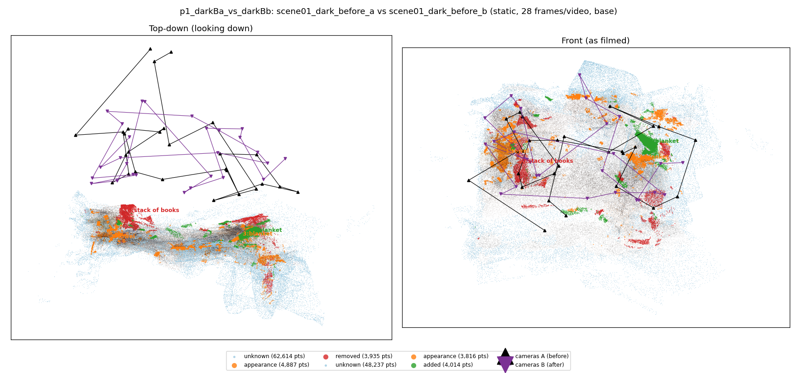
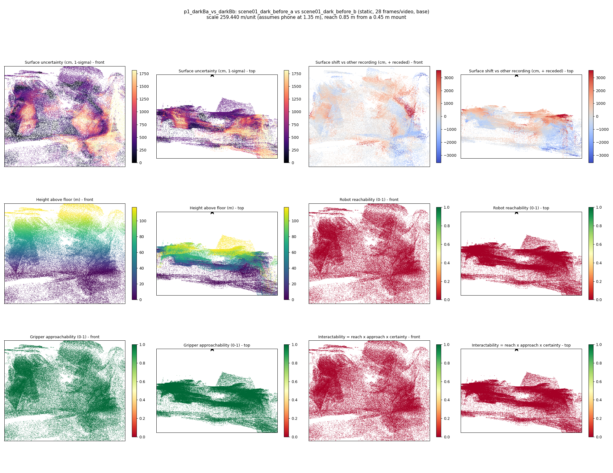
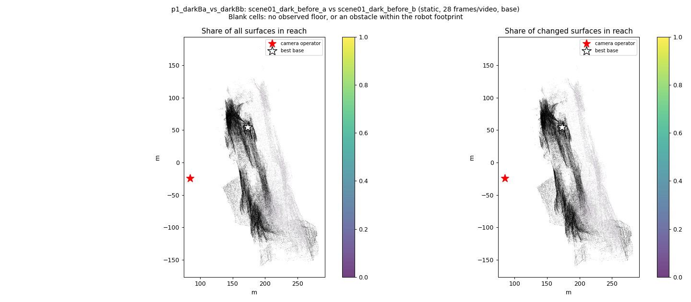
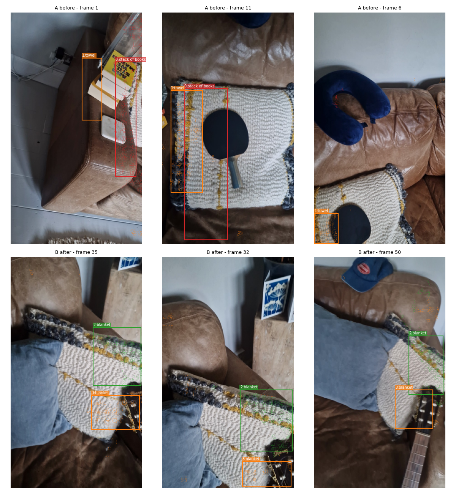
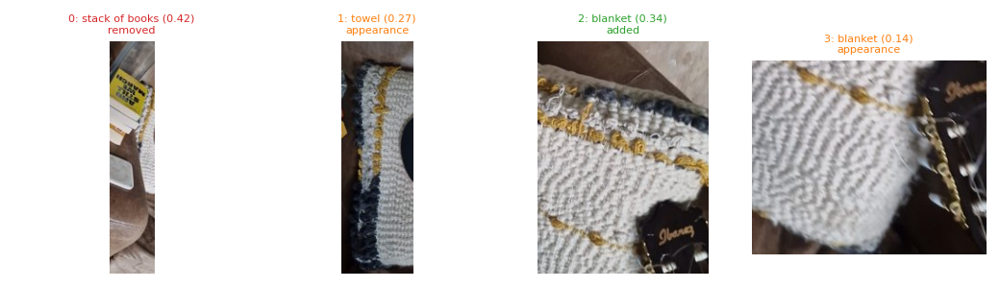
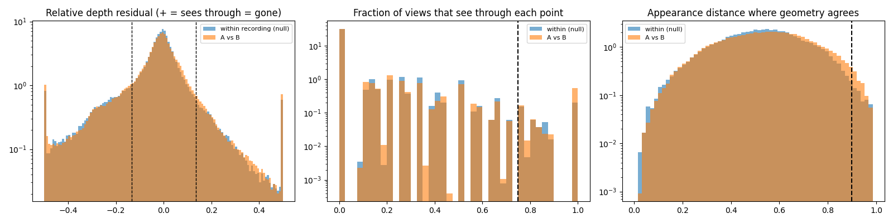

# p1_darkBa_vs_darkBb

**scene01_dark_before_a** (A, before) vs **scene01_dark_before_b** (B, after) - pair type **static**, 28 frames per video, variant `base`.

Distances are in cm, from a floor fit and an assumed phone height (scale 259.44 m/unit, range [211.3956, 307.4844]).

| Measure | Value |
|---|---|
| Observed share (A / B) | 84.4% / 87.9% |
| Changed share of observed points (A / B) | 2.61% / 2.23% |
| Alignment residual across / within recordings | 0.049 / 0.0446 |
| Thresholds (depth tau, see-through fraction, appearance) | 0.13448 / 0.75 / 0.89941 |
| Changes (moved / removed / added / appearance) | 0 / 1 / 1 / 2 |
| Reconstruction time | 27.8 s (GPU peak 9.57 GB) |

Nothing was moved between these recordings, so every flagged point is a false change: **false-change rate 2.42%**.

Heat maps (recording B): reachable 0%, approachable 100%, interactable 0%; surface uncertainty median 534.079 cm (90th pct 1486.146); surface shift 99th pct 3578.913 cm.

Scene report with simulator randomisation ranges: [scene_report.md](scene_report.md)

## Changes

- **2 added** blanket (p=0.337, 2932 pts, centroid +/- 0.029): A blanket appears in the second recording that was not there before.
- **1 appearance** towel (p=0.267, 2449 pts, centroid +/- 0.029): The towel looks different (turned over, deformed or swapped) but occupies the same place.
- **0 removed** stack of books (p=0.423, 1358 pts, centroid +/- 0.029): A stack of books that was there in the first recording is no longer there.
- **3 appearance** blanket (p=0.141, 877 pts, centroid +/- 0.029): The blanket looks different (turned over, deformed or swapped) but occupies the same place.

Interactive 3D: download `viewer.html` and open it in a browser. Dense cloud: `cloud.ply` (colour by the `change` field); heat maps: `fields.ply`.
