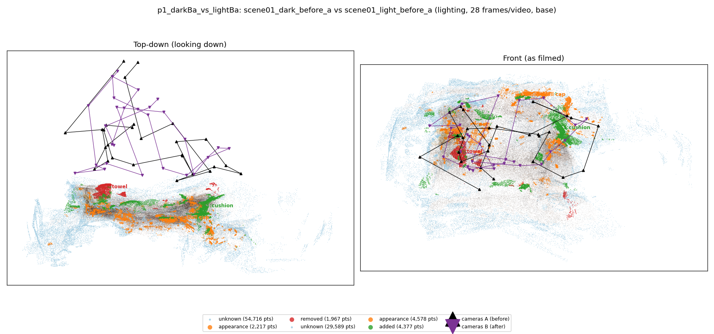
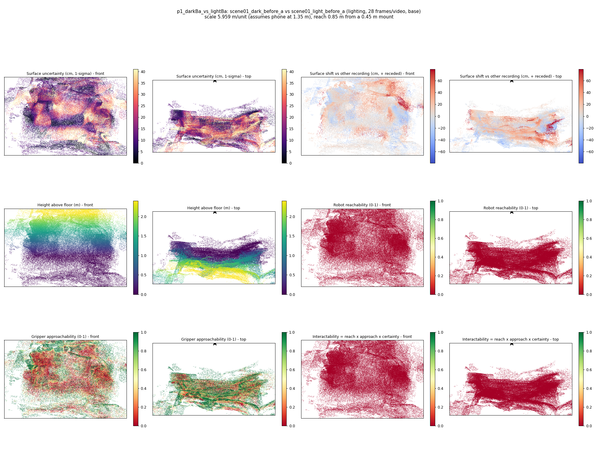
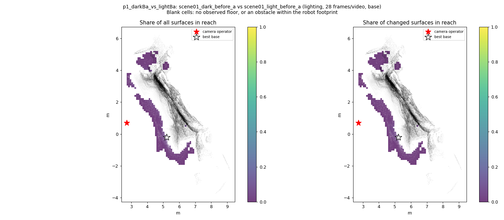
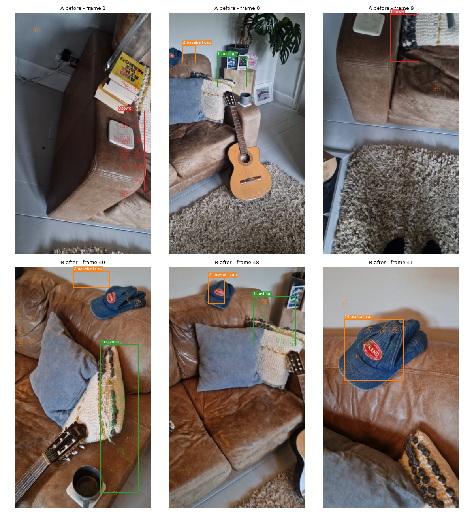
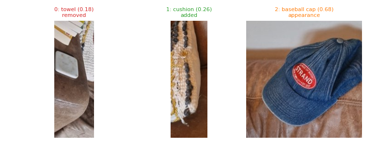
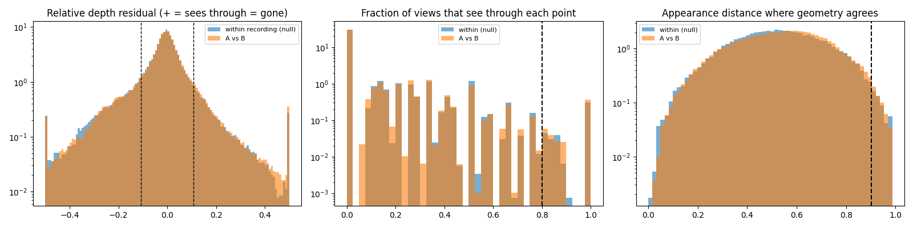

# p1_darkBa_vs_lightBa

**scene01_dark_before_a** (A, before) vs **scene01_light_before_a** (B, after) - pair type **lighting**, 28 frames per video, variant `base`.

Distances are in cm, from a floor fit and an assumed phone height (scale 5.9589 m/unit, range [4.8554, 7.0624]).

| Measure | Value |
|---|---|
| Observed share (A / B) | 86.3% / 92.6% |
| Changed share of observed points (A / B) | 1.21% / 2.42% |
| Alignment residual across / within recordings | 0.0365 / 0.0358 |
| Thresholds (depth tau, see-through fraction, appearance) | 0.1078 / 0.8 / 0.9012 |
| Changes (moved / removed / added / appearance) | 0 / 1 / 1 / 1 |
| Reconstruction time | 28.5 s (GPU peak 9.57 GB) |

Nothing was moved between these recordings, so every flagged point is a false change: **false-change rate 1.81%**.

Heat maps (recording B): reachable 0%, approachable 35%, interactable 0%; surface uncertainty median 11.253 cm (90th pct 32.537); surface shift 99th pct 78.978 cm.

Scene report with simulator randomisation ranges: [scene_report.md](scene_report.md)

## Changes

- **1 added** cushion (p=0.263, 2053 pts, centroid +/- 0.025): A cushion appears in the second recording that was not there before.
- **0 removed** towel (p=0.182, 1147 pts, centroid +/- 0.025): A towel that was there in the first recording is no longer there.
- **2 appearance** baseball cap (p=0.681, 856 pts, centroid +/- 0.025): The baseball cap looks different (turned over, deformed or swapped) but occupies the same place.

Interactive 3D: download `viewer.html` and open it in a browser. Dense cloud: `cloud.ply` (colour by the `change` field); heat maps: `fields.ply`.
