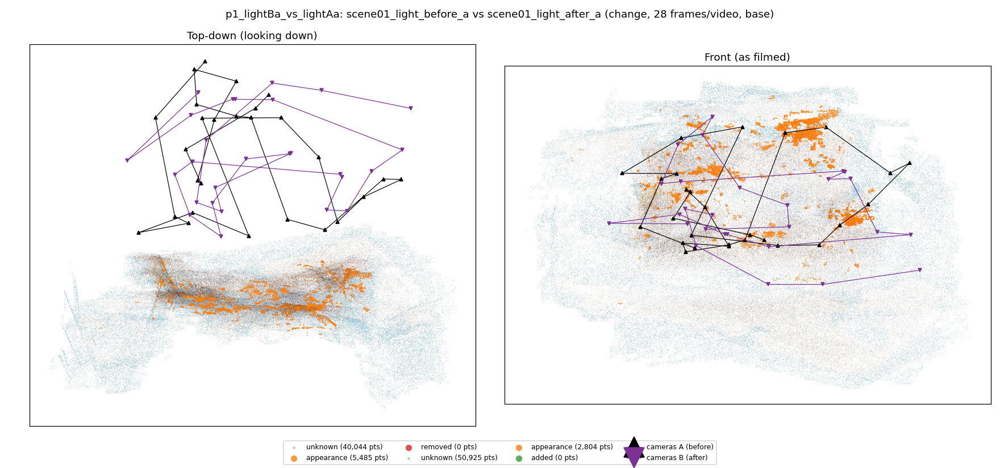
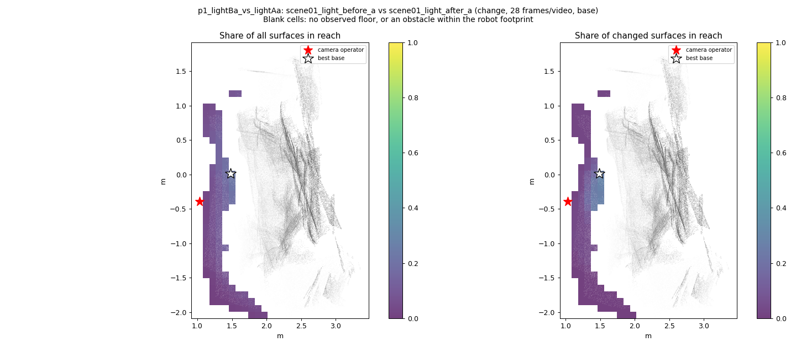
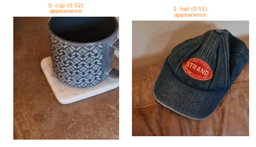
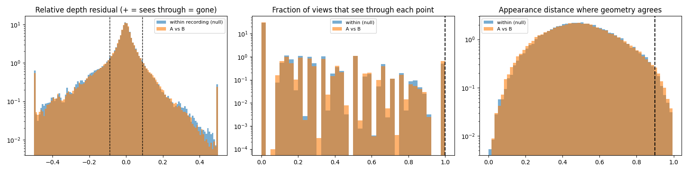

# p1_lightBa_vs_lightAa

**scene01_light_before_a** (A, before) vs **scene01_light_after_a** (B, after) - pair type **change**, 28 frames per video, variant `base`.

Distances are in cm, from a floor fit and an assumed phone height (scale 2.5242 m/unit, range [2.0567, 2.9916]).

| Measure | Value |
|---|---|
| Observed share (A / B) | 90.0% / 87.3% |
| Changed share of observed points (A / B) | 1.52% / 0.80% |
| Alignment residual across / within recordings | 0.0289 / 0.0295 |
| Thresholds (depth tau, see-through fraction, appearance) | 0.08798 / 1.0 / 0.89893 |
| Changes (moved / removed / added / appearance) | 0 / 0 / 0 / 2 |
| Reconstruction time | 27.0 s (GPU peak 8.92 GB) |

Heat maps (recording B): reachable 1%, approachable 30%, interactable 0%; surface uncertainty median 6.246 cm (90th pct 20.075); surface shift 99th pct 28.05 cm.

Scene report with simulator randomisation ranges: [scene_report.md](scene_report.md)

## Changes

- **1 appearance** hat (p=0.513, 2247 pts, centroid +/- 0.025): The hat looks different (turned over, deformed or swapped) but occupies the same place.
- **0 appearance** cup (p=0.517, 1110 pts, centroid +/- 0.025): The cup looks different (turned over, deformed or swapped) but occupies the same place.

Interactive 3D: download `viewer.html` and open it in a browser. Dense cloud: `cloud.ply` (colour by the `change` field); heat maps: `fields.ply`.
