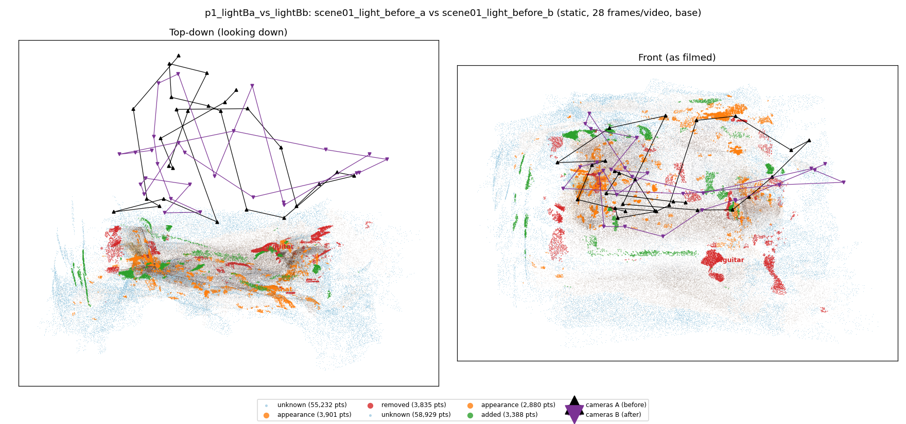
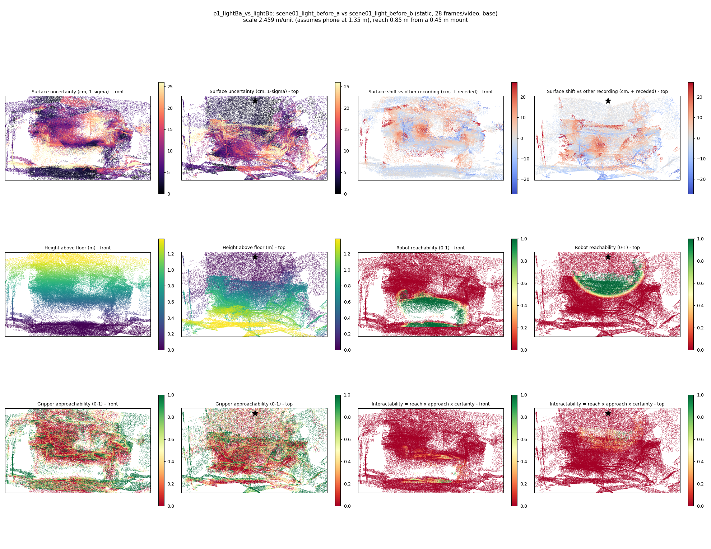
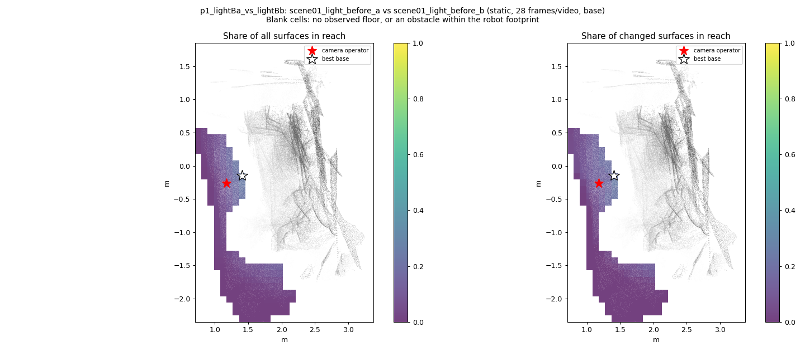
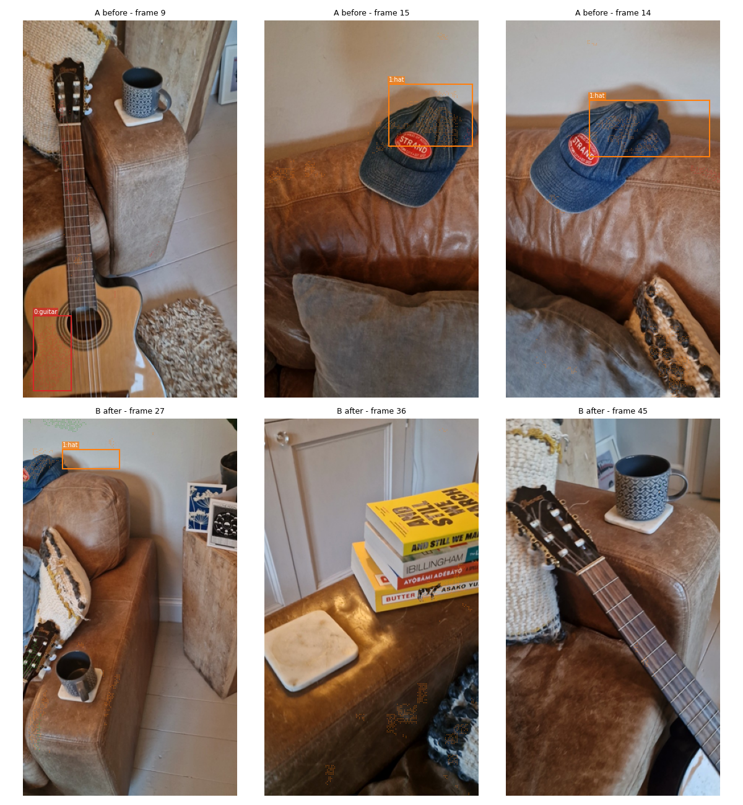
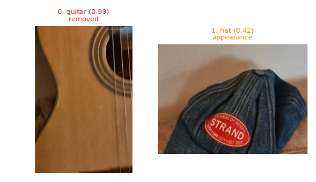
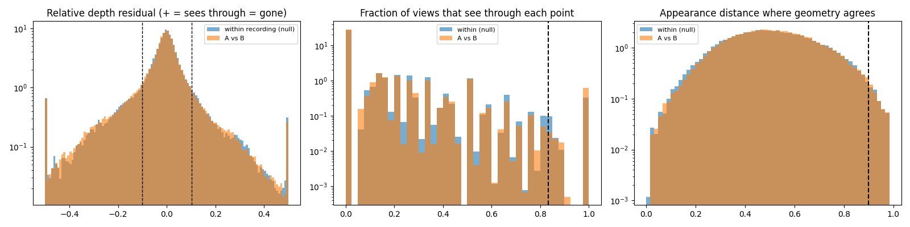

# p1_lightBa_vs_lightBb

**scene01_light_before_a** (A, before) vs **scene01_light_before_b** (B, after) - pair type **static**, 28 frames per video, variant `base`.

Distances are in cm, from a floor fit and an assumed phone height (scale 2.4587 m/unit, range [2.0034, 2.914]).

| Measure | Value |
|---|---|
| Observed share (A / B) | 86.2% / 85.3% |
| Changed share of observed points (A / B) | 2.24% / 1.84% |
| Alignment residual across / within recordings | 0.0337 / 0.0337 |
| Thresholds (depth tau, see-through fraction, appearance) | 0.10174 / 0.83333 / 0.89856 |
| Changes (moved / removed / added / appearance) | 0 / 1 / 0 / 1 |
| Reconstruction time | 24.7 s (GPU peak 9.57 GB) |

Nothing was moved between these recordings, so every flagged point is a false change: **false-change rate 2.04%**.

Heat maps (recording B): reachable 14%, approachable 33%, interactable 1%; surface uncertainty median 5.921 cm (90th pct 20.363); surface shift 99th pct 27.007 cm.

Scene report with simulator randomisation ranges: [scene_report.md](scene_report.md)

## Changes

- **1 appearance** hat (p=0.42, 1132 pts, centroid +/- 0.027): The hat looks different (turned over, deformed or swapped) but occupies the same place.
- **0 removed** guitar (p=0.991, 910 pts, centroid +/- 0.027): A guitar that was there in the first recording is no longer there.

Interactive 3D: download `viewer.html` and open it in a browser. Dense cloud: `cloud.ply` (colour by the `change` field); heat maps: `fields.ply`.
