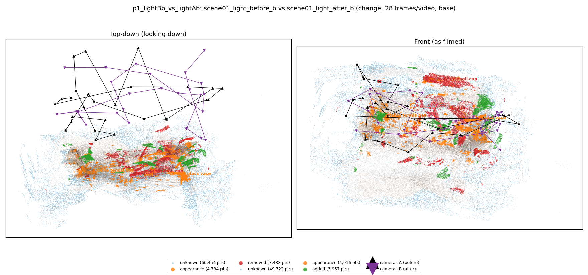
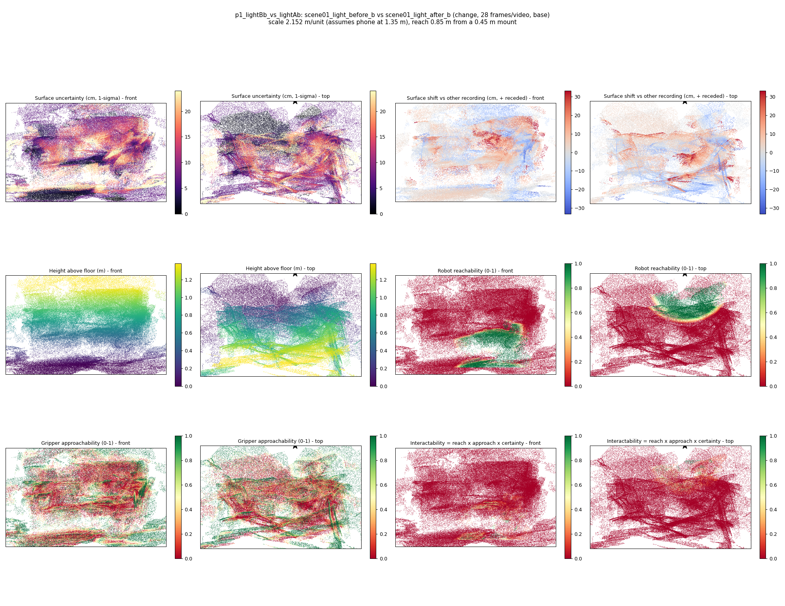
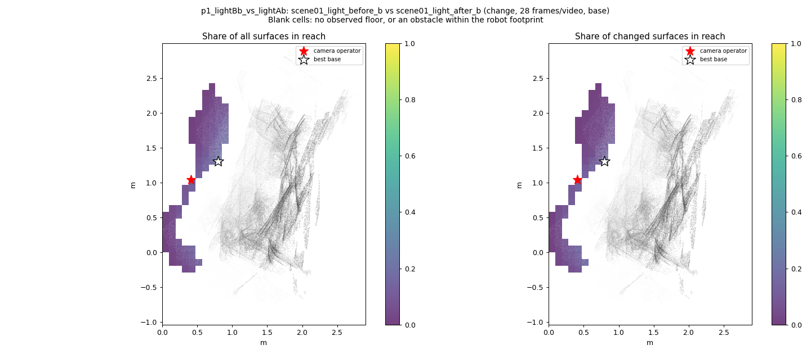
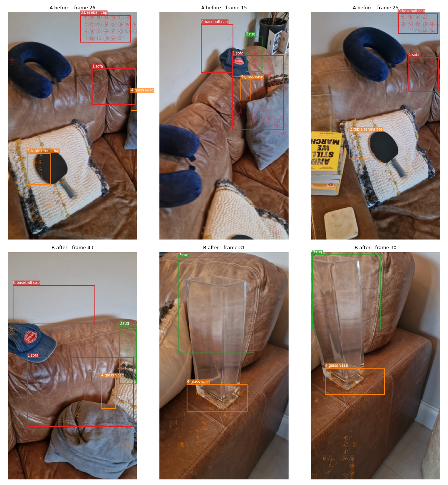
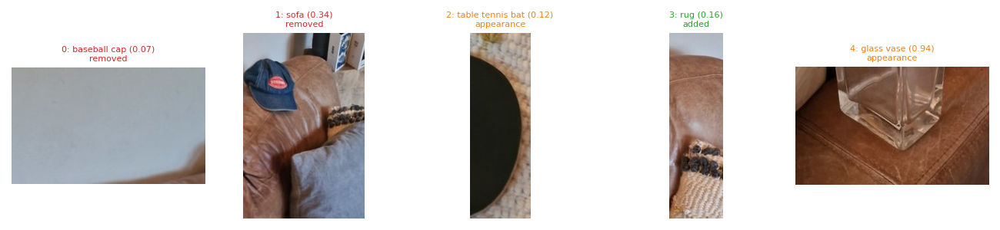
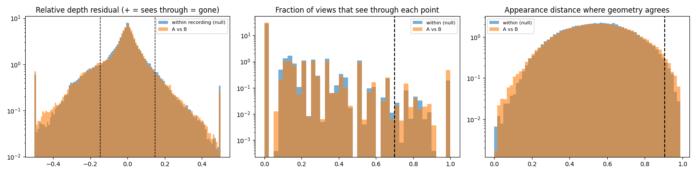

# p1_lightBb_vs_lightAb

**scene01_light_before_b** (A, before) vs **scene01_light_after_b** (B, after) - pair type **change**, 28 frames per video, variant `base`.

Distances are in cm, from a floor fit and an assumed phone height (scale 2.152 m/unit, range [1.7535, 2.5505]).

| Measure | Value |
|---|---|
| Observed share (A / B) | 84.9% / 87.6% |
| Changed share of observed points (A / B) | 3.61% / 2.53% |
| Alignment residual across / within recordings | 0.0484 / 0.049 |
| Thresholds (depth tau, see-through fraction, appearance) | 0.14765 / 0.7 / 0.90622 |
| Changes (moved / removed / added / appearance) | 0 / 2 / 1 / 2 |
| Reconstruction time | 27.8 s (GPU peak 9.57 GB) |

Heat maps (recording B): reachable 12%, approachable 30%, interactable 1%; surface uncertainty median 7.224 cm (90th pct 20.524); surface shift 99th pct 33.219 cm.

Scene report with simulator randomisation ranges: [scene_report.md](scene_report.md)

## Changes

- **1 removed** sofa (p=0.343, 2178 pts, centroid +/- 0.045): A sofa that was there in the first recording is no longer there.
- **0 removed** baseball cap (p=0.067, 1979 pts, centroid +/- 0.045): A baseball cap that was there in the first recording is no longer there.
- **2 appearance** table tennis bat (p=0.117, 1222 pts, centroid +/- 0.045): The table tennis bat looks different (turned over, deformed or swapped) but occupies the same place.
- **4 appearance** glass vase (p=0.935, 1103 pts, centroid +/- 0.045): The glass vase looks different (turned over, deformed or swapped) but occupies the same place.
- **3 added** rug (p=0.156, 1003 pts, centroid +/- 0.045): A rug appears in the second recording that was not there before.

Interactive 3D: download `viewer.html` and open it in a browser. Dense cloud: `cloud.ply` (colour by the `change` field); heat maps: `fields.ply`.
