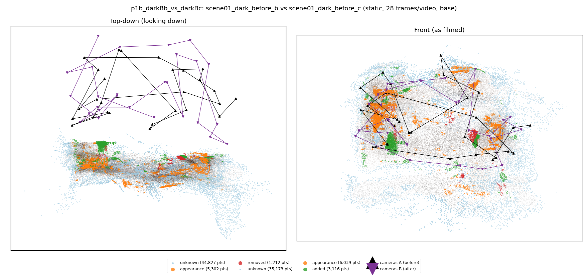
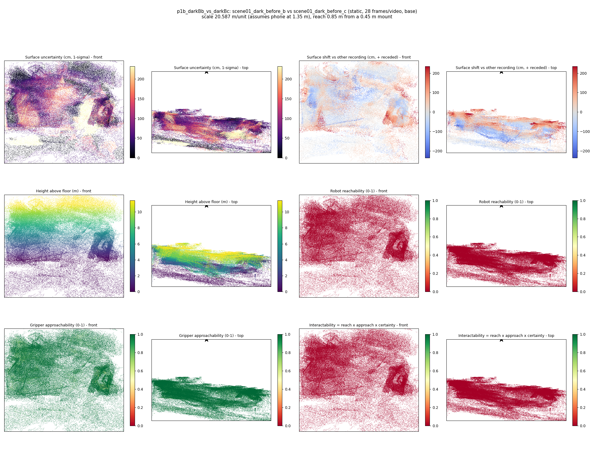
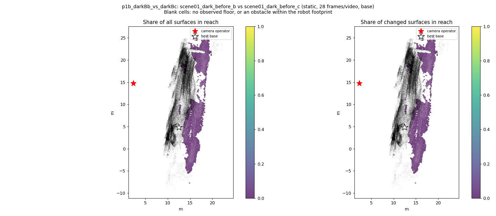
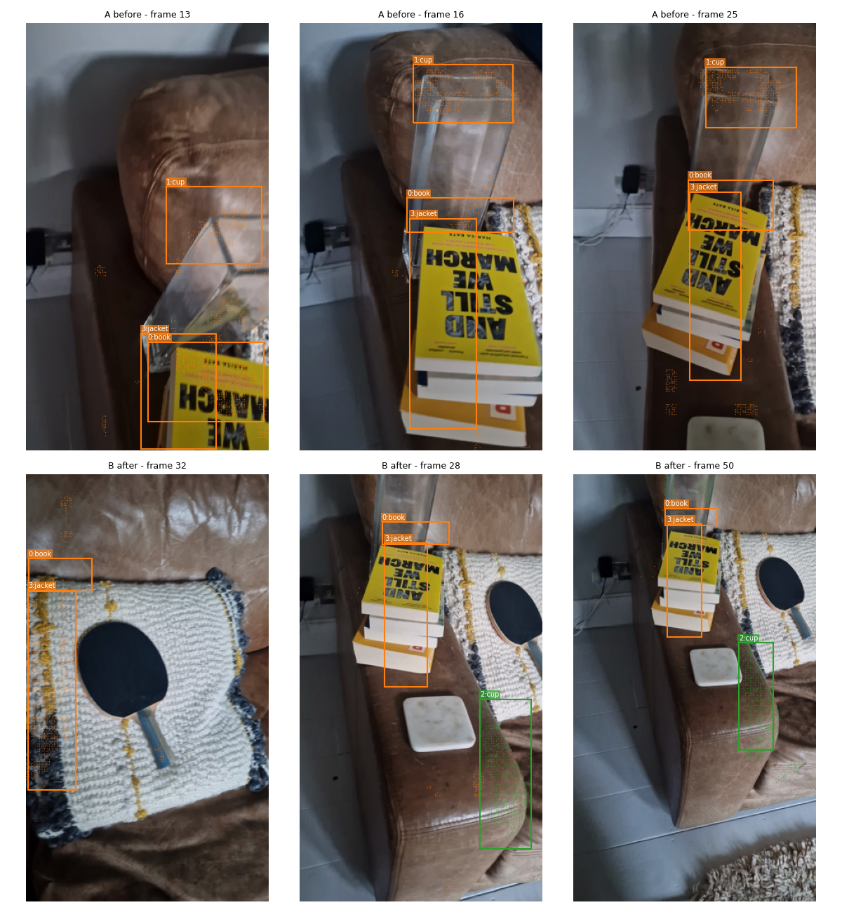
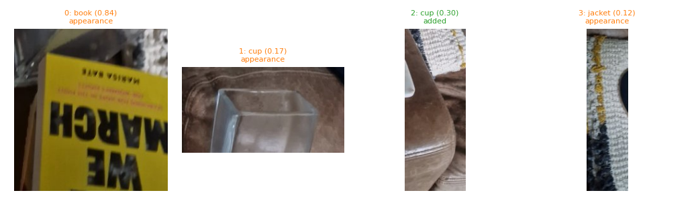
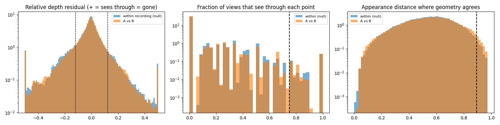

# p1b_darkBb_vs_darkBc

**scene01_dark_before_b** (A, before) vs **scene01_dark_before_c** (B, after) - pair type **static**, 28 frames per video, variant `base`.

Distances are in cm, from a floor fit and an assumed phone height (scale 20.5868 m/unit, range [16.7744, 24.3992]).

| Measure | Value |
|---|---|
| Observed share (A / B) | 88.8% / 91.2% |
| Changed share of observed points (A / B) | 1.83% / 2.51% |
| Alignment residual across / within recordings | 0.0392 / 0.0404 |
| Thresholds (depth tau, see-through fraction, appearance) | 0.12126 / 0.75 / 0.89225 |
| Changes (moved / removed / added / appearance) | 0 / 0 / 1 / 3 |
| Reconstruction time | 27.7 s (GPU peak 9.57 GB) |

Nothing was moved between these recordings, so every flagged point is a false change: **false-change rate 2.17%**.

Heat maps (recording B): reachable 0%, approachable 97%, interactable 0%; surface uncertainty median 53.964 cm (90th pct 166.149); surface shift 99th pct 234.767 cm.

Scene report with simulator randomisation ranges: [scene_report.md](scene_report.md)

## Changes

- **3 appearance** jacket (p=0.117, 2262 pts, centroid +/- 0.037): The jacket looks different (turned over, deformed or swapped) but occupies the same place.
- **2 added** cup (p=0.305, 1534 pts, centroid +/- 0.037): A cup appears in the second recording that was not there before.
- **1 appearance** cup (p=0.174, 1438 pts, centroid +/- 0.037): The cup looks different (turned over, deformed or swapped) but occupies the same place.
- **0 appearance** book (p=0.84, 1011 pts, centroid +/- 0.037): The book looks different (turned over, deformed or swapped) but occupies the same place.

Interactive 3D: download `viewer.html` and open it in a browser. Dense cloud: `cloud.ply` (colour by the `change` field); heat maps: `fields.ply`.
