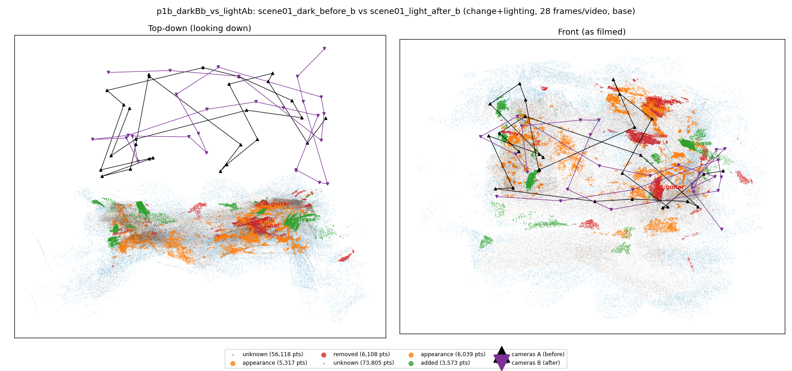
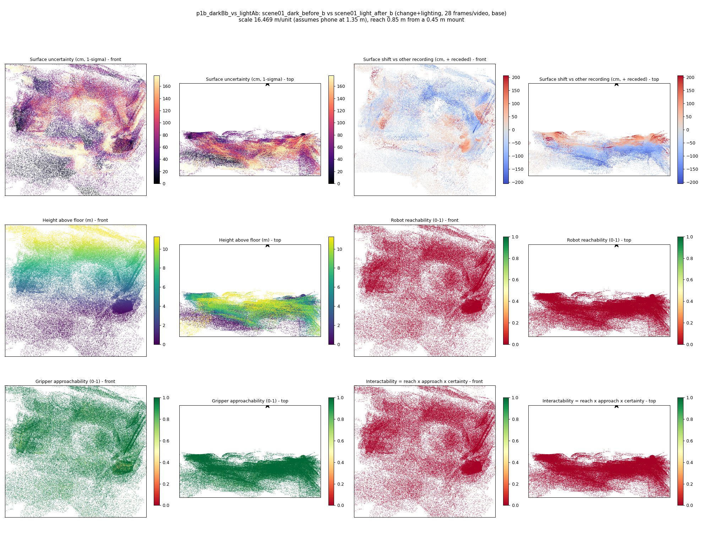
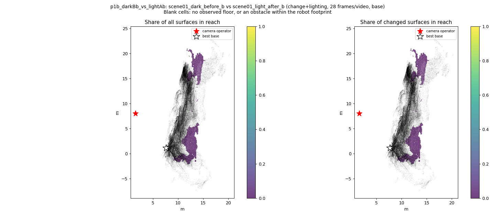
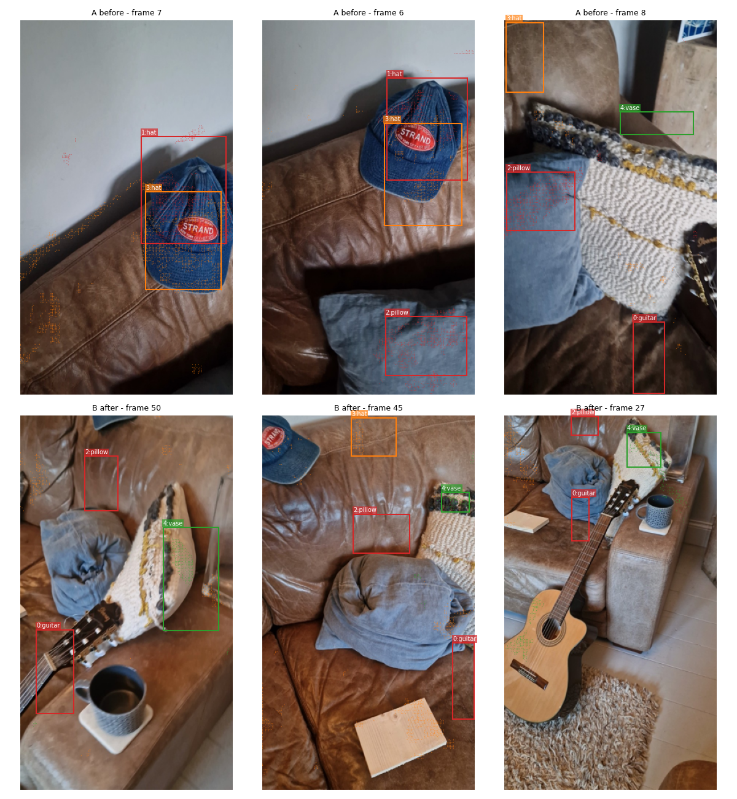
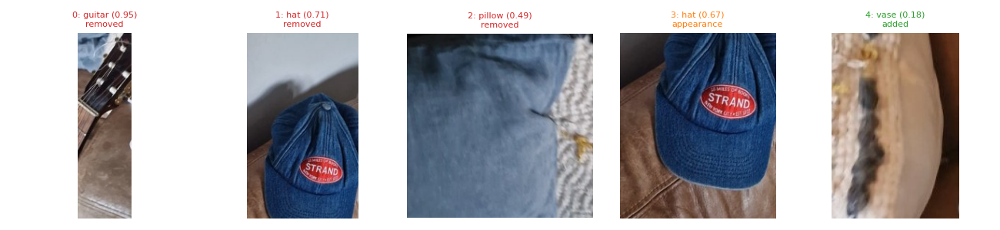
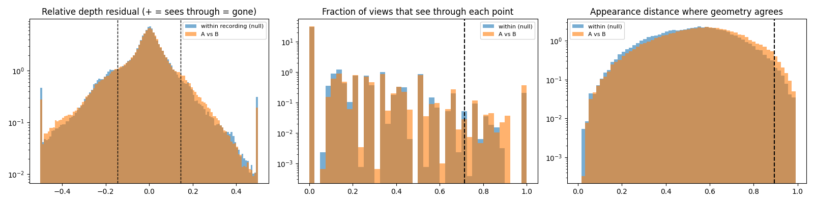

# p1b_darkBb_vs_lightAb

**scene01_dark_before_b** (A, before) vs **scene01_light_after_b** (B, after) - pair type **change+lighting**, 28 frames per video, variant `base`.

Distances are in cm, from a floor fit and an assumed phone height (scale 16.4687 m/unit, range [13.4189, 19.5184]).

| Measure | Value |
|---|---|
| Observed share (A / B) | 86.0% / 81.5% |
| Changed share of observed points (A / B) | 3.32% / 2.95% |
| Alignment residual across / within recordings | 0.0499 / 0.0481 |
| Thresholds (depth tau, see-through fraction, appearance) | 0.14472 / 0.71429 / 0.89478 |
| Changes (moved / removed / added / appearance) | 0 / 3 / 1 / 1 |
| Reconstruction time | 27.9 s (GPU peak 9.57 GB) |

Heat maps (recording B): reachable 0%, approachable 94%, interactable 0%; surface uncertainty median 59.876 cm (90th pct 150.138); surface shift 99th pct 205.713 cm.

Scene report with simulator randomisation ranges: [scene_report.md](scene_report.md)

## Changes

- **2 removed** pillow (p=0.491, 2109 pts, centroid +/- 0.048): A pillow that was there in the first recording is no longer there.
- **3 appearance** hat (p=0.667, 1614 pts, centroid +/- 0.048): The hat looks different (turned over, deformed or swapped) but occupies the same place.
- **1 removed** hat (p=0.712, 1532 pts, centroid +/- 0.048): A hat that was there in the first recording is no longer there.
- **0 removed** guitar (p=0.951, 1117 pts, centroid +/- 0.048): A guitar that was there in the first recording is no longer there.
- **4 added** vase (p=0.18, 811 pts, centroid +/- 0.048): A vase appears in the second recording that was not there before.

Interactive 3D: download `viewer.html` and open it in a browser. Dense cloud: `cloud.ply` (colour by the `change` field); heat maps: `fields.ply`.
