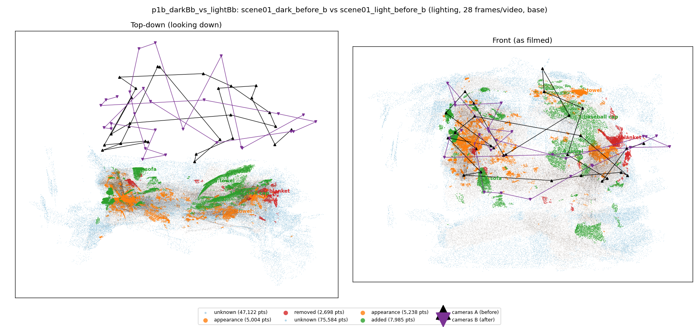
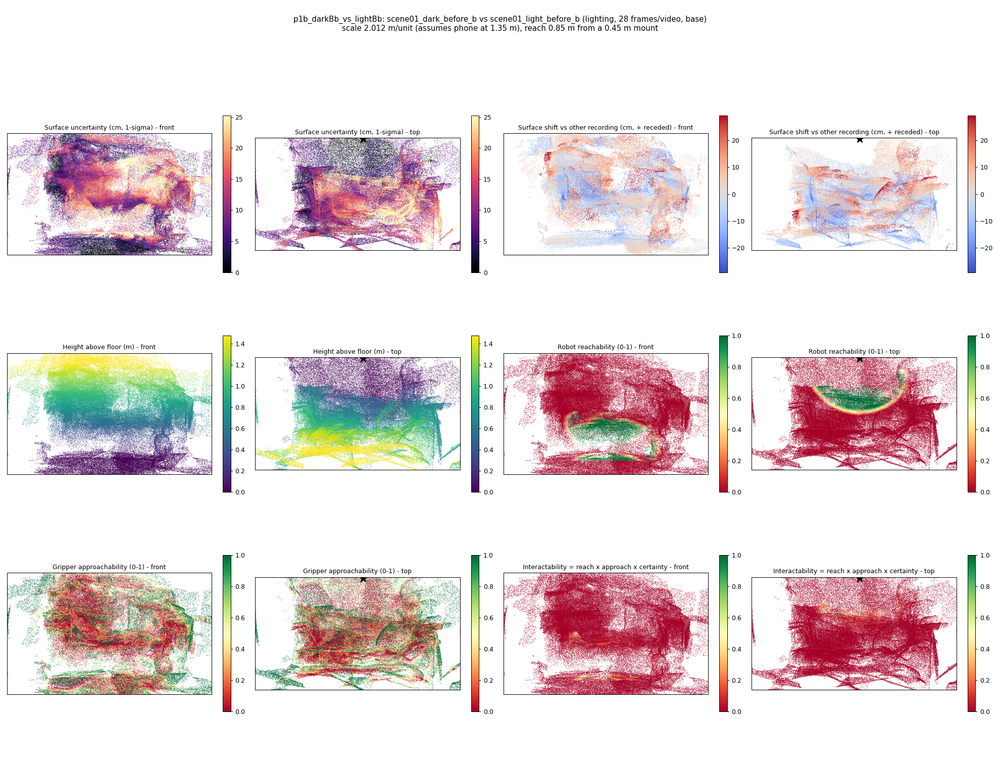
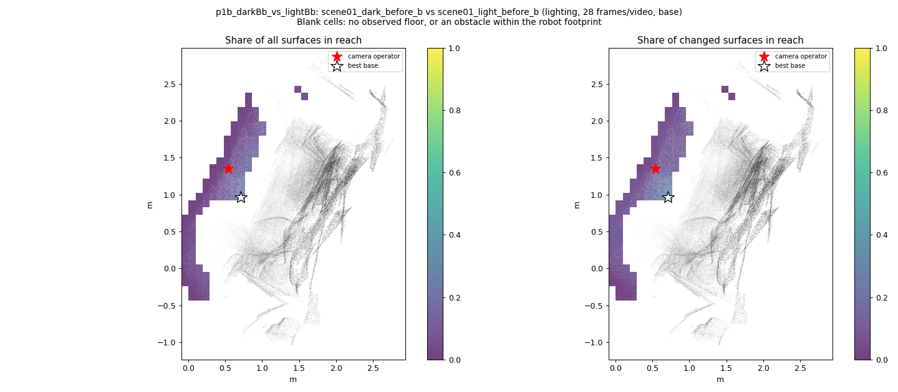
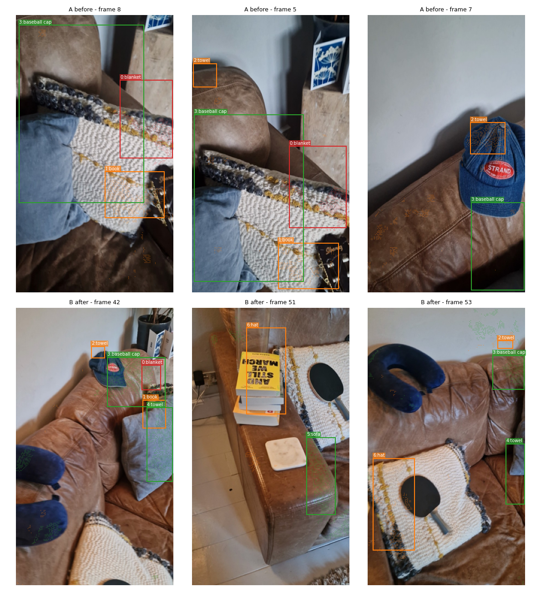
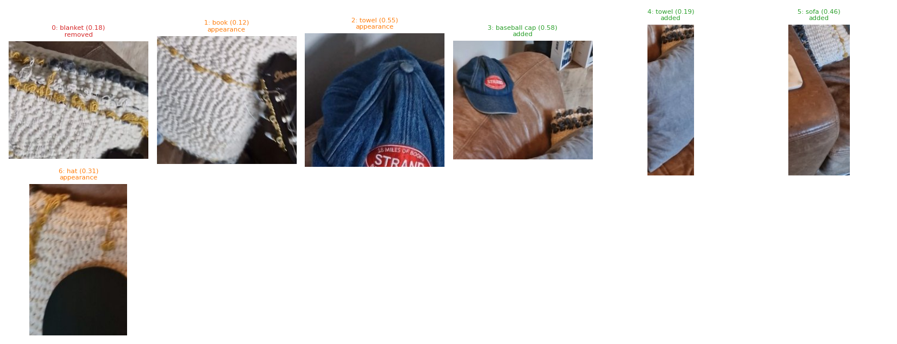
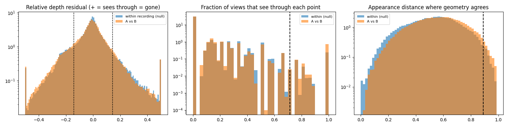

# p1b_darkBb_vs_lightBb

**scene01_dark_before_b** (A, before) vs **scene01_light_before_b** (B, after) - pair type **lighting**, 28 frames per video, variant `base`.

Distances are in cm, from a floor fit and an assumed phone height (scale 2.012 m/unit, range [1.6394, 2.3846]).

| Measure | Value |
|---|---|
| Observed share (A / B) | 88.2% / 81.1% |
| Changed share of observed points (A / B) | 2.18% / 4.08% |
| Alignment residual across / within recordings | 0.0521 / 0.0477 |
| Thresholds (depth tau, see-through fraction, appearance) | 0.14362 / 0.71429 / 0.89084 |
| Changes (moved / removed / added / appearance) | 0 / 1 / 3 / 3 |
| Reconstruction time | 27.8 s (GPU peak 9.57 GB) |

Nothing was moved between these recordings, so every flagged point is a false change: **false-change rate 3.13%**.

Heat maps (recording B): reachable 8%, approachable 29%, interactable 0%; surface uncertainty median 8.041 cm (90th pct 20.806); surface shift 99th pct 29.059 cm.

Scene report with simulator randomisation ranges: [scene_report.md](scene_report.md)

## Changes

- **6 appearance** hat (p=0.307, 2041 pts, centroid +/- 0.046): The hat looks different (turned over, deformed or swapped) but occupies the same place.
- **3 added** baseball cap (p=0.585, 1610 pts, centroid +/- 0.046): A baseball cap appears in the second recording that was not there before.
- **0 removed** blanket (p=0.182, 1404 pts, centroid +/- 0.046): A blanket that was there in the first recording is no longer there.
- **1 appearance** book (p=0.115, 1322 pts, centroid +/- 0.046): The book looks different (turned over, deformed or swapped) but occupies the same place.
- **2 appearance** towel (p=0.547, 860 pts, centroid +/- 0.046): The towel looks different (turned over, deformed or swapped) but occupies the same place.
- **4 added** towel (p=0.194, 851 pts, centroid +/- 0.046): A towel appears in the second recording that was not there before.
- **5 added** sofa (p=0.459, 816 pts, centroid +/- 0.046): A sofa appears in the second recording that was not there before.

Interactive 3D: download `viewer.html` and open it in a browser. Dense cloud: `cloud.ply` (colour by the `change` field); heat maps: `fields.ply`.
