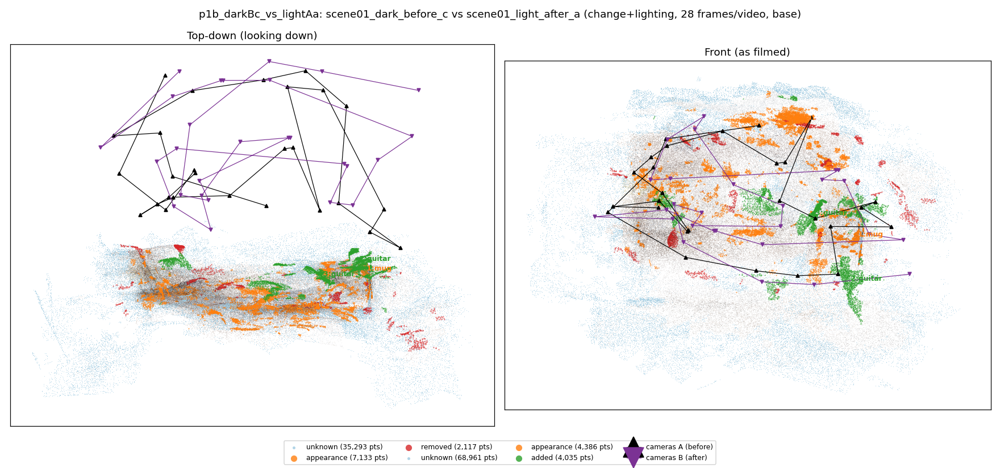
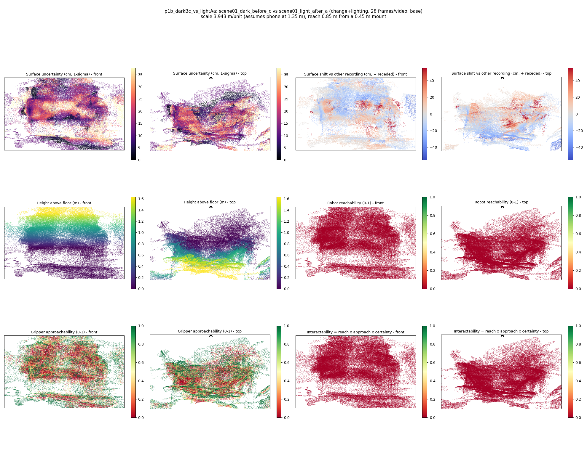
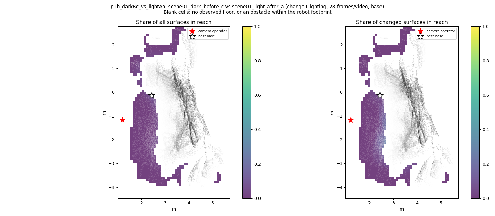
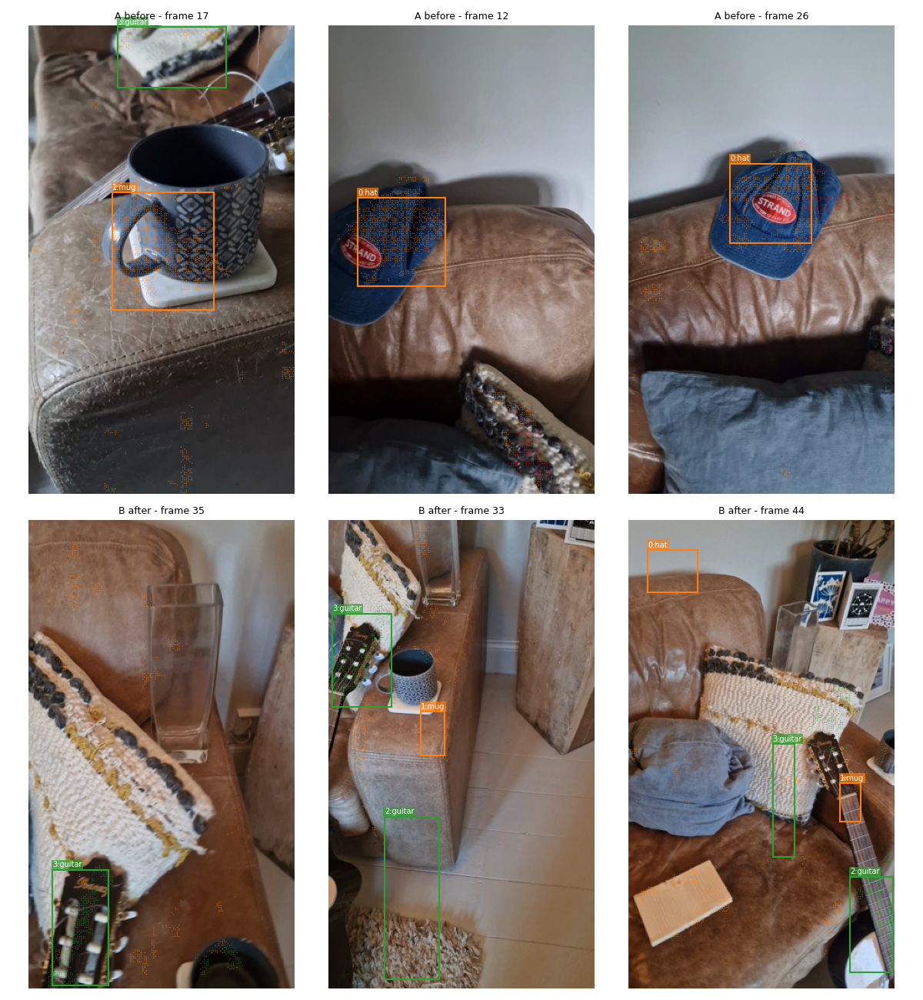
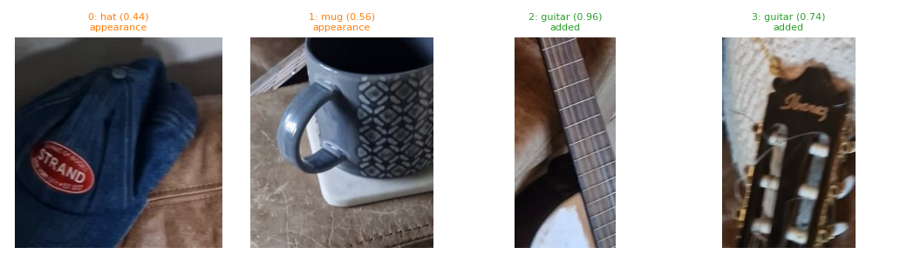
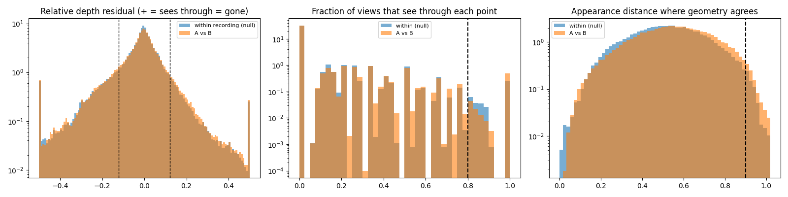

# p1b_darkBc_vs_lightAa

**scene01_dark_before_c** (A, before) vs **scene01_light_after_a** (B, after) - pair type **change+lighting**, 28 frames per video, variant `base`.

Distances are in cm, from a floor fit and an assumed phone height (scale 3.9433 m/unit, range [3.2131, 4.6736]).

| Measure | Value |
|---|---|
| Observed share (A / B) | 91.2% / 82.8% |
| Changed share of observed points (A / B) | 2.54% / 2.54% |
| Alignment residual across / within recordings | 0.0427 / 0.0405 |
| Thresholds (depth tau, see-through fraction, appearance) | 0.12092 / 0.8 / 0.90077 |
| Changes (moved / removed / added / appearance) | 0 / 0 / 2 / 2 |
| Reconstruction time | 27.4 s (GPU peak 9.57 GB) |

Heat maps (recording B): reachable 0%, approachable 35%, interactable 0%; surface uncertainty median 12.171 cm (90th pct 29.866); surface shift 99th pct 55.243 cm.

Scene report with simulator randomisation ranges: [scene_report.md](scene_report.md)

## Changes

- **0 appearance** hat (p=0.441, 2029 pts, centroid +/- 0.035): The hat looks different (turned over, deformed or swapped) but occupies the same place.
- **1 appearance** mug (p=0.564, 1590 pts, centroid +/- 0.035): The mug looks different (turned over, deformed or swapped) but occupies the same place.
- **2 added** guitar (p=0.962, 1012 pts, centroid +/- 0.035): A guitar appears in the second recording that was not there before.
- **3 added** guitar (p=0.744, 982 pts, centroid +/- 0.035): A guitar appears in the second recording that was not there before.

Interactive 3D: download `viewer.html` and open it in a browser. Dense cloud: `cloud.ply` (colour by the `change` field); heat maps: `fields.ply`.
