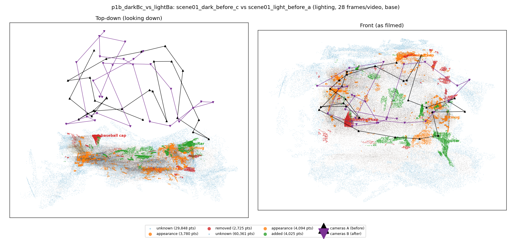
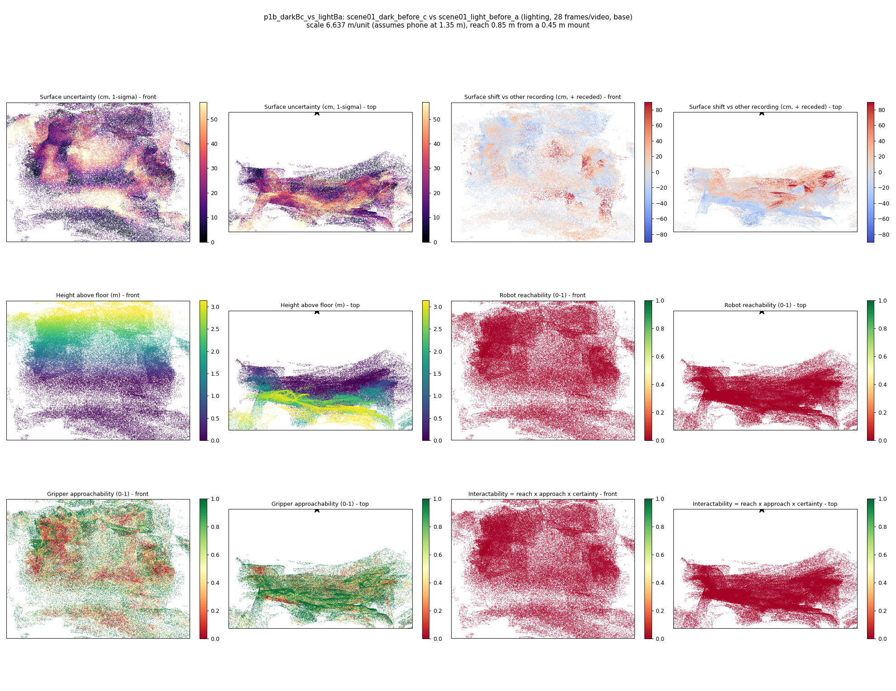
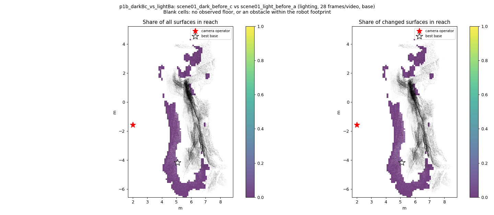
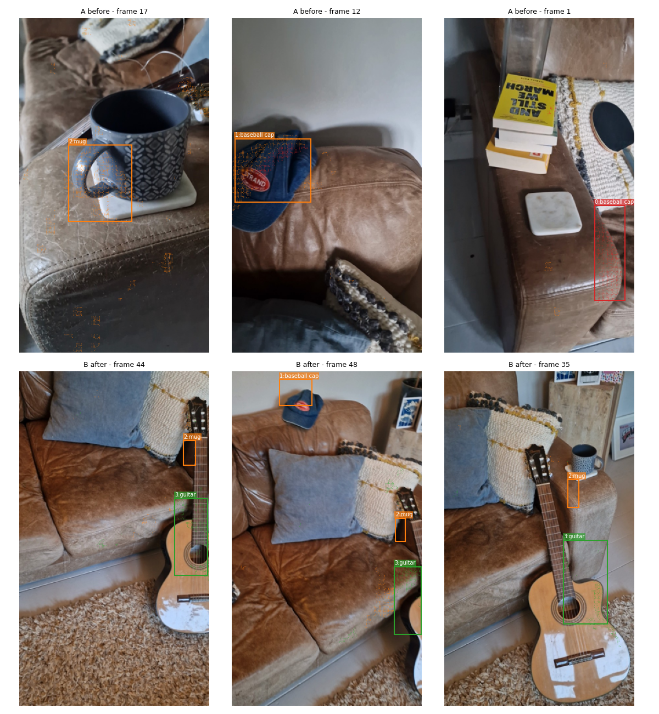
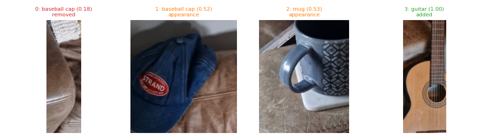
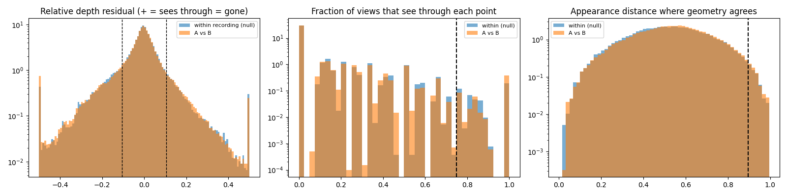

# p1b_darkBc_vs_lightBa

**scene01_dark_before_c** (A, before) vs **scene01_light_before_a** (B, after) - pair type **lighting**, 28 frames per video, variant `base`.

Distances are in cm, from a floor fit and an assumed phone height (scale 6.6366 m/unit, range [5.4076, 7.8656]).

| Measure | Value |
|---|---|
| Observed share (A / B) | 92.5% / 84.9% |
| Changed share of observed points (A / B) | 1.76% / 2.39% |
| Alignment residual across / within recordings | 0.0351 / 0.0349 |
| Thresholds (depth tau, see-through fraction, appearance) | 0.10469 / 0.75 / 0.89711 |
| Changes (moved / removed / added / appearance) | 0 / 1 / 1 / 2 |
| Reconstruction time | 27.5 s (GPU peak 9.57 GB) |

Nothing was moved between these recordings, so every flagged point is a false change: **false-change rate 2.07%**.

Heat maps (recording B): reachable 0%, approachable 47%, interactable 0%; surface uncertainty median 14.267 cm (90th pct 44.31); surface shift 99th pct 89.946 cm.

Scene report with simulator randomisation ranges: [scene_report.md](scene_report.md)

## Changes

- **3 added** guitar (p=0.997, 1165 pts, centroid +/- 0.030): A guitar appears in the second recording that was not there before.
- **0 removed** baseball cap (p=0.185, 1093 pts, centroid +/- 0.030): A baseball cap that was there in the first recording is no longer there.
- **2 appearance** mug (p=0.533, 983 pts, centroid +/- 0.030): The mug looks different (turned over, deformed or swapped) but occupies the same place.
- **1 appearance** baseball cap (p=0.519, 909 pts, centroid +/- 0.030): The baseball cap looks different (turned over, deformed or swapped) but occupies the same place.

Interactive 3D: download `viewer.html` and open it in a browser. Dense cloud: `cloud.ply` (colour by the `change` field); heat maps: `fields.ply`.
