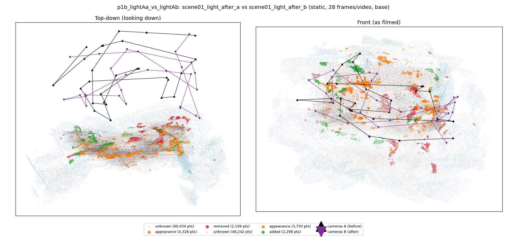
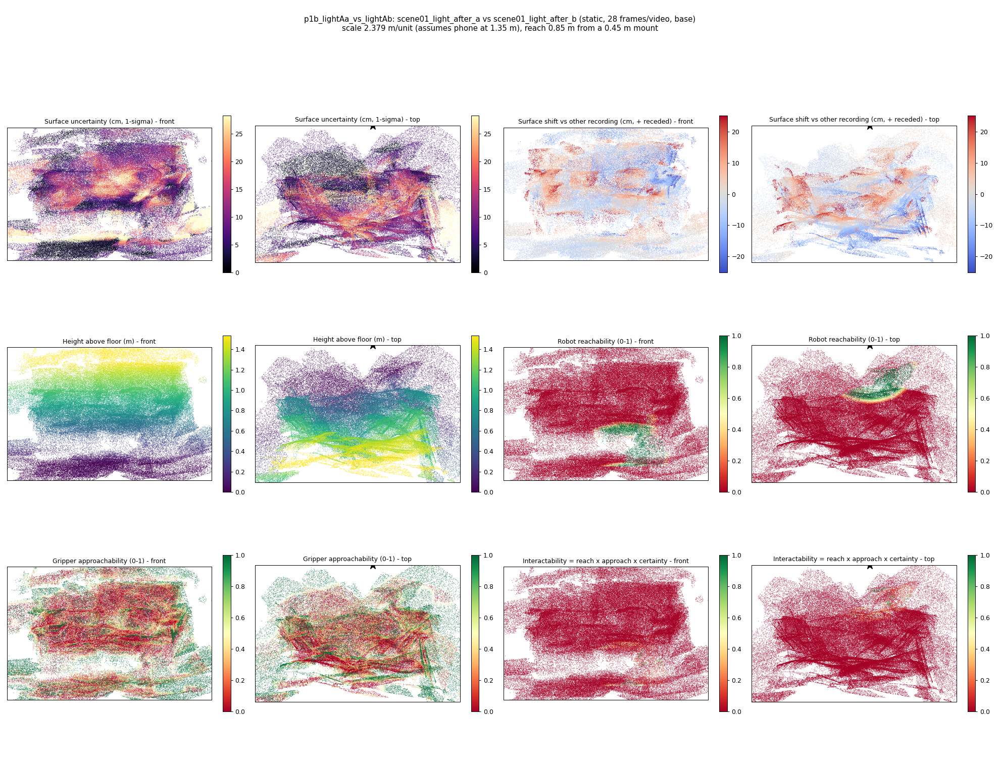
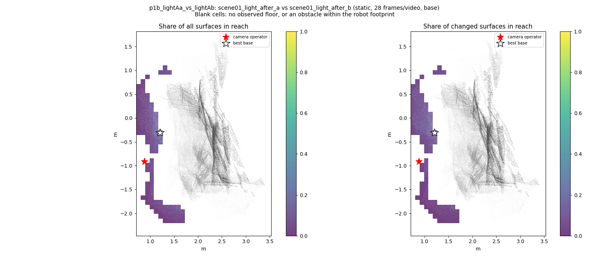
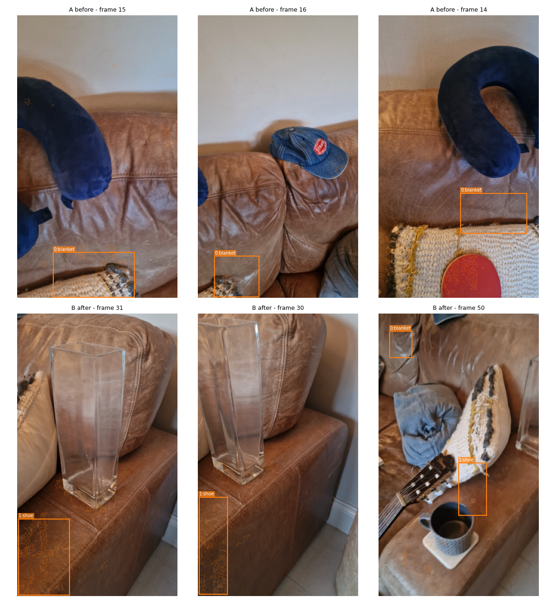
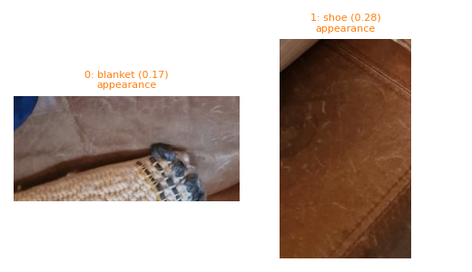
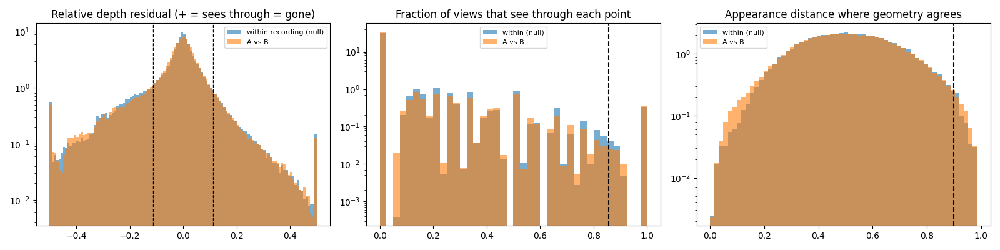

# p1b_lightAa_vs_lightAb

**scene01_light_after_a** (A, before) vs **scene01_light_after_b** (B, after) - pair type **static**, 28 frames per video, variant `base`.

Distances are in cm, from a floor fit and an assumed phone height (scale 2.3794 m/unit, range [1.9388, 2.82]).

| Measure | Value |
|---|---|
| Observed share (A / B) | 84.9% / 87.9% |
| Changed share of observed points (A / B) | 1.92% / 1.72% |
| Alignment residual across / within recordings | 0.0389 / 0.0375 |
| Thresholds (depth tau, see-through fraction, appearance) | 0.11161 / 0.85714 / 0.89844 |
| Changes (moved / removed / added / appearance) | 0 / 0 / 0 / 2 |
| Reconstruction time | 27.5 s (GPU peak 9.57 GB) |

Nothing was moved between these recordings, so every flagged point is a false change: **false-change rate 1.82%**.

Heat maps (recording B): reachable 4%, approachable 30%, interactable 0%; surface uncertainty median 7.25 cm (90th pct 22.829); surface shift 99th pct 25.021 cm.

Scene report with simulator randomisation ranges: [scene_report.md](scene_report.md)

## Changes

- **0 appearance** blanket (p=0.169, 1343 pts, centroid +/- 0.035): The blanket looks different (turned over, deformed or swapped) but occupies the same place.
- **1 appearance** shoe (p=0.275, 1337 pts, centroid +/- 0.035): The shoe looks different (turned over, deformed or swapped) but occupies the same place.

Interactive 3D: download `viewer.html` and open it in a browser. Dense cloud: `cloud.ply` (colour by the `change` field); heat maps: `fields.ply`.
