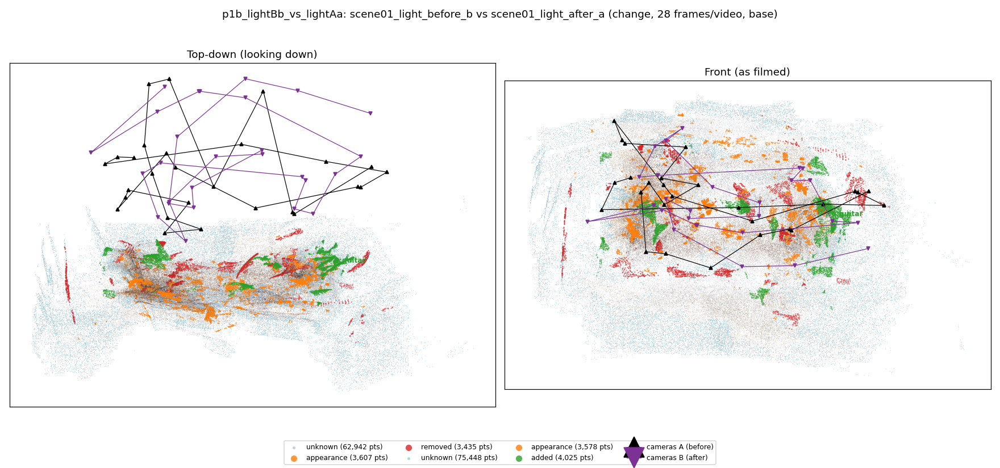
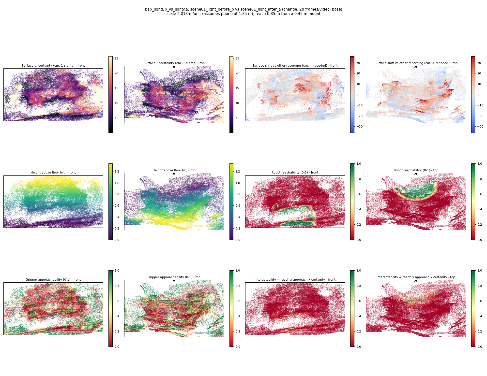
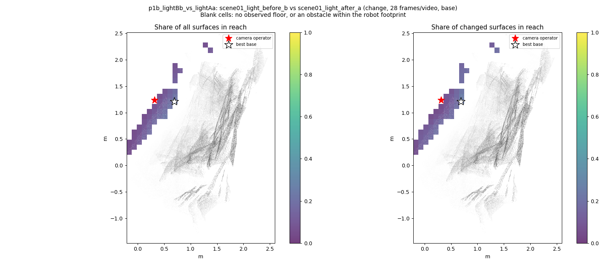
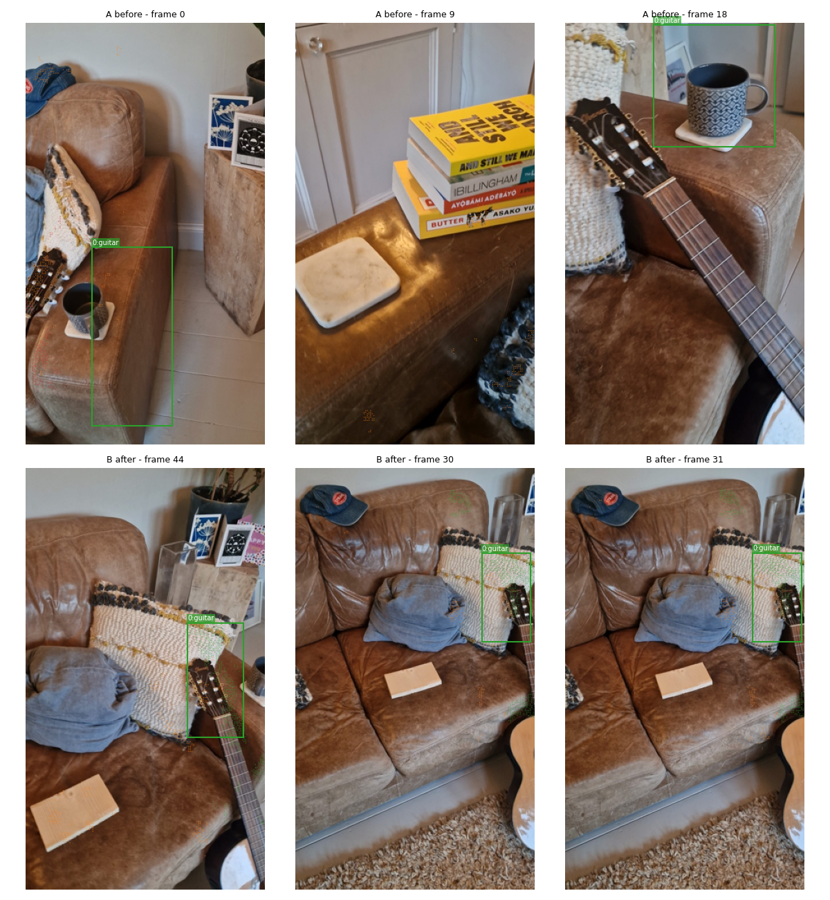
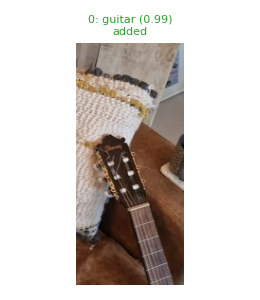
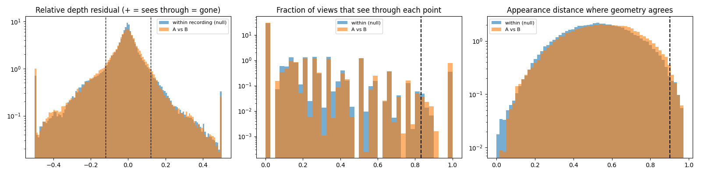

# p1b_lightBb_vs_lightAa

**scene01_light_before_b** (A, before) vs **scene01_light_after_a** (B, after) - pair type **change**, 28 frames per video, variant `base`.

Distances are in cm, from a floor fit and an assumed phone height (scale 2.0134 m/unit, range [1.6406, 2.3863]).

| Measure | Value |
|---|---|
| Observed share (A / B) | 84.3% / 81.1% |
| Changed share of observed points (A / B) | 2.09% / 2.34% |
| Alignment residual across / within recordings | 0.0459 / 0.0402 |
| Thresholds (depth tau, see-through fraction, appearance) | 0.12069 / 0.83333 / 0.90289 |
| Changes (moved / removed / added / appearance) | 0 / 0 / 1 / 0 |
| Reconstruction time | 27.8 s (GPU peak 9.57 GB) |

Heat maps (recording B): reachable 7%, approachable 30%, interactable 1%; surface uncertainty median 5.75 cm (90th pct 18.258); surface shift 99th pct 35.797 cm.

Scene report with simulator randomisation ranges: [scene_report.md](scene_report.md)

## Changes

- **0 added** guitar (p=0.992, 1527 pts, centroid +/- 0.038): A guitar appears in the second recording that was not there before.

Interactive 3D: download `viewer.html` and open it in a browser. Dense cloud: `cloud.ply` (colour by the `change` field); heat maps: `fields.ply`.
