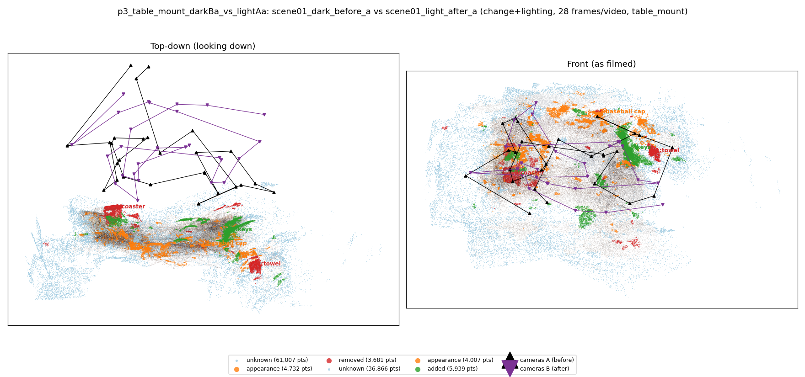
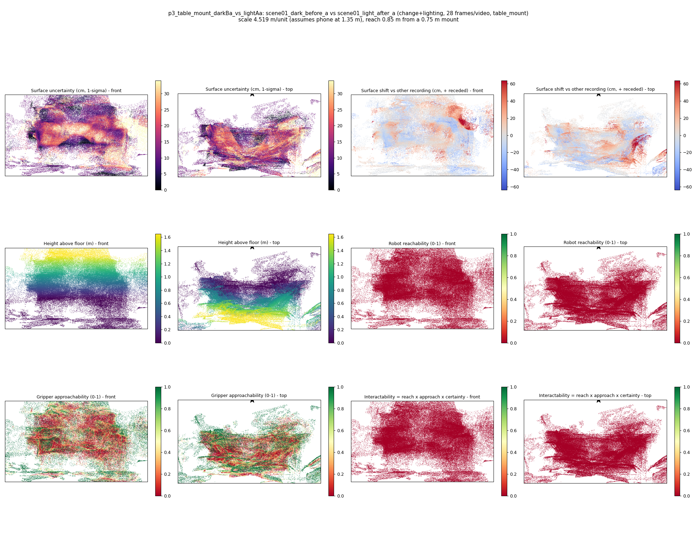
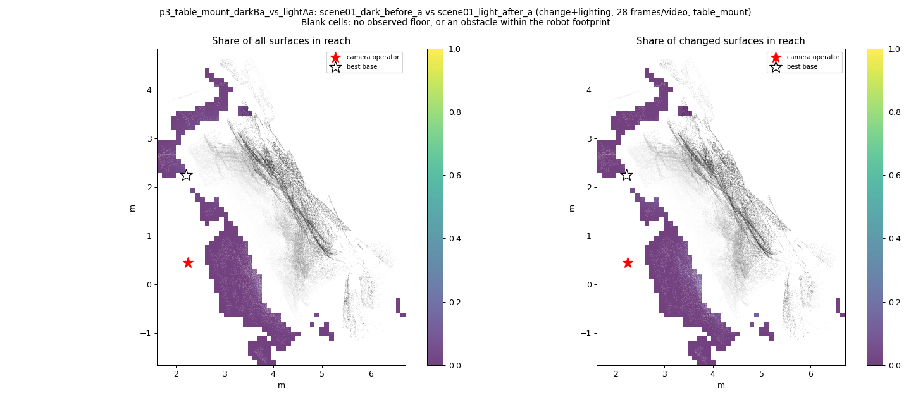
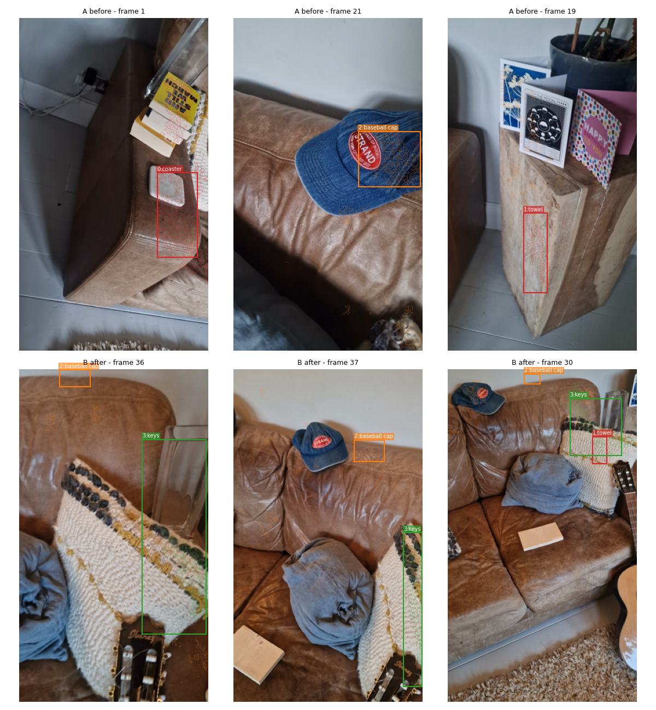
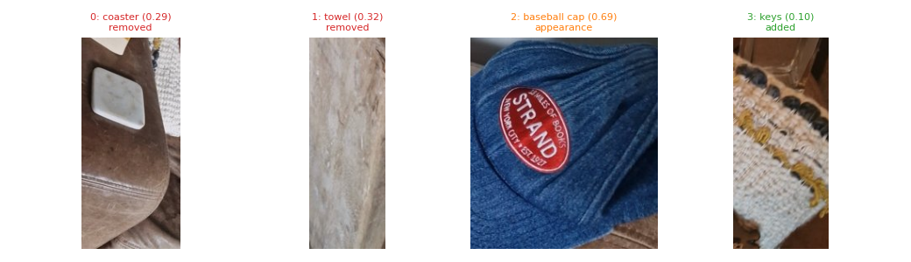
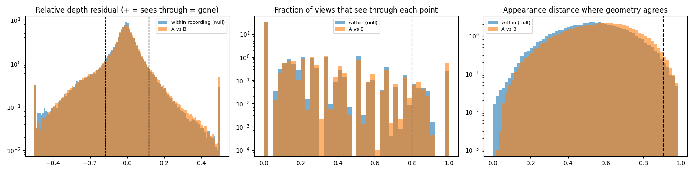

# p3_table_mount_darkBa_vs_lightAa

**scene01_dark_before_a** (A, before) vs **scene01_light_after_a** (B, after) - pair type **change+lighting**, 28 frames per video, variant `table_mount`.

Distances are in cm, from a floor fit and an assumed phone height (scale 4.5192 m/unit, range [3.6823, 5.356]).

| Measure | Value |
|---|---|
| Observed share (A / B) | 84.8% / 90.8% |
| Changed share of observed points (A / B) | 2.48% / 2.74% |
| Alignment residual across / within recordings | 0.0407 / 0.0396 |
| Thresholds (depth tau, see-through fraction, appearance) | 0.11804 / 0.8 / 0.9069 |
| Changes (moved / removed / added / appearance) | 0 / 2 / 1 / 1 |
| Reconstruction time | 27.0 s (GPU peak 9.57 GB) |

Heat maps (recording B): reachable 0%, approachable 31%, interactable 0%; surface uncertainty median 11.335 cm (90th pct 27.147); surface shift 99th pct 63.7 cm.

Scene report with simulator randomisation ranges: [scene_report.md](scene_report.md)

## Changes

- **3 added** keys (p=0.105, 4077 pts, centroid +/- 0.028): A keys appears in the second recording that was not there before.
- **0 removed** coaster (p=0.295, 1190 pts, centroid +/- 0.028): A coaster that was there in the first recording is no longer there.
- **1 removed** towel (p=0.323, 1093 pts, centroid +/- 0.028): A towel that was there in the first recording is no longer there.
- **2 appearance** baseball cap (p=0.686, 947 pts, centroid +/- 0.028): The baseball cap looks different (turned over, deformed or swapped) but occupies the same place.

Interactive 3D: download `viewer.html` and open it in a browser. Dense cloud: `cloud.ply` (colour by the `change` field); heat maps: `fields.ply`.
