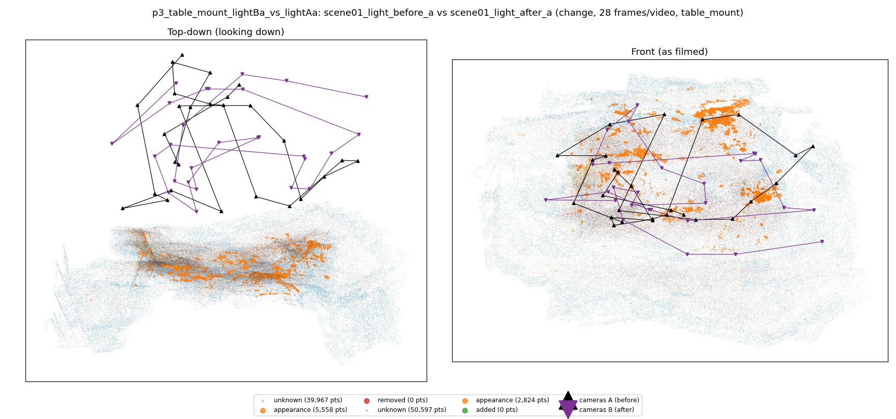
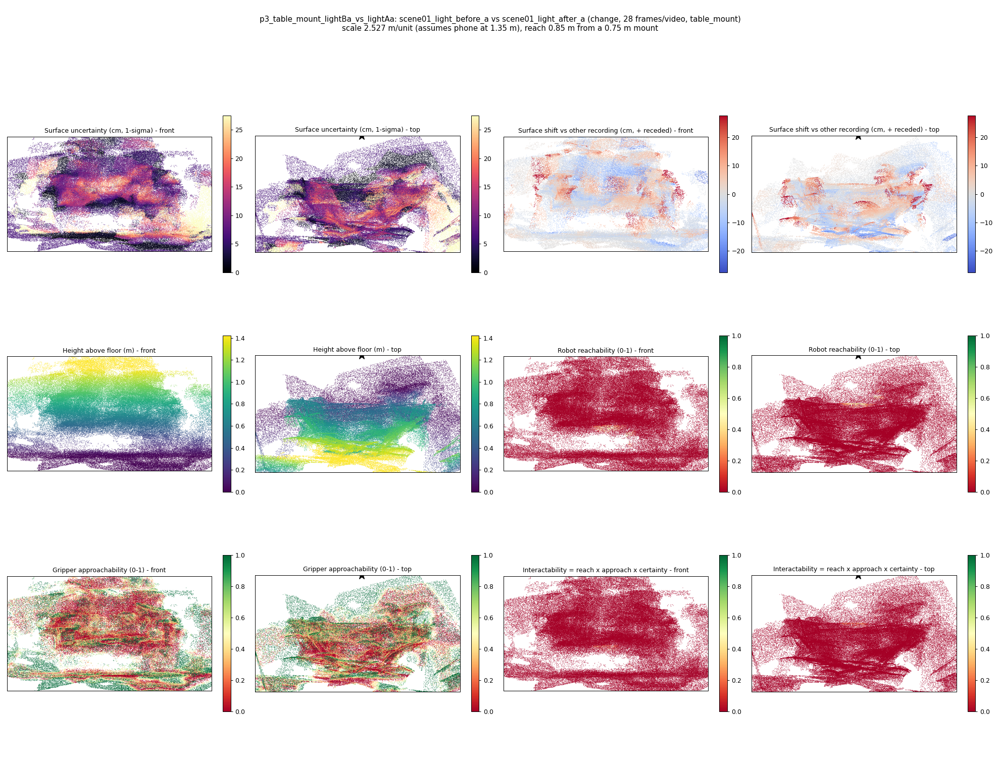
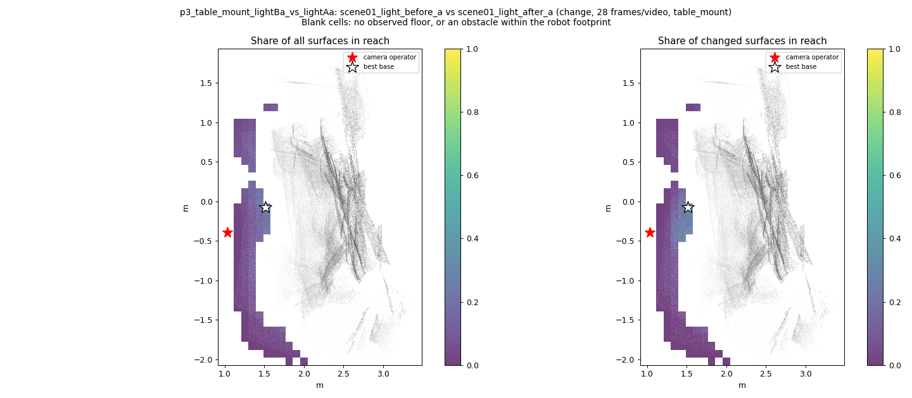
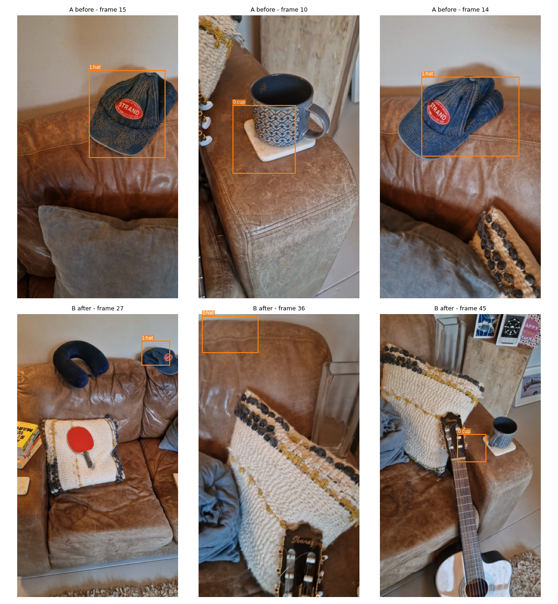
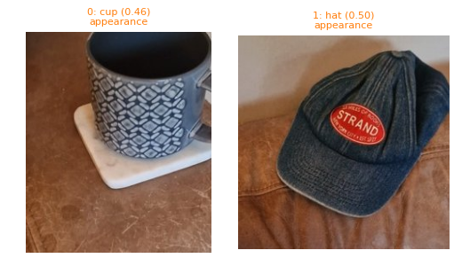
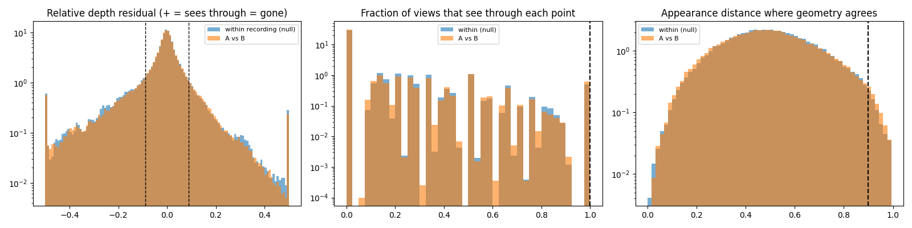

# p3_table_mount_lightBa_vs_lightAa

**scene01_light_before_a** (A, before) vs **scene01_light_after_a** (B, after) - pair type **change**, 28 frames per video, variant `table_mount`.

Distances are in cm, from a floor fit and an assumed phone height (scale 2.5271 m/unit, range [2.0591, 2.995]).

| Measure | Value |
|---|---|
| Observed share (A / B) | 90.0% / 87.4% |
| Changed share of observed points (A / B) | 1.54% / 0.81% |
| Alignment residual across / within recordings | 0.029 / 0.0293 |
| Thresholds (depth tau, see-through fraction, appearance) | 0.08806 / 1.0 / 0.89893 |
| Changes (moved / removed / added / appearance) | 0 / 0 / 0 / 2 |
| Reconstruction time | 27.0 s (GPU peak 8.92 GB) |

Heat maps (recording B): reachable 0%, approachable 29%, interactable 0%; surface uncertainty median 6.267 cm (90th pct 20.082); surface shift 99th pct 27.477 cm.

Scene report with simulator randomisation ranges: [scene_report.md](scene_report.md)

## Changes

- **1 appearance** hat (p=0.503, 2261 pts, centroid +/- 0.025): The hat looks different (turned over, deformed or swapped) but occupies the same place.
- **0 appearance** cup (p=0.455, 1136 pts, centroid +/- 0.025): The cup looks different (turned over, deformed or swapped) but occupies the same place.

Interactive 3D: download `viewer.html` and open it in a browser. Dense cloud: `cloud.ply` (colour by the `change` field); heat maps: `fields.ply`.
