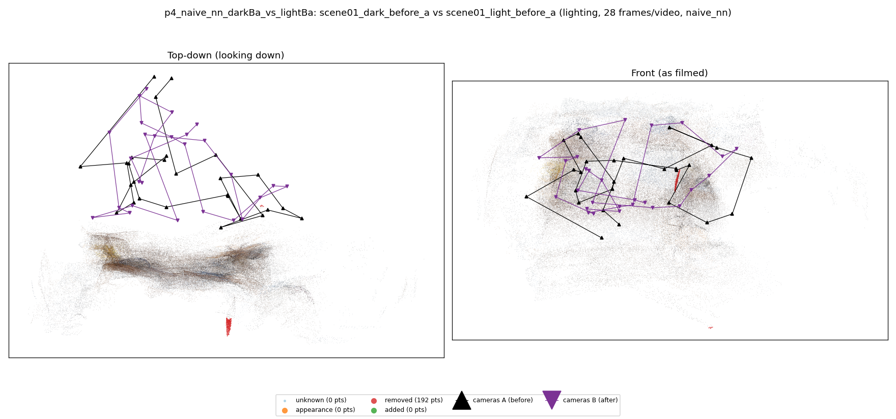
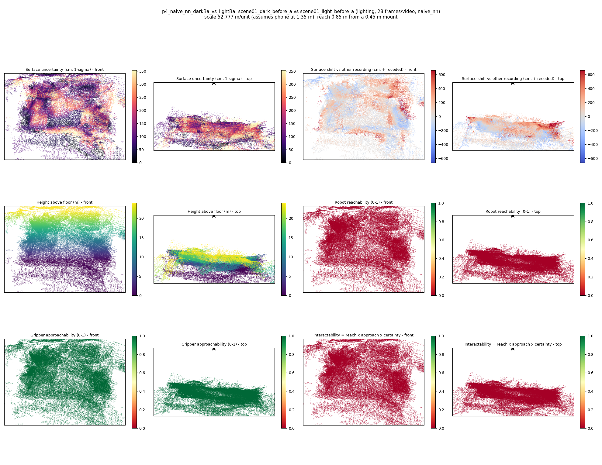

# p4_naive_nn_darkBa_vs_lightBa

**scene01_dark_before_a** (A, before) vs **scene01_light_before_a** (B, after) - pair type **lighting**, 28 frames per video, variant `naive_nn`.

Distances are in cm, from a floor fit and an assumed phone height (scale 52.7766 m/unit, range [43.0031, 62.55]).

| Measure | Value |
|---|---|
| Observed share (A / B) | 100.0% / 100.0% |
| Changed share of observed points (A / B) | 0.06% / 0.00% |
| Alignment residual across / within recordings | 0.0368 / 0.0359 |
| Thresholds (depth tau, see-through fraction, appearance) | 0.10766 / 0.8 / 0.8985 |
| Changes (moved / removed / added / appearance) | 0 / 0 / 0 / 0 |
| Reconstruction time | 28.5 s (GPU peak 9.57 GB) |

Nothing was moved between these recordings, so every flagged point is a false change: **false-change rate 0.03%**.

Heat maps (recording B): reachable 0%, approachable 100%, interactable 0%; surface uncertainty median 99.967 cm (90th pct 279.925); surface shift 99th pct 661.997 cm.

## Changes

- none detected
