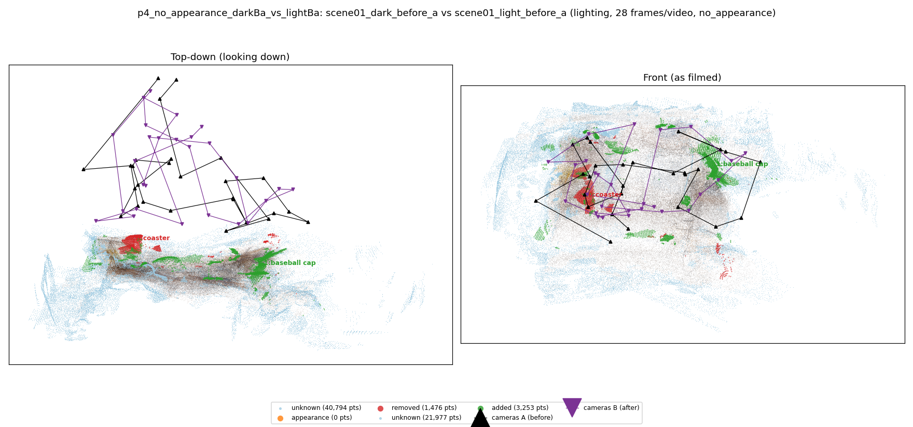
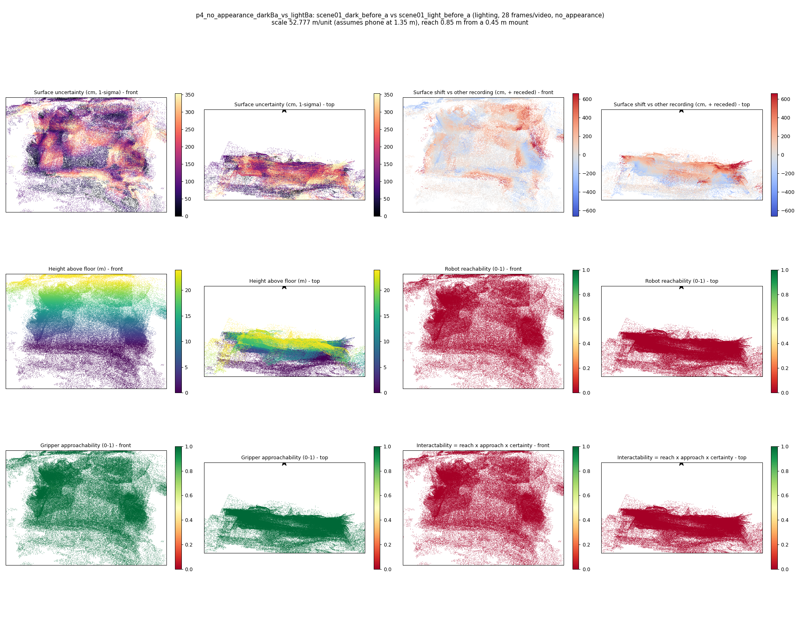

# p4_no_appearance_darkBa_vs_lightBa

**scene01_dark_before_a** (A, before) vs **scene01_light_before_a** (B, after) - pair type **lighting**, 28 frames per video, variant `no_appearance`.

Distances are in cm, from a floor fit and an assumed phone height (scale 52.7766 m/unit, range [43.0031, 62.55]).

| Measure | Value |
|---|---|
| Observed share (A / B) | 86.3% / 92.6% |
| Changed share of observed points (A / B) | 0.57% / 1.18% |
| Alignment residual across / within recordings | 0.0368 / 0.0359 |
| Thresholds (depth tau, see-through fraction, appearance) | 0.10766 / 0.8 / None |
| Changes (moved / removed / added / appearance) | 0 / 1 / 1 / 0 |
| Reconstruction time | 28.5 s (GPU peak 9.57 GB) |

Nothing was moved between these recordings, so every flagged point is a false change: **false-change rate 0.88%**.

Heat maps (recording B): reachable 0%, approachable 100%, interactable 0%; surface uncertainty median 99.967 cm (90th pct 279.925); surface shift 99th pct 661.997 cm.

## Changes

- **1 added** baseball cap (p=0.186, 1467 pts, centroid +/- 0.025): A baseball cap appears in the second recording that was not there before.
- **0 removed** coaster (p=0.303, 864 pts, centroid +/- 0.025): A coaster that was there in the first recording is no longer there.
