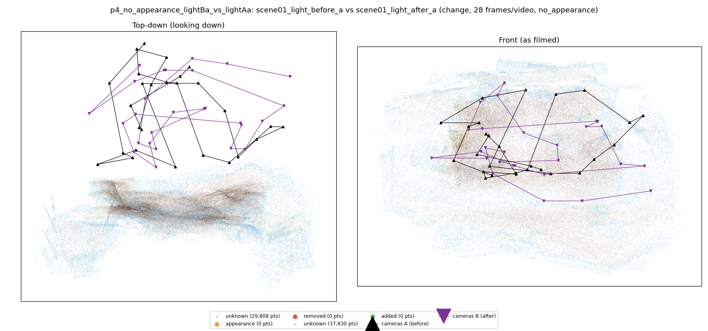
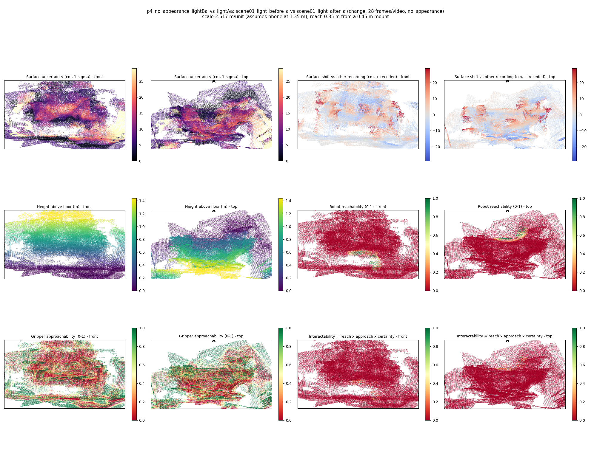

# p4_no_appearance_lightBa_vs_lightAa

**scene01_light_before_a** (A, before) vs **scene01_light_after_a** (B, after) - pair type **change**, 28 frames per video, variant `no_appearance`.

Distances are in cm, from a floor fit and an assumed phone height (scale 2.5171 m/unit, range [2.051, 2.9832]).

| Measure | Value |
|---|---|
| Observed share (A / B) | 90.0% / 87.3% |
| Changed share of observed points (A / B) | 0.00% / 0.00% |
| Alignment residual across / within recordings | 0.0289 / 0.0294 |
| Thresholds (depth tau, see-through fraction, appearance) | 0.08779 / 1.0 / None |
| Changes (moved / removed / added / appearance) | 0 / 0 / 0 / 0 |
| Reconstruction time | 27.0 s (GPU peak 8.92 GB) |

Heat maps (recording B): reachable 1%, approachable 33%, interactable 0%; surface uncertainty median 6.592 cm (90th pct 21.094); surface shift 99th pct 28.8 cm.

## Changes

- none detected
