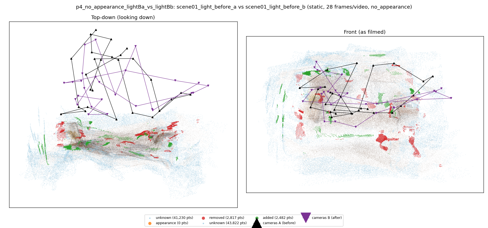
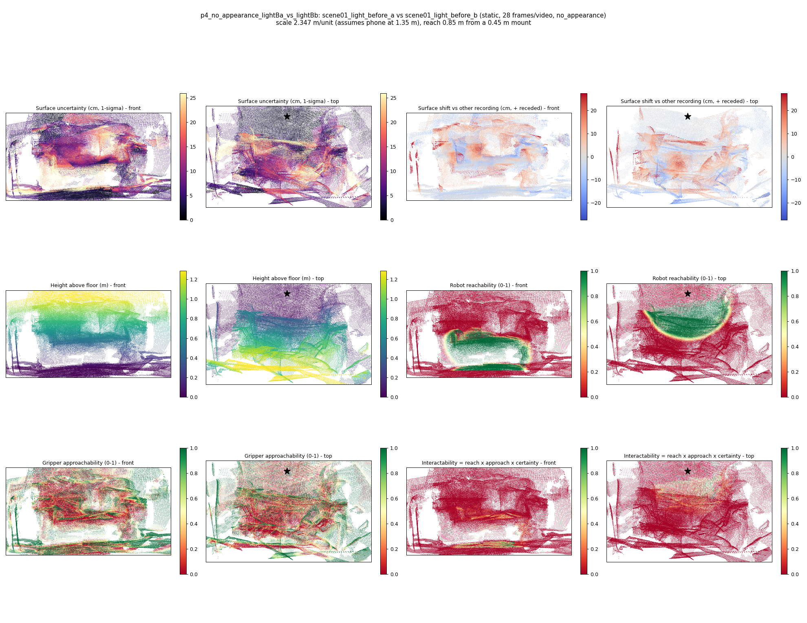

# p4_no_appearance_lightBa_vs_lightBb

**scene01_light_before_a** (A, before) vs **scene01_light_before_b** (B, after) - pair type **static**, 28 frames per video, variant `no_appearance`.

Distances are in cm, from a floor fit and an assumed phone height (scale 2.3471 m/unit, range [1.9124, 2.7817]).

| Measure | Value |
|---|---|
| Observed share (A / B) | 86.2% / 85.3% |
| Changed share of observed points (A / B) | 1.10% / 0.98% |
| Alignment residual across / within recordings | 0.0339 / 0.034 |
| Thresholds (depth tau, see-through fraction, appearance) | 0.10161 / 0.83333 / None |
| Changes (moved / removed / added / appearance) | 0 / 1 / 0 / 0 |
| Reconstruction time | 24.7 s (GPU peak 9.57 GB) |

Nothing was moved between these recordings, so every flagged point is a false change: **false-change rate 1.04%**.

Heat maps (recording B): reachable 21%, approachable 36%, interactable 1%; surface uncertainty median 5.706 cm (90th pct 20.775); surface shift 99th pct 27.364 cm.

## Changes

- **0 removed** guitar (p=0.991, 672 pts, centroid +/- 0.027): A guitar that was there in the first recording is no longer there.
