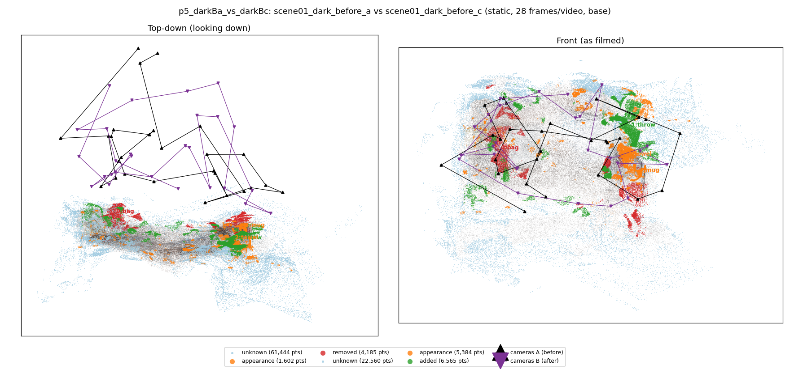
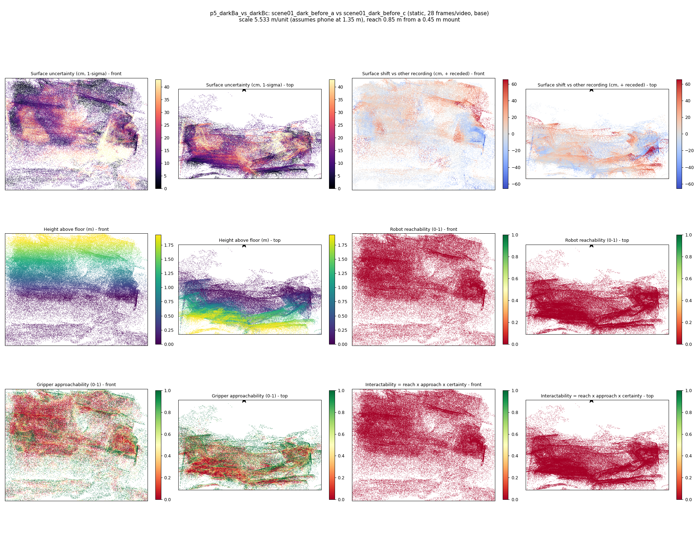
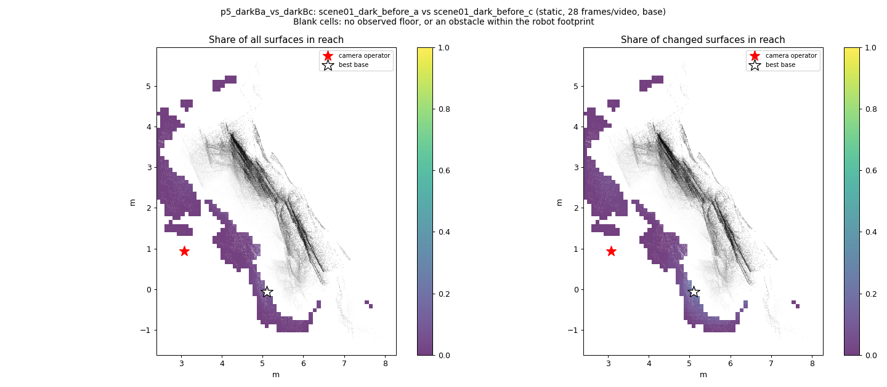
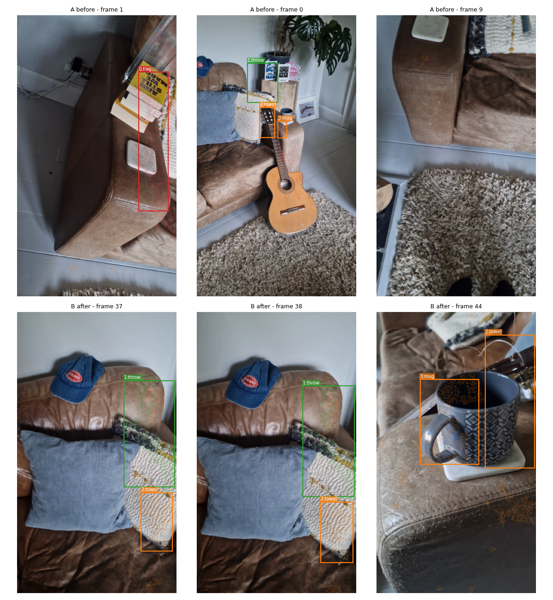
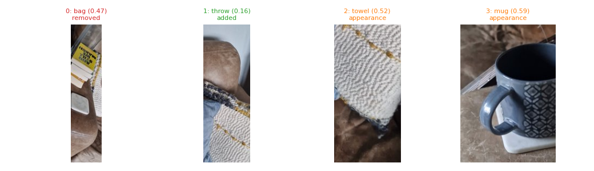
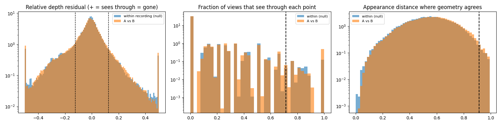

# p5_darkBa_vs_darkBc

**scene01_dark_before_a** (A, before) vs **scene01_dark_before_c** (B, after) - pair type **static**, 28 frames per video, variant `base`.

Distances are in cm, from a floor fit and an assumed phone height (scale 5.5326 m/unit, range [4.5081, 6.5572]).

| Measure | Value |
|---|---|
| Observed share (A / B) | 84.6% / 94.4% |
| Changed share of observed points (A / B) | 1.71% / 3.17% |
| Alignment residual across / within recordings | 0.0442 / 0.0415 |
| Thresholds (depth tau, see-through fraction, appearance) | 0.12424 / 0.71429 / 0.91504 |
| Changes (moved / removed / added / appearance) | 0 / 1 / 1 / 2 |
| Reconstruction time | 25.5 s (GPU peak 9.57 GB) |

Nothing was moved between these recordings, so every flagged point is a false change: **false-change rate 2.44%**.

Heat maps (recording B): reachable 0%, approachable 30%, interactable 0%; surface uncertainty median 10.074 cm (90th pct 31.655); surface shift 99th pct 65.647 cm.

Scene report with simulator randomisation ranges: [scene_report.md](scene_report.md)

## Changes

- **1 added** throw (p=0.162, 3417 pts, centroid +/- 0.026): A throw appears in the second recording that was not there before.
- **3 appearance** mug (p=0.593, 1632 pts, centroid +/- 0.026): The mug looks different (turned over, deformed or swapped) but occupies the same place.
- **0 removed** bag (p=0.465, 1594 pts, centroid +/- 0.026): A bag that was there in the first recording is no longer there.
- **2 appearance** towel (p=0.517, 1429 pts, centroid +/- 0.026): The towel looks different (turned over, deformed or swapped) but occupies the same place.

Interactive 3D: download `viewer.html` and open it in a browser. Dense cloud: `cloud.ply` (colour by the `change` field); heat maps: `fields.ply`.
