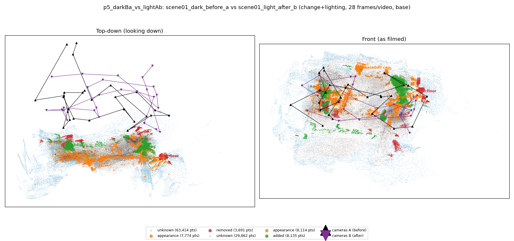
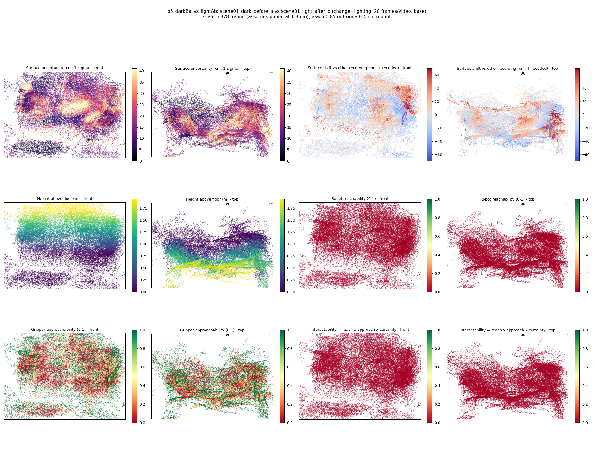
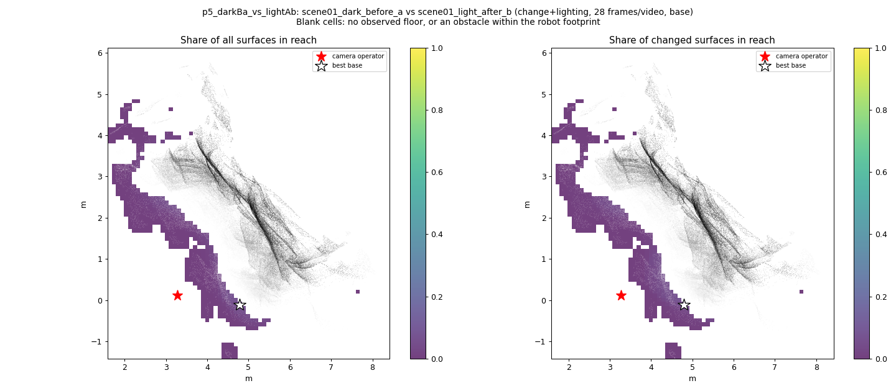
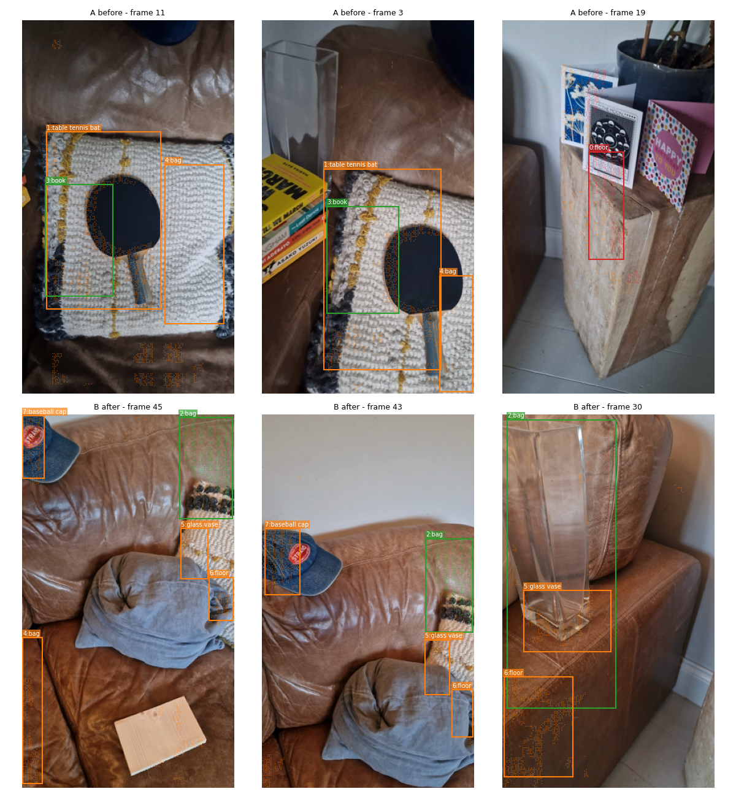
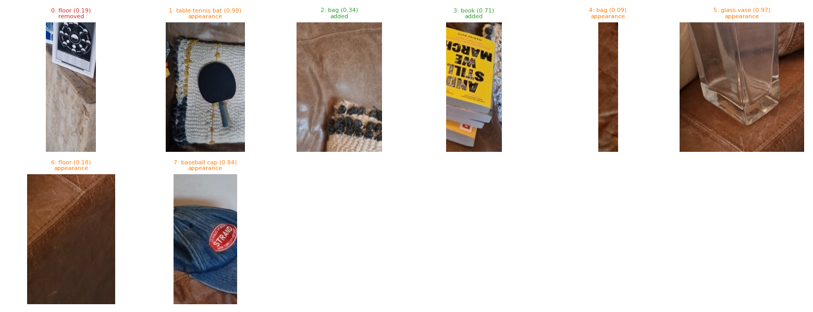
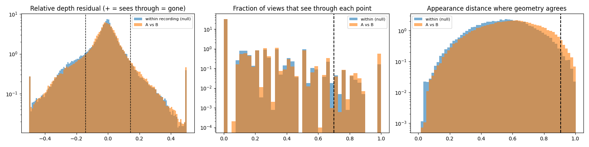

# p5_darkBa_vs_lightAb

**scene01_dark_before_a** (A, before) vs **scene01_light_after_b** (B, after) - pair type **change+lighting**, 28 frames per video, variant `base`.

Distances are in cm, from a floor fit and an assumed phone height (scale 5.3781 m/unit, range [4.3822, 6.3741]).

| Measure | Value |
|---|---|
| Observed share (A / B) | 84.2% / 92.5% |
| Changed share of observed points (A / B) | 3.41% / 4.39% |
| Alignment residual across / within recordings | 0.05 / 0.0477 |
| Thresholds (depth tau, see-through fraction, appearance) | 0.14258 / 0.7 / 0.9072 |
| Changes (moved / removed / added / appearance) | 0 / 1 / 2 / 5 |
| Reconstruction time | 24.8 s (GPU peak 9.57 GB) |

Heat maps (recording B): reachable 0%, approachable 35%, interactable 0%; surface uncertainty median 13.563 cm (90th pct 34.05); surface shift 99th pct 69.686 cm.

Scene report with simulator randomisation ranges: [scene_report.md](scene_report.md)

## Changes

- **2 added** bag (p=0.345, 4832 pts, centroid +/- 0.032): A bag appears in the second recording that was not there before.
- **1 appearance** table tennis bat (p=0.977, 3800 pts, centroid +/- 0.032): The table tennis bat looks different (turned over, deformed or swapped) but occupies the same place.
- **6 appearance** floor (p=0.182, 1663 pts, centroid +/- 0.032): The floor looks different (turned over, deformed or swapped) but occupies the same place.
- **7 appearance** baseball cap (p=0.838, 1429 pts, centroid +/- 0.032): The baseball cap looks different (turned over, deformed or swapped) but occupies the same place.
- **4 appearance** bag (p=0.093, 912 pts, centroid +/- 0.032): The bag looks different (turned over, deformed or swapped) but occupies the same place.
- **3 added** book (p=0.706, 901 pts, centroid +/- 0.032): A book appears in the second recording that was not there before.
- **0 removed** floor (p=0.192, 895 pts, centroid +/- 0.032): A floor that was there in the first recording is no longer there.
- **5 appearance** glass vase (p=0.975, 849 pts, centroid +/- 0.032): The glass vase looks different (turned over, deformed or swapped) but occupies the same place.

Interactive 3D: download `viewer.html` and open it in a browser. Dense cloud: `cloud.ply` (colour by the `change` field); heat maps: `fields.ply`.
