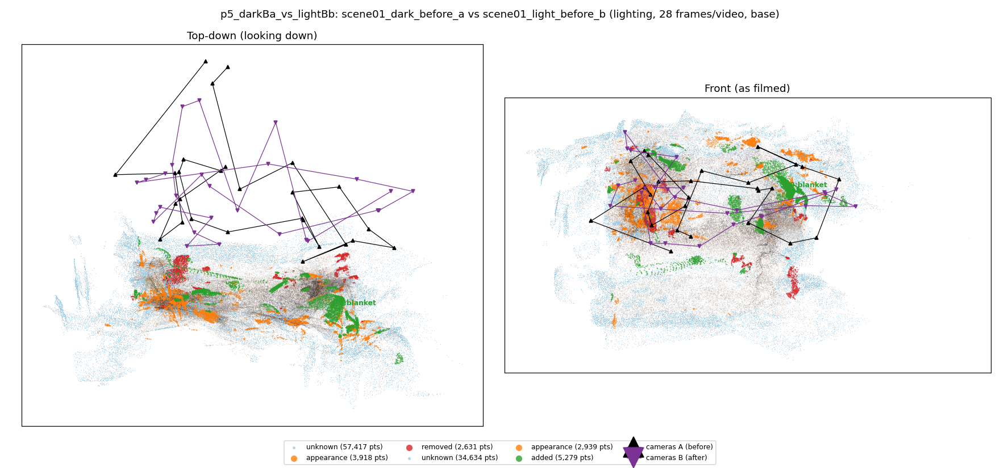
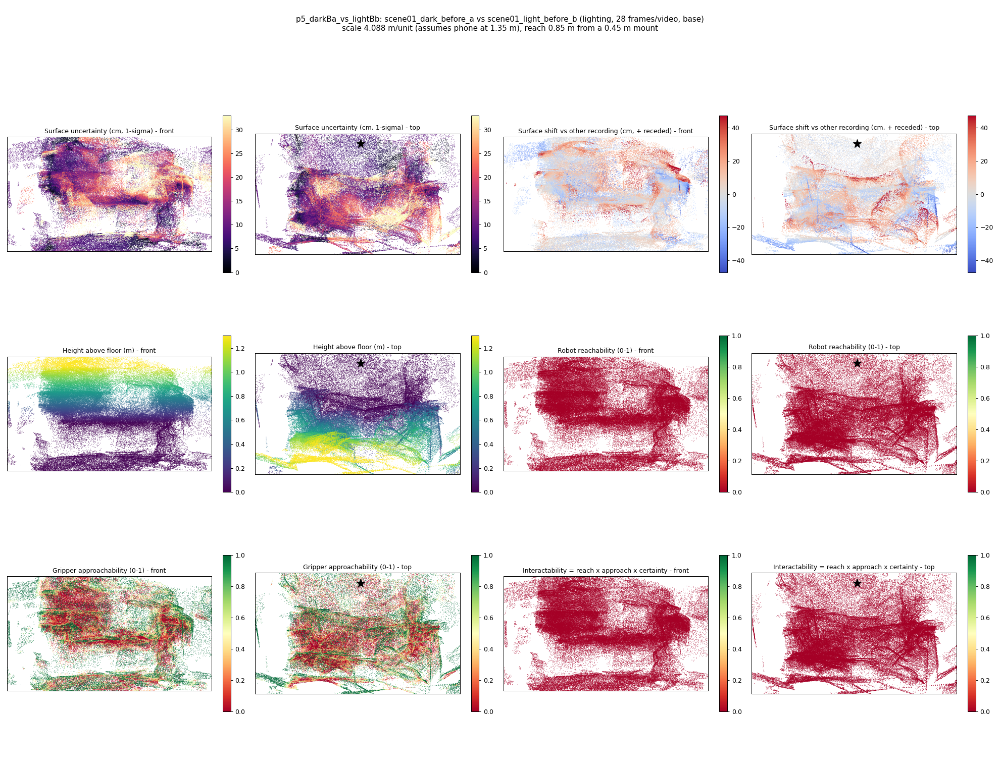
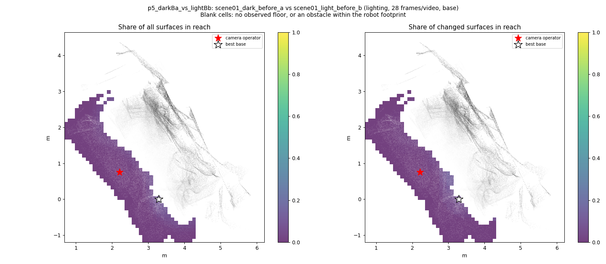
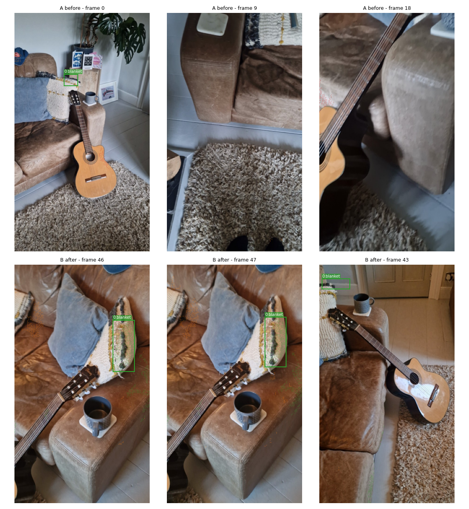
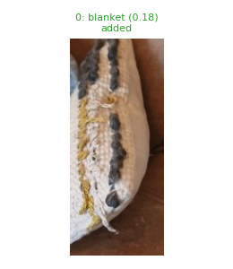
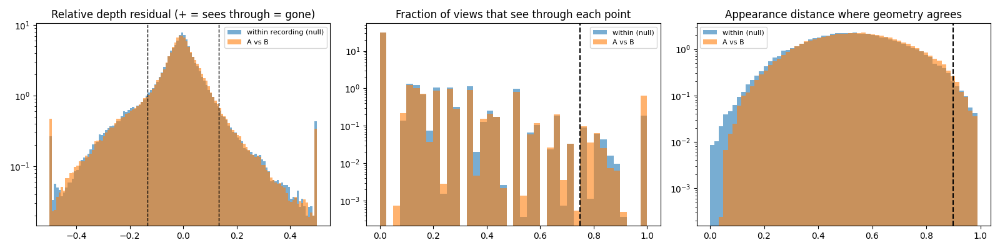

# p5_darkBa_vs_lightBb

**scene01_dark_before_a** (A, before) vs **scene01_light_before_b** (B, after) - pair type **lighting**, 28 frames per video, variant `base`.

Distances are in cm, from a floor fit and an assumed phone height (scale 4.0883 m/unit, range [3.3312, 4.8454]).

| Measure | Value |
|---|---|
| Observed share (A / B) | 85.7% / 91.3% |
| Changed share of observed points (A / B) | 1.91% / 2.25% |
| Alignment residual across / within recordings | 0.0452 / 0.0444 |
| Thresholds (depth tau, see-through fraction, appearance) | 0.13288 / 0.75 / 0.89893 |
| Changes (moved / removed / added / appearance) | 0 / 0 / 1 / 0 |
| Reconstruction time | 26.8 s (GPU peak 9.57 GB) |

Nothing was moved between these recordings, so every flagged point is a false change: **false-change rate 2.08%**.

Heat maps (recording B): reachable 0%, approachable 32%, interactable 0%; surface uncertainty median 9.456 cm (90th pct 26.153); surface shift 99th pct 47.171 cm.

Scene report with simulator randomisation ranges: [scene_report.md](scene_report.md)

## Changes

- **0 added** blanket (p=0.185, 1214 pts, centroid +/- 0.030): A blanket appears in the second recording that was not there before.

Interactive 3D: download `viewer.html` and open it in a browser. Dense cloud: `cloud.ply` (colour by the `change` field); heat maps: `fields.ply`.
