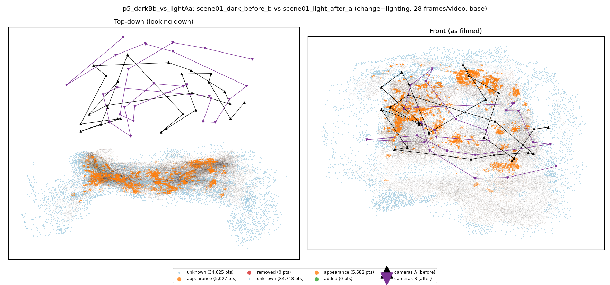
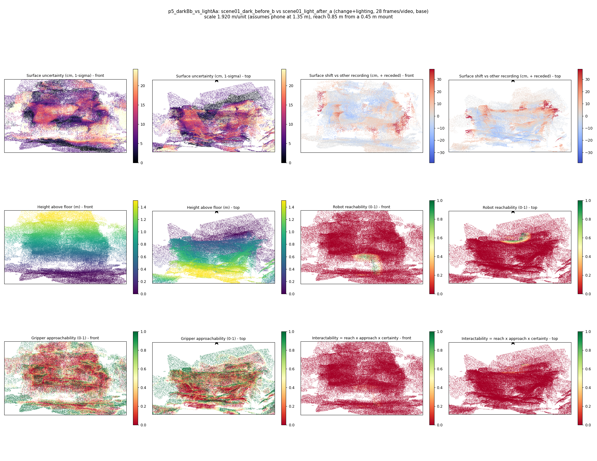
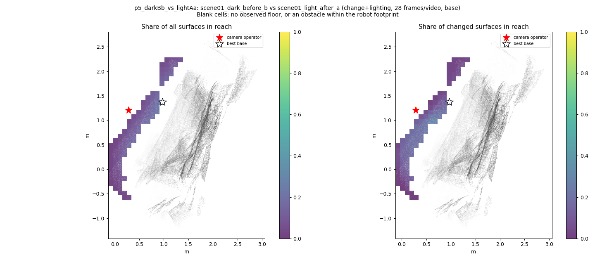
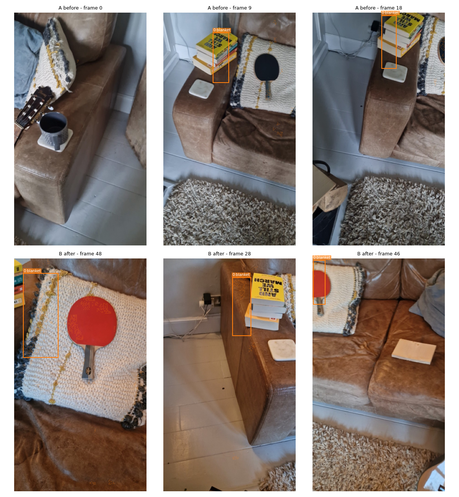
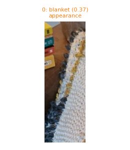
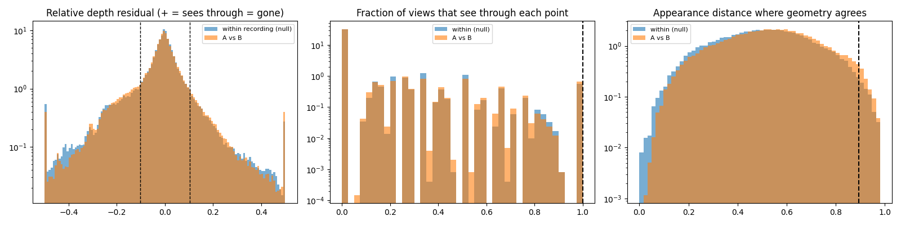

# p5_darkBb_vs_lightAa

**scene01_dark_before_b** (A, before) vs **scene01_light_after_a** (B, after) - pair type **change+lighting**, 28 frames per video, variant `base`.

Distances are in cm, from a floor fit and an assumed phone height (scale 1.9202 m/unit, range [1.5646, 2.2758]).

| Measure | Value |
|---|---|
| Observed share (A / B) | 91.3% / 78.8% |
| Changed share of observed points (A / B) | 1.38% / 1.80% |
| Alignment residual across / within recordings | 0.0359 / 0.0343 |
| Thresholds (depth tau, see-through fraction, appearance) | 0.1032 / 1.0 / 0.89502 |
| Changes (moved / removed / added / appearance) | 0 / 0 / 0 / 1 |
| Reconstruction time | 25.2 s (GPU peak 9.57 GB) |

Heat maps (recording B): reachable 1%, approachable 29%, interactable 0%; surface uncertainty median 6.235 cm (90th pct 18.488); surface shift 99th pct 38.36 cm.

Scene report with simulator randomisation ranges: [scene_report.md](scene_report.md)

## Changes

- **0 appearance** blanket (p=0.368, 826 pts, centroid +/- 0.036): The blanket looks different (turned over, deformed or swapped) but occupies the same place.

Interactive 3D: download `viewer.html` and open it in a browser. Dense cloud: `cloud.ply` (colour by the `change` field); heat maps: `fields.ply`.
