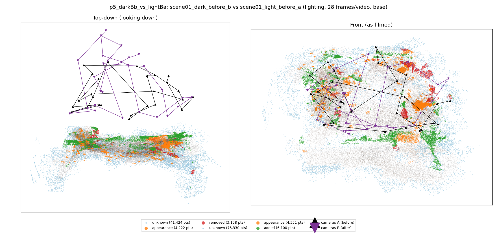
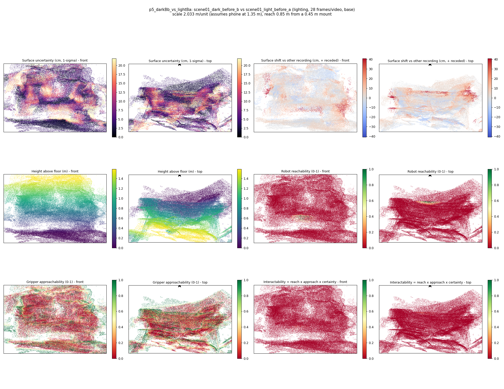
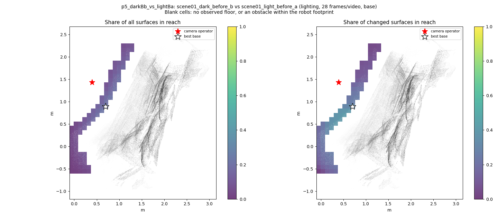
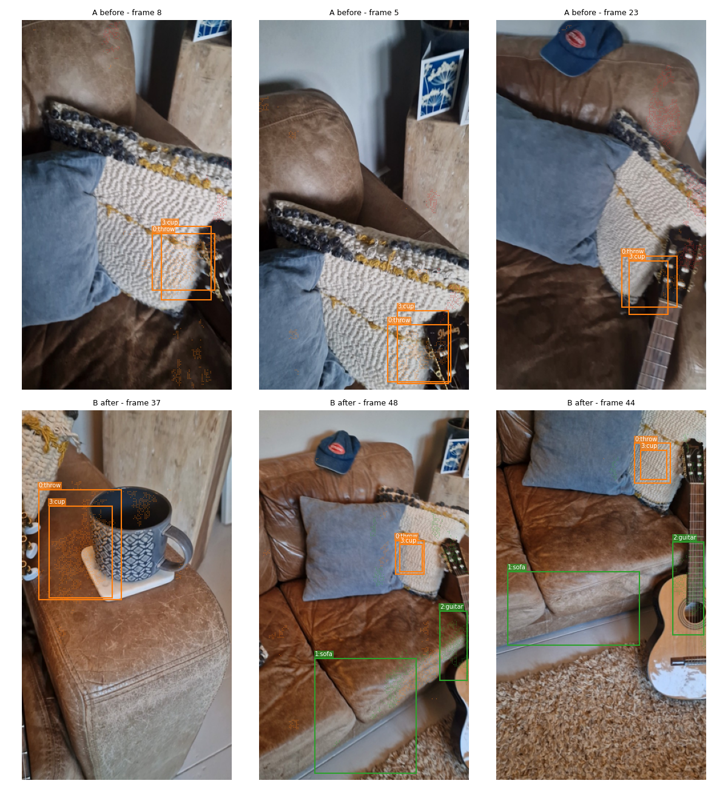
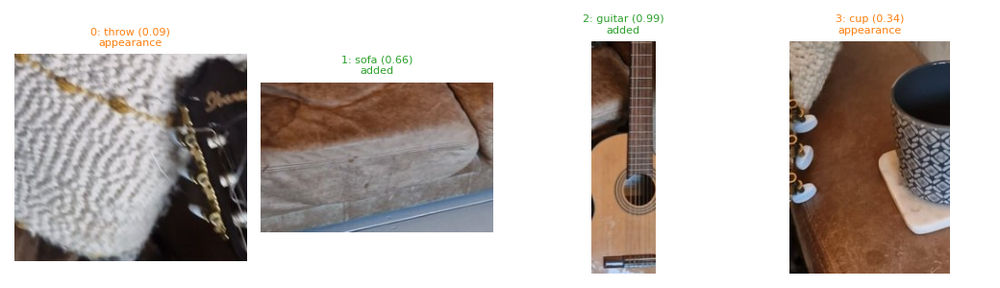
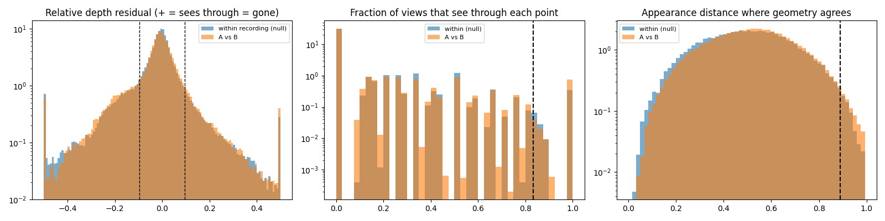

# p5_darkBb_vs_lightBa

**scene01_dark_before_b** (A, before) vs **scene01_light_before_a** (B, after) - pair type **lighting**, 28 frames per video, variant `base`.

Distances are in cm, from a floor fit and an assumed phone height (scale 2.0331 m/unit, range [1.6566, 2.4096]).

| Measure | Value |
|---|---|
| Observed share (A / B) | 89.6% / 81.7% |
| Changed share of observed points (A / B) | 2.06% / 3.20% |
| Alignment residual across / within recordings | 0.0348 / 0.0315 |
| Thresholds (depth tau, see-through fraction, appearance) | 0.09495 / 0.83333 / 0.88809 |
| Changes (moved / removed / added / appearance) | 0 / 0 / 2 / 2 |
| Reconstruction time | 28.4 s (GPU peak 9.57 GB) |

Nothing was moved between these recordings, so every flagged point is a false change: **false-change rate 2.63%**.

Heat maps (recording B): reachable 0%, approachable 23%, interactable 0%; surface uncertainty median 4.396 cm (90th pct 16.568); surface shift 99th pct 40.75 cm.

Scene report with simulator randomisation ranges: [scene_report.md](scene_report.md)

## Changes

- **0 appearance** throw (p=0.094, 1303 pts, centroid +/- 0.031): The throw looks different (turned over, deformed or swapped) but occupies the same place.
- **2 added** guitar (p=0.994, 1209 pts, centroid +/- 0.031): A guitar appears in the second recording that was not there before.
- **3 appearance** cup (p=0.339, 1149 pts, centroid +/- 0.031): The cup looks different (turned over, deformed or swapped) but occupies the same place.
- **1 added** sofa (p=0.655, 963 pts, centroid +/- 0.031): A sofa appears in the second recording that was not there before.

Interactive 3D: download `viewer.html` and open it in a browser. Dense cloud: `cloud.ply` (colour by the `change` field); heat maps: `fields.ply`.
