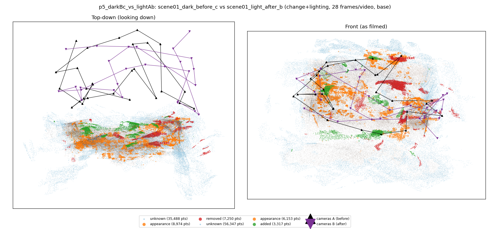
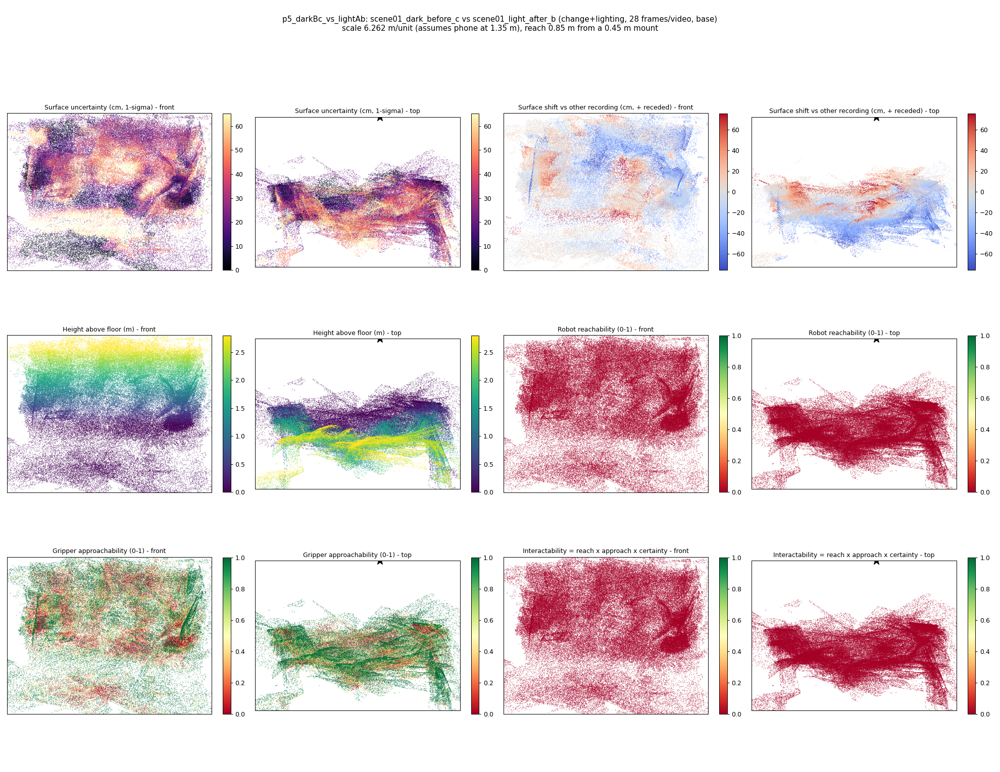
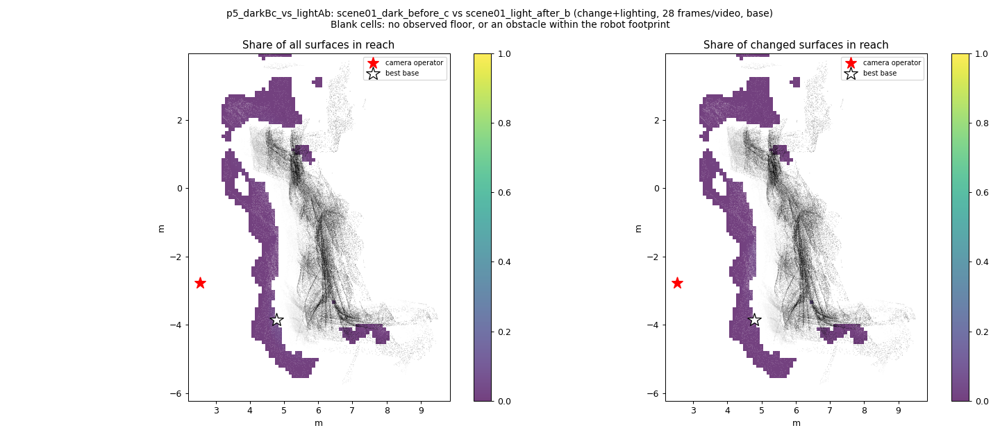
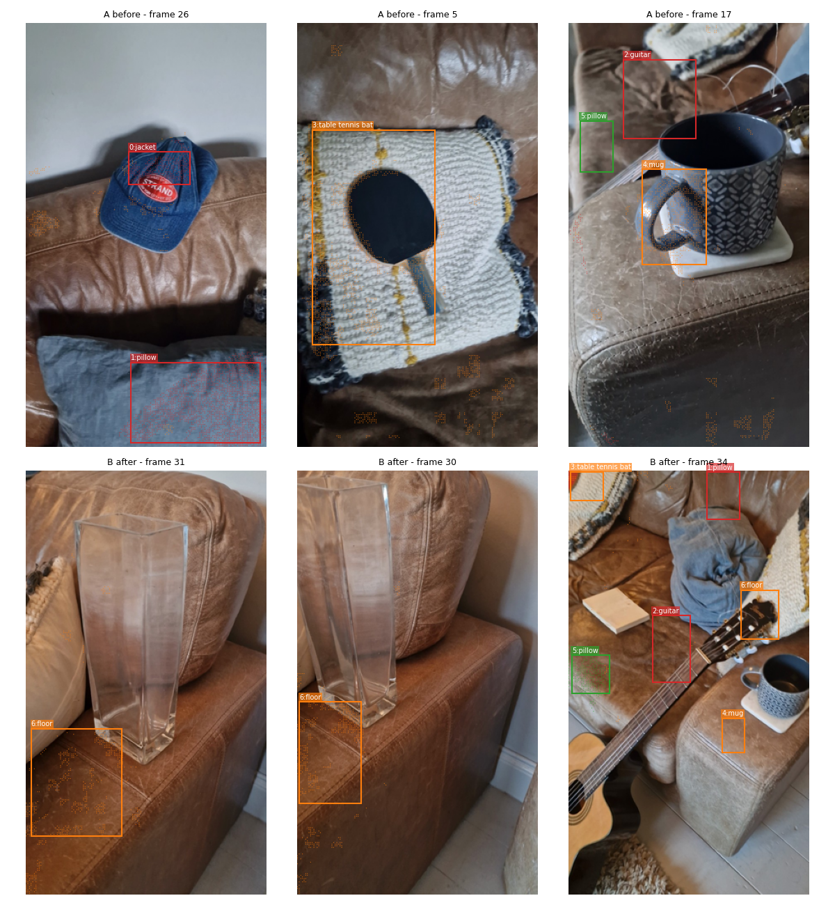
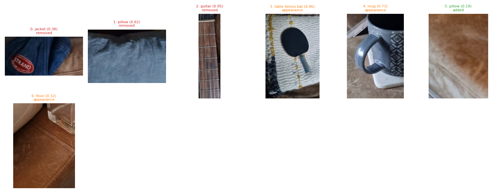
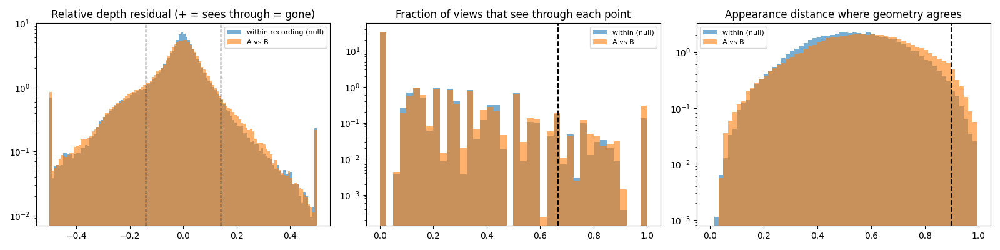

# p5_darkBc_vs_lightAb

**scene01_dark_before_c** (A, before) vs **scene01_light_after_b** (B, after) - pair type **change+lighting**, 28 frames per video, variant `base`.

Distances are in cm, from a floor fit and an assumed phone height (scale 6.2618 m/unit, range [5.1022, 7.4214]).

| Measure | Value |
|---|---|
| Observed share (A / B) | 91.1% / 85.9% |
| Changed share of observed points (A / B) | 4.45% / 2.76% |
| Alignment residual across / within recordings | 0.0531 / 0.0469 |
| Thresholds (depth tau, see-through fraction, appearance) | 0.14076 / 0.66667 / 0.89673 |
| Changes (moved / removed / added / appearance) | 0 / 3 / 1 / 3 |
| Reconstruction time | 25.4 s (GPU peak 9.57 GB) |

Heat maps (recording B): reachable 0%, approachable 49%, interactable 0%; surface uncertainty median 21.067 cm (90th pct 53.925); surface shift 99th pct 75.751 cm.

Scene report with simulator randomisation ranges: [scene_report.md](scene_report.md)

## Changes

- **1 removed** pillow (p=0.616, 3329 pts, centroid +/- 0.039): A pillow that was there in the first recording is no longer there.
- **3 appearance** table tennis bat (p=0.965, 3017 pts, centroid +/- 0.039): The table tennis bat looks different (turned over, deformed or swapped) but occupies the same place.
- **4 appearance** mug (p=0.733, 1081 pts, centroid +/- 0.039): The mug looks different (turned over, deformed or swapped) but occupies the same place.
- **0 removed** jacket (p=0.38, 1076 pts, centroid +/- 0.039): A jacket that was there in the first recording is no longer there.
- **2 removed** guitar (p=0.952, 979 pts, centroid +/- 0.039): A guitar that was there in the first recording is no longer there.
- **6 appearance** floor (p=0.318, 938 pts, centroid +/- 0.039): The floor looks different (turned over, deformed or swapped) but occupies the same place.
- **5 added** pillow (p=0.188, 834 pts, centroid +/- 0.039): A pillow appears in the second recording that was not there before.

Interactive 3D: download `viewer.html` and open it in a browser. Dense cloud: `cloud.ply` (colour by the `change` field); heat maps: `fields.ply`.
