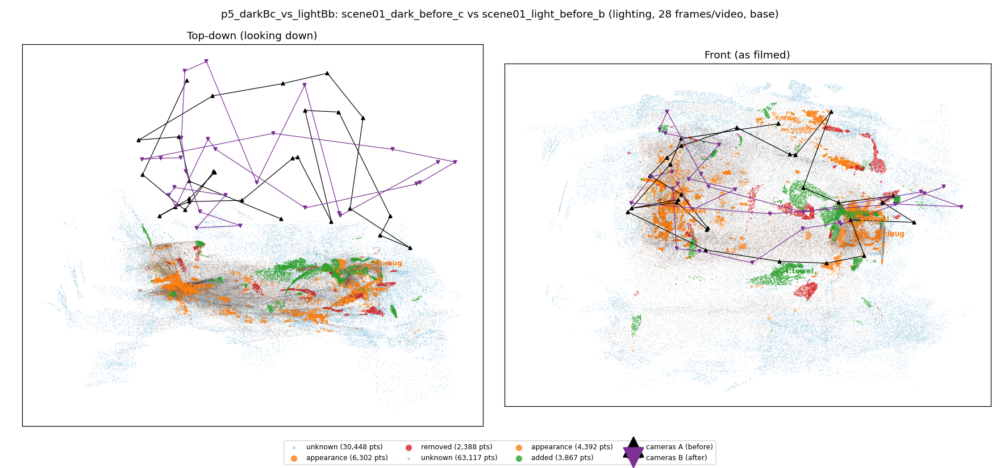
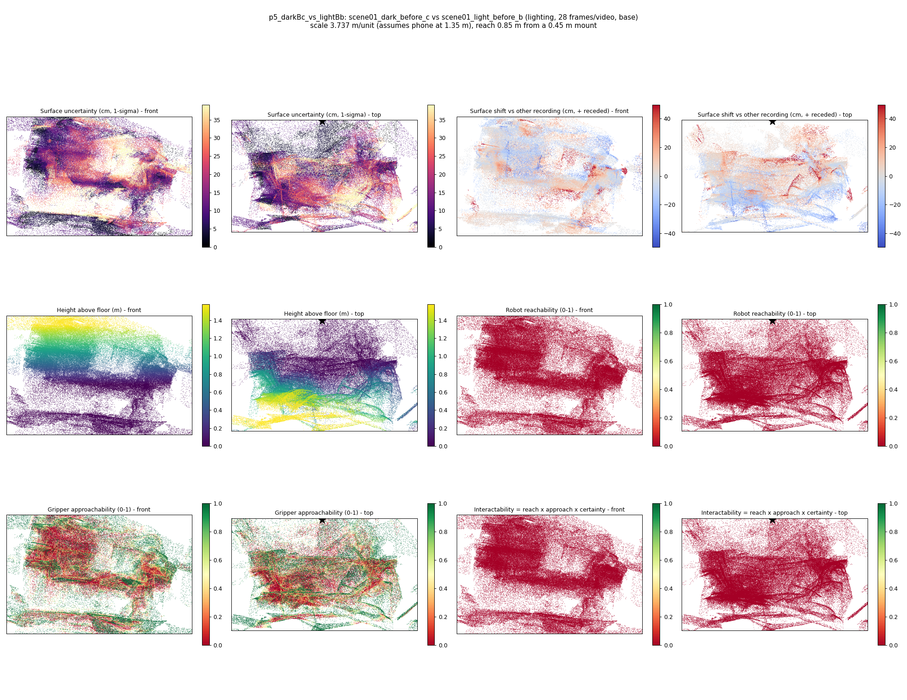
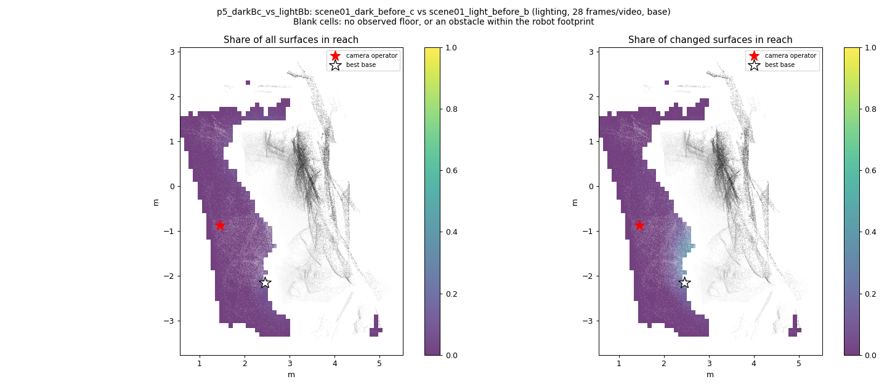
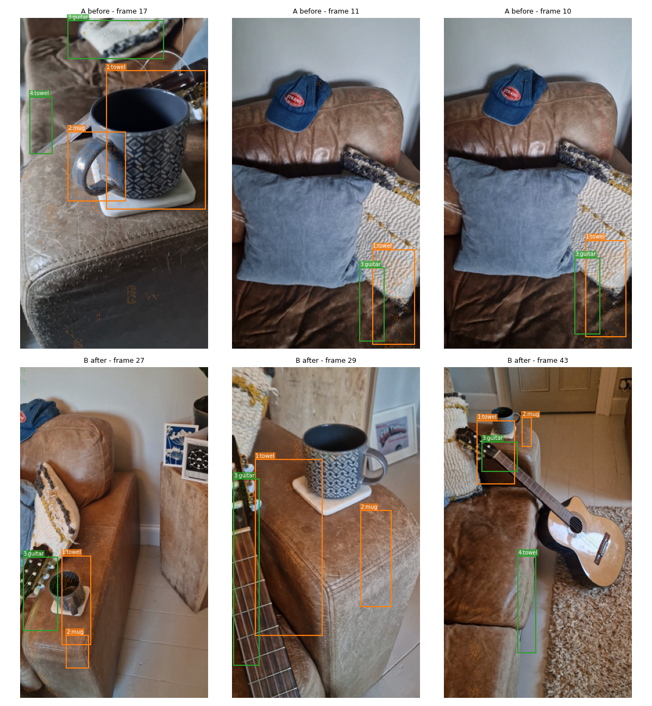
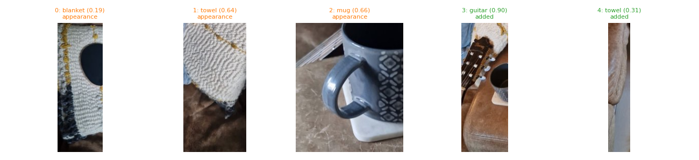
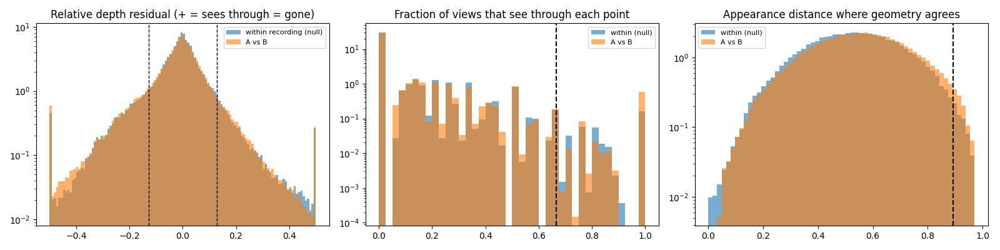

# p5_darkBc_vs_lightBb

**scene01_dark_before_c** (A, before) vs **scene01_light_before_b** (B, after) - pair type **lighting**, 28 frames per video, variant `base`.

Distances are in cm, from a floor fit and an assumed phone height (scale 3.7366 m/unit, range [3.0446, 4.4286]).

| Measure | Value |
|---|---|
| Observed share (A / B) | 92.4% / 84.2% |
| Changed share of observed points (A / B) | 2.35% / 2.45% |
| Alignment residual across / within recordings | 0.0445 / 0.0427 |
| Thresholds (depth tau, see-through fraction, appearance) | 0.12773 / 0.66667 / 0.89343 |
| Changes (moved / removed / added / appearance) | 0 / 0 / 2 / 3 |
| Reconstruction time | 24.6 s (GPU peak 9.57 GB) |

Nothing was moved between these recordings, so every flagged point is a false change: **false-change rate 2.40%**.

Heat maps (recording B): reachable 0%, approachable 34%, interactable 0%; surface uncertainty median 10.614 cm (90th pct 30.607); surface shift 99th pct 49.584 cm.

Scene report with simulator randomisation ranges: [scene_report.md](scene_report.md)

## Changes

- **1 appearance** towel (p=0.639, 1426 pts, centroid +/- 0.035): The towel looks different (turned over, deformed or swapped) but occupies the same place.
- **0 appearance** blanket (p=0.188, 1271 pts, centroid +/- 0.035): The blanket looks different (turned over, deformed or swapped) but occupies the same place.
- **3 added** guitar (p=0.895, 983 pts, centroid +/- 0.035): A guitar appears in the second recording that was not there before.
- **2 appearance** mug (p=0.663, 963 pts, centroid +/- 0.035): The mug looks different (turned over, deformed or swapped) but occupies the same place.
- **4 added** towel (p=0.31, 808 pts, centroid +/- 0.035): A towel appears in the second recording that was not there before.

Interactive 3D: download `viewer.html` and open it in a browser. Dense cloud: `cloud.ply` (colour by the `change` field); heat maps: `fields.ply`.
