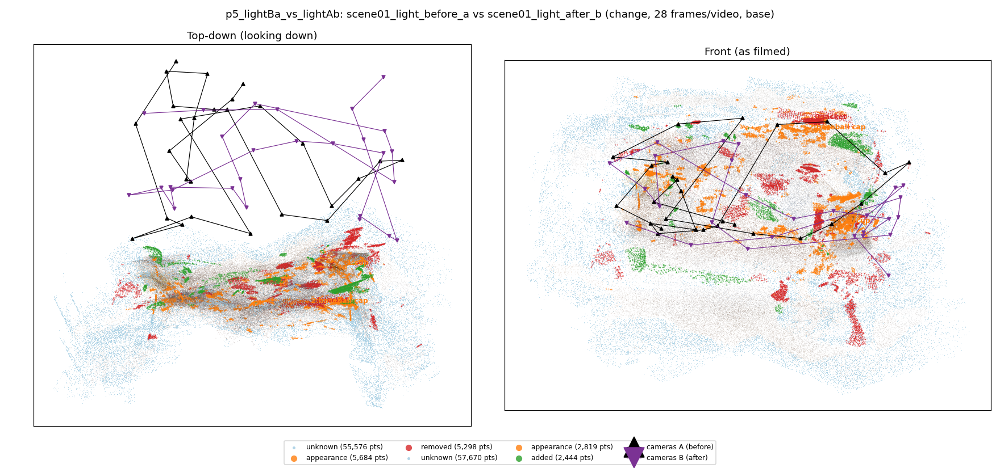
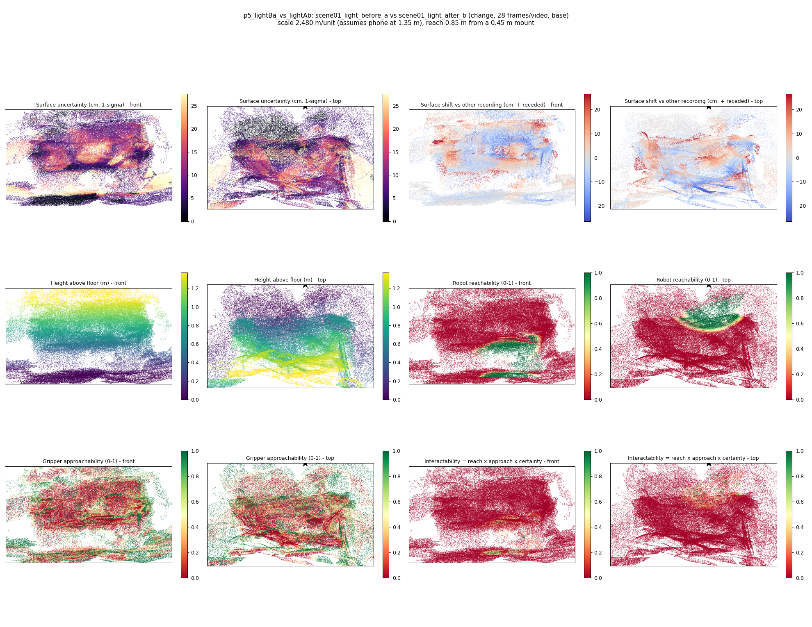
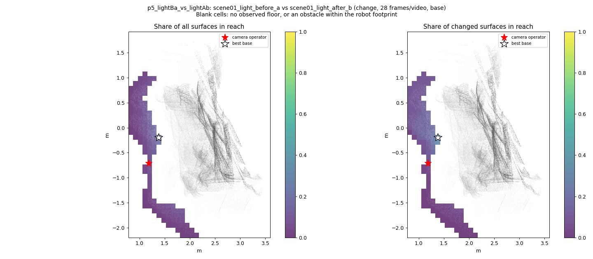
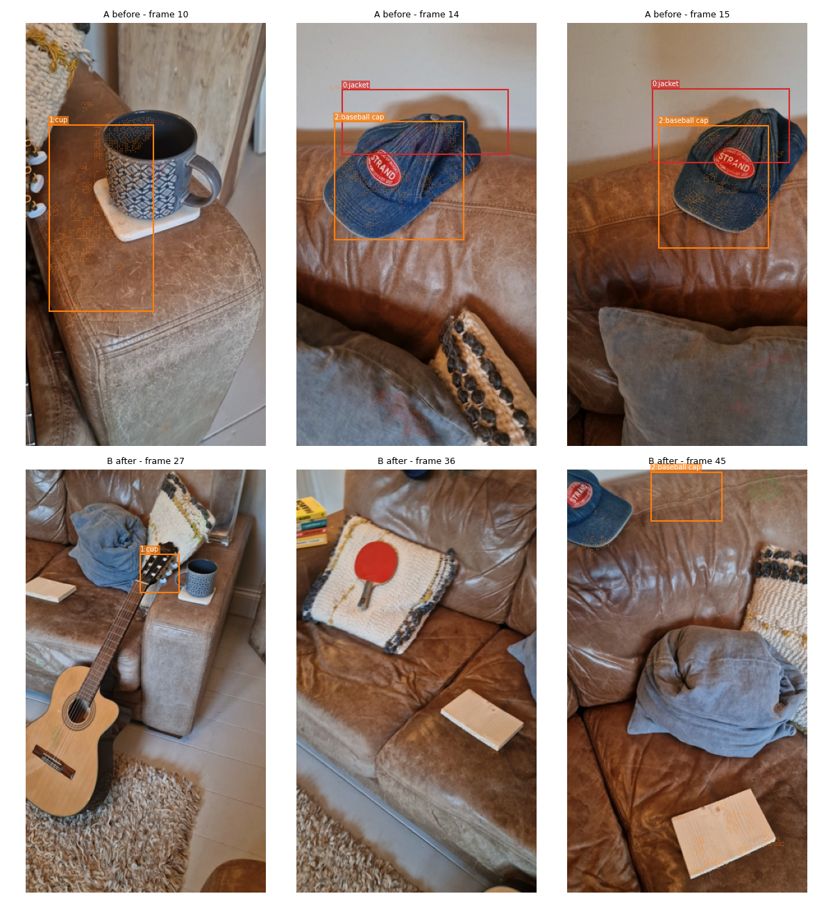
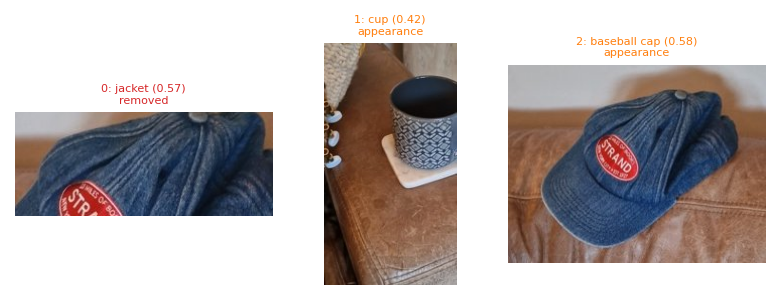
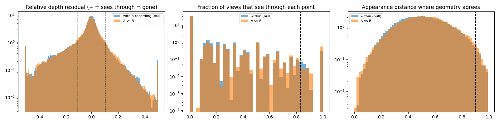

# p5_lightBa_vs_lightAb

**scene01_light_before_a** (A, before) vs **scene01_light_after_b** (B, after) - pair type **change**, 28 frames per video, variant `base`.

Distances are in cm, from a floor fit and an assumed phone height (scale 2.4803 m/unit, range [2.0209, 2.9396]).

| Measure | Value |
|---|---|
| Observed share (A / B) | 86.1% / 85.6% |
| Changed share of observed points (A / B) | 3.19% / 1.54% |
| Alignment residual across / within recordings | 0.0376 / 0.0346 |
| Thresholds (depth tau, see-through fraction, appearance) | 0.10354 / 0.83333 / 0.90181 |
| Changes (moved / removed / added / appearance) | 0 / 1 / 0 / 2 |
| Reconstruction time | 24.4 s (GPU peak 9.57 GB) |

Heat maps (recording B): reachable 9%, approachable 29%, interactable 1%; surface uncertainty median 6.841 cm (90th pct 22.45); surface shift 99th pct 26.379 cm.

Scene report with simulator randomisation ranges: [scene_report.md](scene_report.md)

## Changes

- **1 appearance** cup (p=0.418, 1826 pts, centroid +/- 0.029): The cup looks different (turned over, deformed or swapped) but occupies the same place.
- **2 appearance** baseball cap (p=0.576, 1155 pts, centroid +/- 0.029): The baseball cap looks different (turned over, deformed or swapped) but occupies the same place.
- **0 removed** jacket (p=0.573, 884 pts, centroid +/- 0.029): A jacket that was there in the first recording is no longer there.

Interactive 3D: download `viewer.html` and open it in a browser. Dense cloud: `cloud.ply` (colour by the `change` field); heat maps: `fields.ply`.
