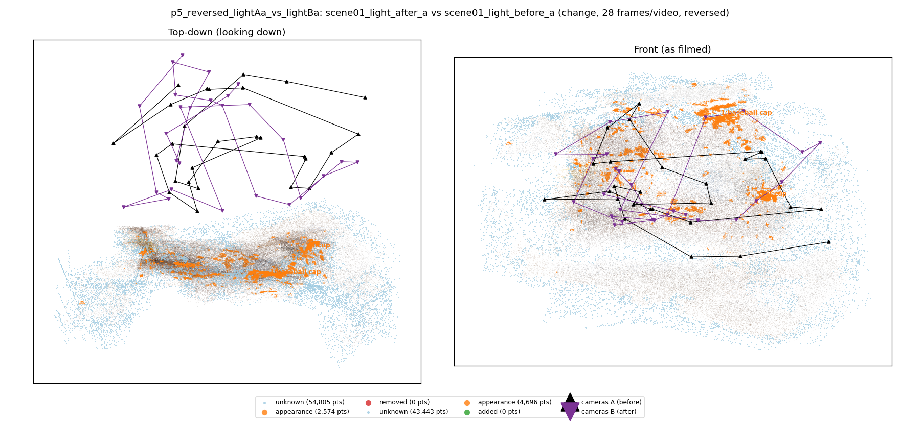
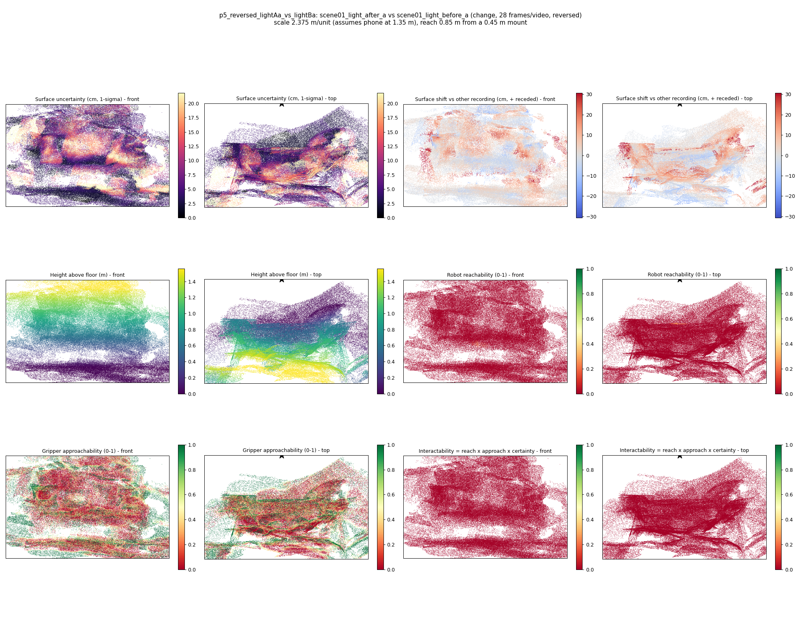
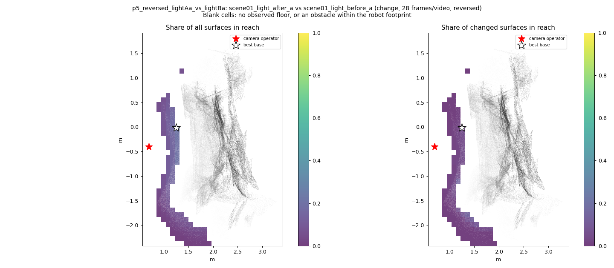
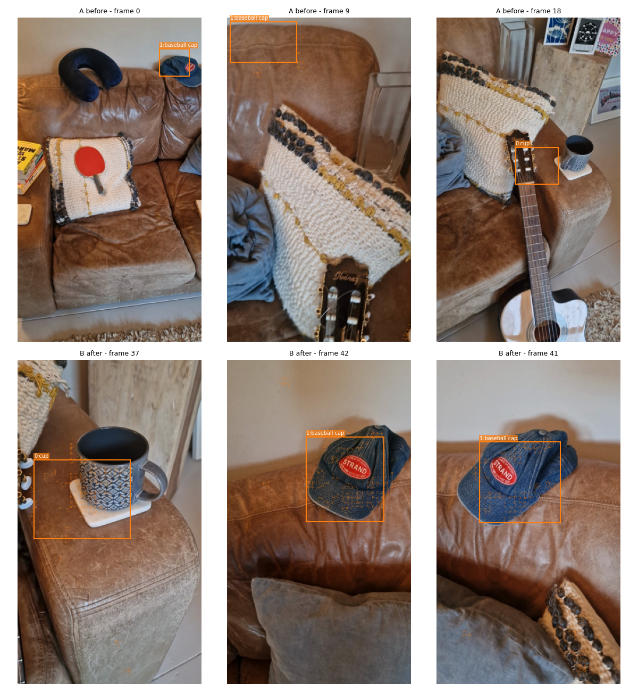
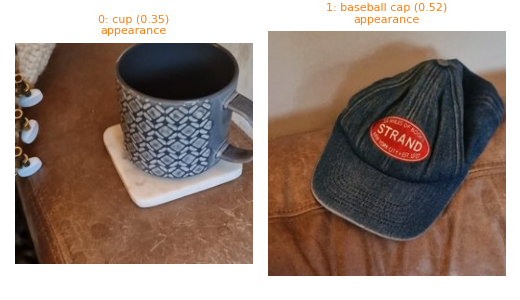
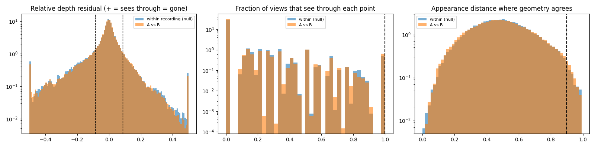

# p5_reversed_lightAa_vs_lightBa

**scene01_light_after_a** (A, before) vs **scene01_light_before_a** (B, after) - pair type **change**, 28 frames per video, variant `reversed`.

Distances are in cm, from a floor fit and an assumed phone height (scale 2.3747 m/unit, range [1.9349, 2.8145]).

| Measure | Value |
|---|---|
| Observed share (A / B) | 86.3% / 89.1% |
| Changed share of observed points (A / B) | 0.75% / 1.32% |
| Alignment residual across / within recordings | 0.0285 / 0.0289 |
| Thresholds (depth tau, see-through fraction, appearance) | 0.08626 / 1.0 / 0.89941 |
| Changes (moved / removed / added / appearance) | 0 / 0 / 0 / 2 |
| Reconstruction time | 28.4 s (GPU peak 9.57 GB) |

Heat maps (recording B): reachable 0%, approachable 27%, interactable 0%; surface uncertainty median 4.385 cm (90th pct 17.304); surface shift 99th pct 30.676 cm.

Scene report with simulator randomisation ranges: [scene_report.md](scene_report.md)

## Changes

- **1 appearance** baseball cap (p=0.517, 1776 pts, centroid +/- 0.028): The baseball cap looks different (turned over, deformed or swapped) but occupies the same place.
- **0 appearance** cup (p=0.346, 1177 pts, centroid +/- 0.028): The cup looks different (turned over, deformed or swapped) but occupies the same place.

Interactive 3D: download `viewer.html` and open it in a browser. Dense cloud: `cloud.ply` (colour by the `change` field); heat maps: `fields.ply`.
