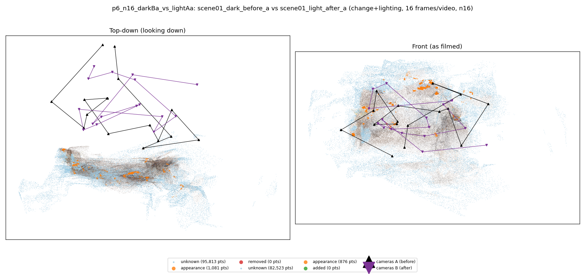
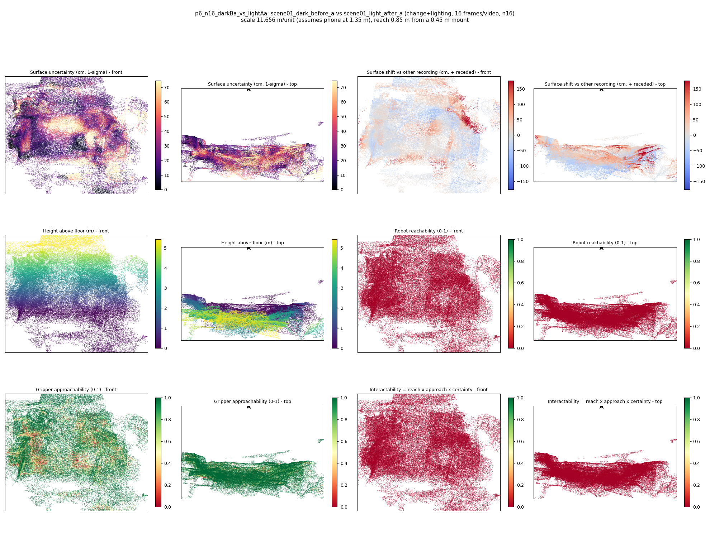
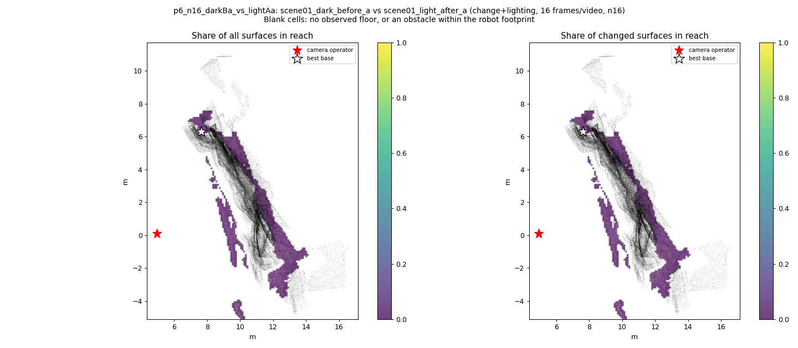
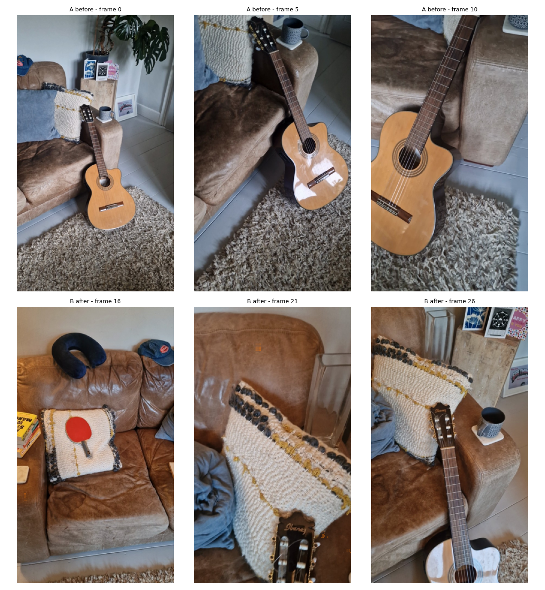
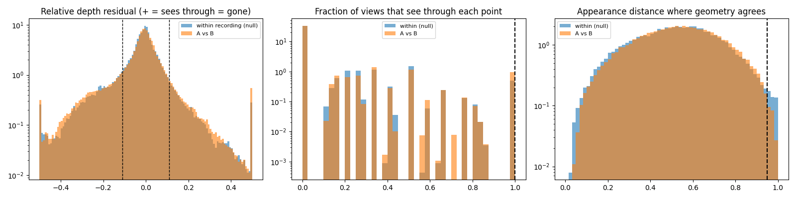

# p6_n16_darkBa_vs_lightAa

**scene01_dark_before_a** (A, before) vs **scene01_light_after_a** (B, after) - pair type **change+lighting**, 16 frames per video, variant `n16`.

Distances are in cm, from a floor fit and an assumed phone height (scale 11.6562 m/unit, range [9.4976, 13.8147]).

| Measure | Value |
|---|---|
| Observed share (A / B) | 75.8% / 79.2% |
| Changed share of observed points (A / B) | 0.36% / 0.28% |
| Alignment residual across / within recordings | 0.0375 / 0.0369 |
| Thresholds (depth tau, see-through fraction, appearance) | 0.11056 / 1.0 / 0.94814 |
| Changes (moved / removed / added / appearance) | 0 / 0 / 0 / 0 |
| Reconstruction time | 11.1 s (GPU peak 8.99 GB) |

Heat maps (recording B): reachable 0%, approachable 75%, interactable 0%; surface uncertainty median 21.185 cm (90th pct 57.355); surface shift 99th pct 176.93 cm.

Scene report with simulator randomisation ranges: [scene_report.md](scene_report.md)

## Changes

- none detected

Interactive 3D: download `viewer.html` and open it in a browser. Dense cloud: `cloud.ply` (colour by the `change` field); heat maps: `fields.ply`.
