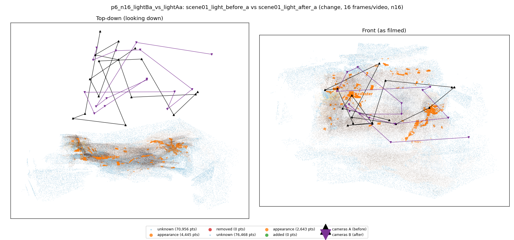
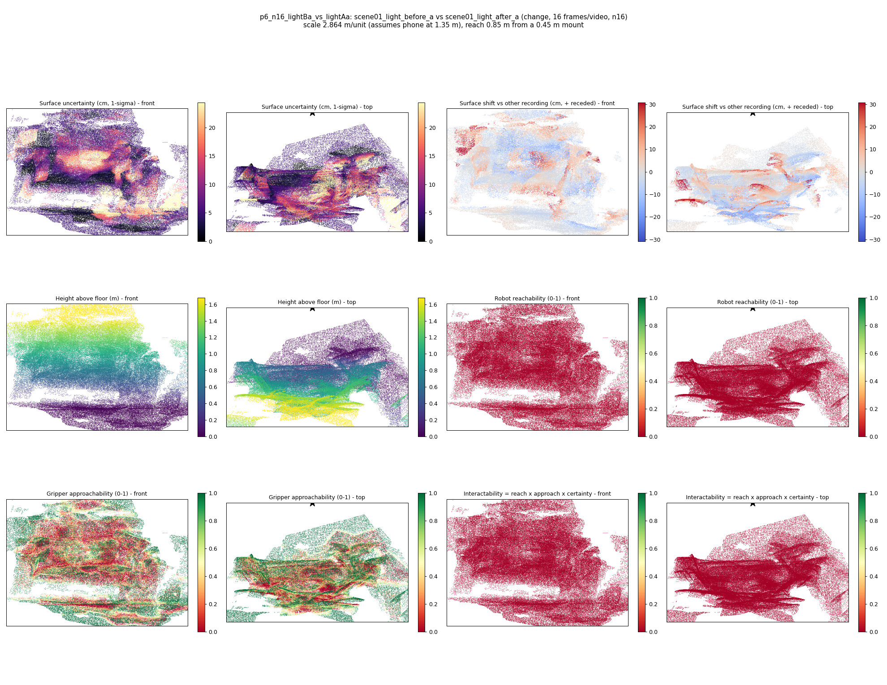
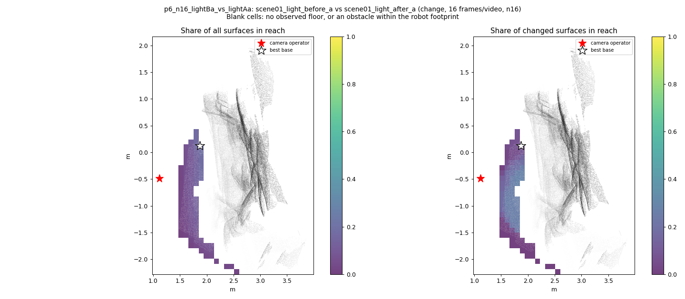
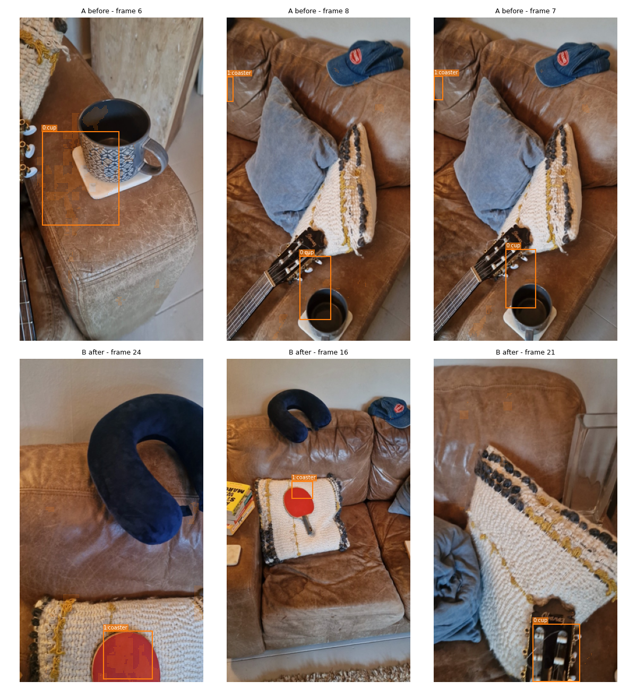
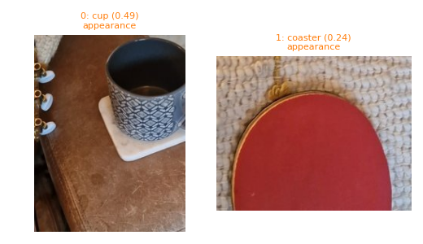
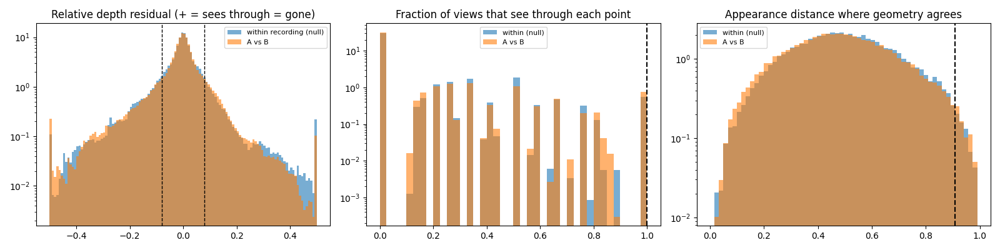

# p6_n16_lightBa_vs_lightAa

**scene01_light_before_a** (A, before) vs **scene01_light_after_a** (B, after) - pair type **change**, 16 frames per video, variant `n16`.

Distances are in cm, from a floor fit and an assumed phone height (scale 2.8643 m/unit, range [2.3339, 3.3948]).

| Measure | Value |
|---|---|
| Observed share (A / B) | 82.1% / 80.7% |
| Changed share of observed points (A / B) | 1.37% / 0.83% |
| Alignment residual across / within recordings | 0.0262 / 0.0266 |
| Thresholds (depth tau, see-through fraction, appearance) | 0.07966 / 1.0 / 0.90877 |
| Changes (moved / removed / added / appearance) | 0 / 0 / 0 / 2 |
| Reconstruction time | 10.9 s (GPU peak 8.99 GB) |

Heat maps (recording B): reachable 0%, approachable 38%, interactable 0%; surface uncertainty median 4.82 cm (90th pct 18.219); surface shift 99th pct 30.831 cm.

Scene report with simulator randomisation ranges: [scene_report.md](scene_report.md)

## Changes

- **0 appearance** cup (p=0.492, 2129 pts, centroid +/- 0.024): The cup looks different (turned over, deformed or swapped) but occupies the same place.
- **1 appearance** coaster (p=0.236, 870 pts, centroid +/- 0.024): The coaster looks different (turned over, deformed or swapped) but occupies the same place.

Interactive 3D: download `viewer.html` and open it in a browser. Dense cloud: `cloud.ply` (colour by the `change` field); heat maps: `fields.ply`.
