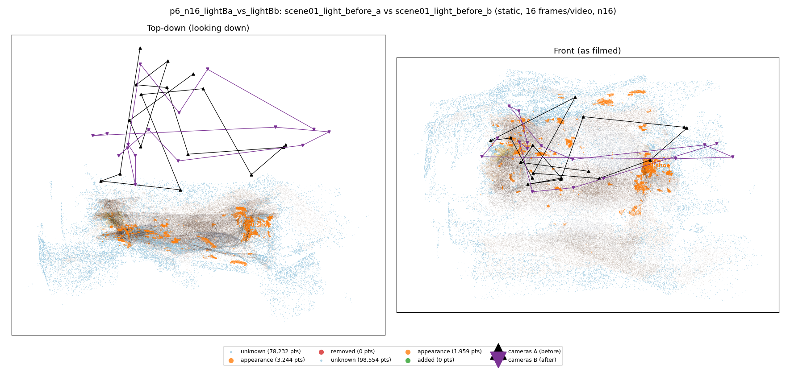
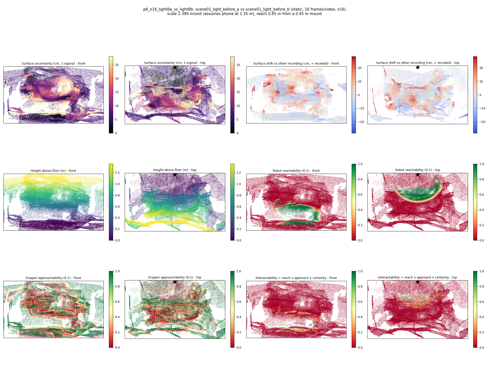
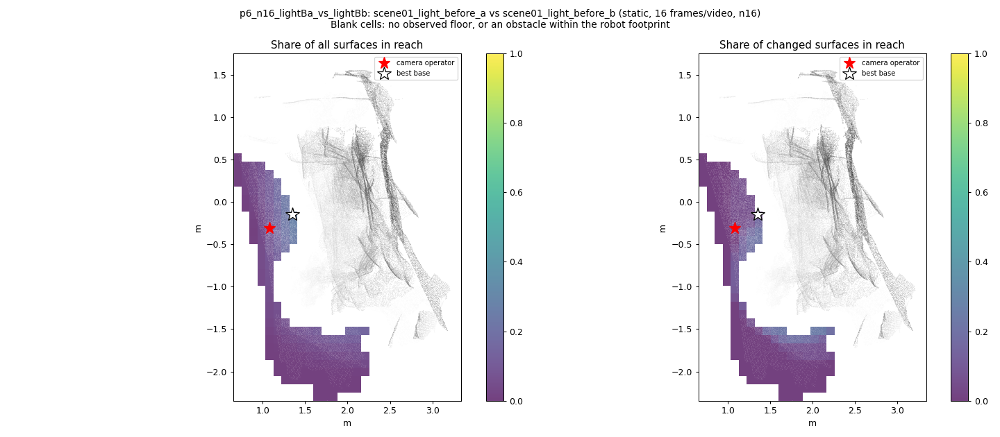
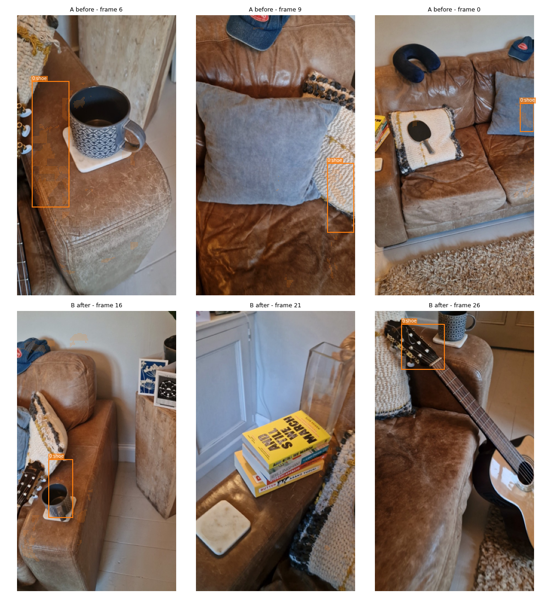
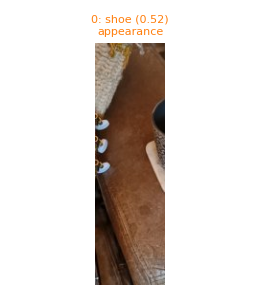
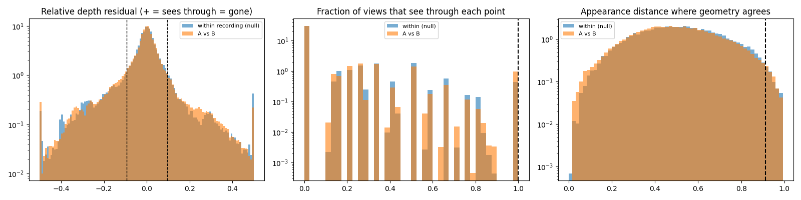

# p6_n16_lightBa_vs_lightBb

**scene01_light_before_a** (A, before) vs **scene01_light_before_b** (B, after) - pair type **static**, 16 frames per video, variant `n16`.

Distances are in cm, from a floor fit and an assumed phone height (scale 2.3989 m/unit, range [1.9546, 2.8431]).

| Measure | Value |
|---|---|
| Observed share (A / B) | 80.2% / 75.1% |
| Changed share of observed points (A / B) | 1.02% / 0.66% |
| Alignment residual across / within recordings | 0.0322 / 0.0315 |
| Thresholds (depth tau, see-through fraction, appearance) | 0.0947 / 1.0 / 0.91279 |
| Changes (moved / removed / added / appearance) | 0 / 0 / 0 / 1 |
| Reconstruction time | 12.0 s (GPU peak 8.99 GB) |

Nothing was moved between these recordings, so every flagged point is a false change: **false-change rate 0.84%**.

Heat maps (recording B): reachable 13%, approachable 42%, interactable 2%; surface uncertainty median 6.151 cm (90th pct 21.853); surface shift 99th pct 28.351 cm.

Scene report with simulator randomisation ranges: [scene_report.md](scene_report.md)

## Changes

- **0 appearance** shoe (p=0.524, 1761 pts, centroid +/- 0.027): The shoe looks different (turned over, deformed or swapped) but occupies the same place.

Interactive 3D: download `viewer.html` and open it in a browser. Dense cloud: `cloud.ply` (colour by the `change` field); heat maps: `fields.ply`.
