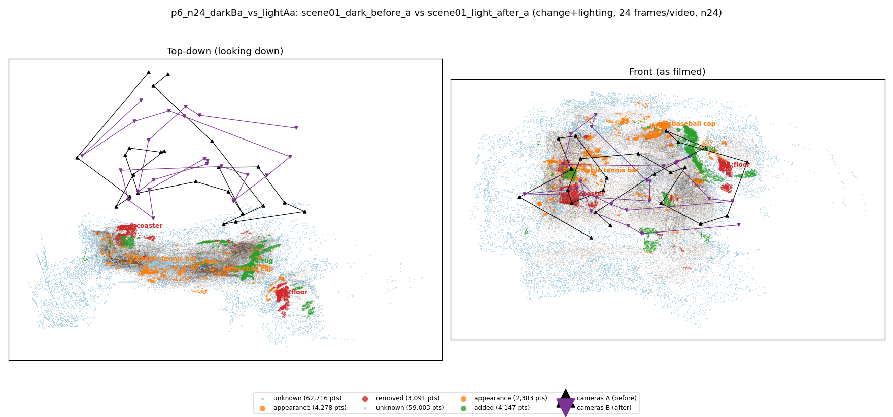
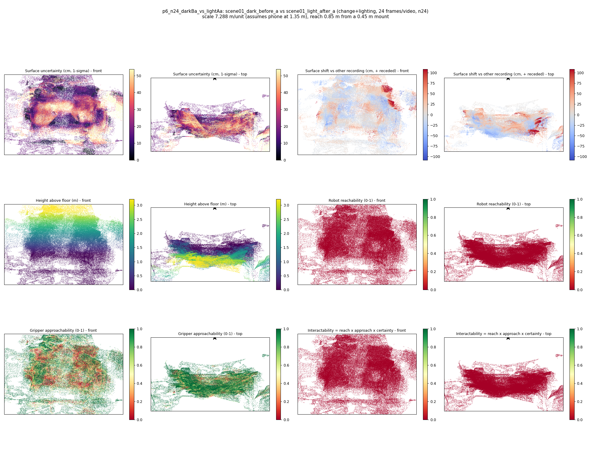
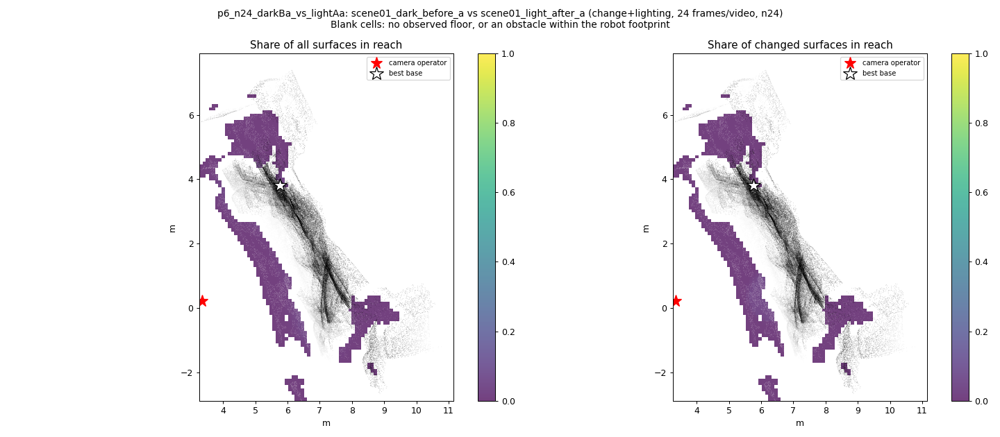
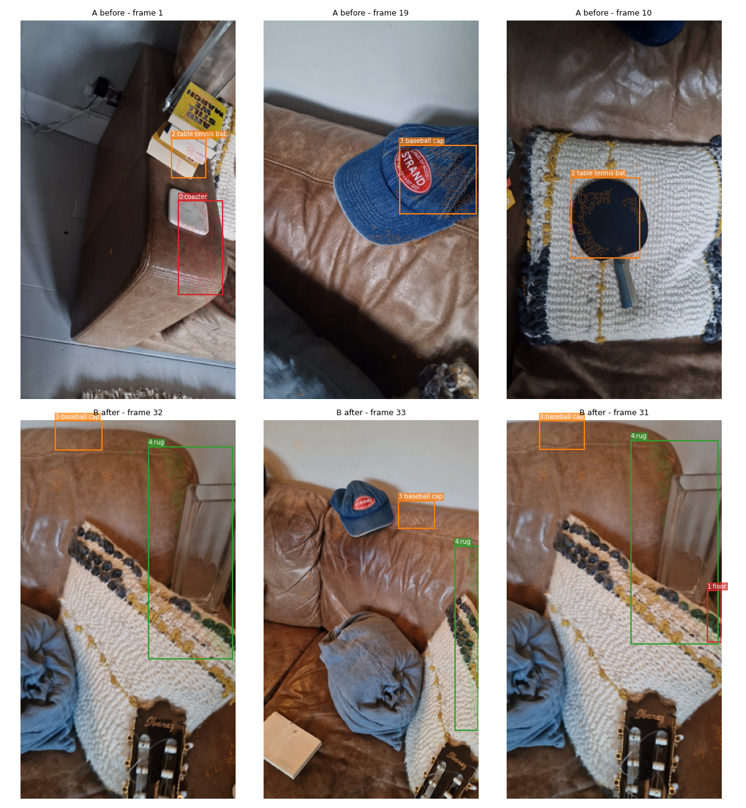
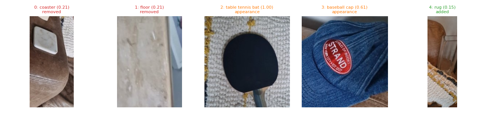
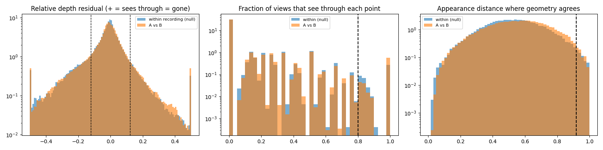

# p6_n24_darkBa_vs_lightAa

**scene01_dark_before_a** (A, before) vs **scene01_light_after_a** (B, after) - pair type **change+lighting**, 24 frames per video, variant `n24`.

Distances are in cm, from a floor fit and an assumed phone height (scale 7.2884 m/unit, range [5.9387, 8.6381]).

| Measure | Value |
|---|---|
| Observed share (A / B) | 84.3% / 85.2% |
| Changed share of observed points (A / B) | 2.19% / 1.92% |
| Alignment residual across / within recordings | 0.0414 / 0.0405 |
| Thresholds (depth tau, see-through fraction, appearance) | 0.12126 / 0.8 / 0.91846 |
| Changes (moved / removed / added / appearance) | 0 / 2 / 1 / 2 |
| Reconstruction time | 22.1 s (GPU peak 9.41 GB) |

Heat maps (recording B): reachable 0%, approachable 48%, interactable 0%; surface uncertainty median 17.502 cm (90th pct 44.38); surface shift 99th pct 108.204 cm.

Scene report with simulator randomisation ranges: [scene_report.md](scene_report.md)

## Changes

- **4 added** rug (p=0.148, 2682 pts, centroid +/- 0.028): A rug appears in the second recording that was not there before.
- **3 appearance** baseball cap (p=0.608, 1280 pts, centroid +/- 0.028): The baseball cap looks different (turned over, deformed or swapped) but occupies the same place.
- **0 removed** coaster (p=0.214, 1168 pts, centroid +/- 0.028): A coaster that was there in the first recording is no longer there.
- **2 appearance** table tennis bat (p=0.999, 1017 pts, centroid +/- 0.028): The table tennis bat looks different (turned over, deformed or swapped) but occupies the same place.
- **1 removed** floor (p=0.212, 802 pts, centroid +/- 0.028): A floor that was there in the first recording is no longer there.

Interactive 3D: download `viewer.html` and open it in a browser. Dense cloud: `cloud.ply` (colour by the `change` field); heat maps: `fields.ply`.
