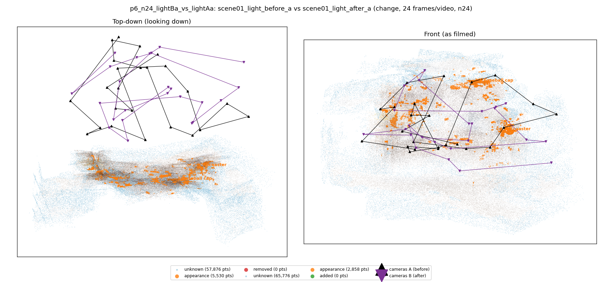
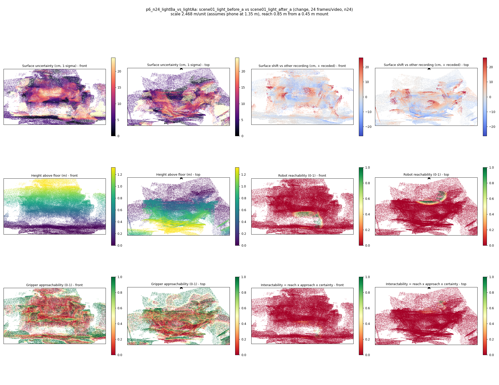
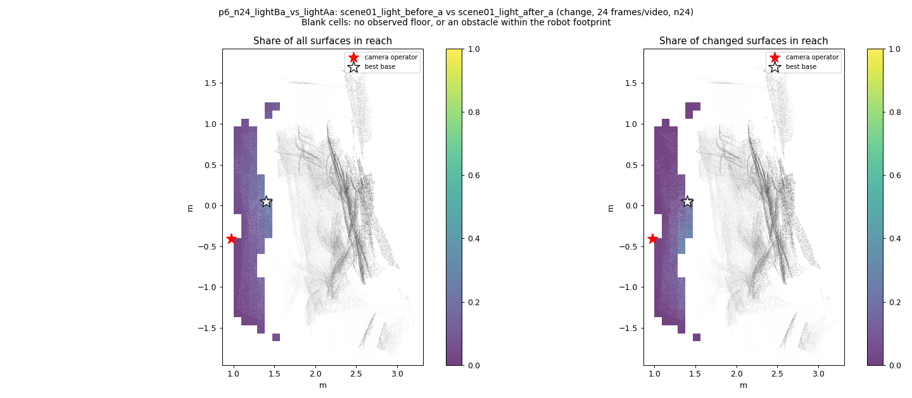
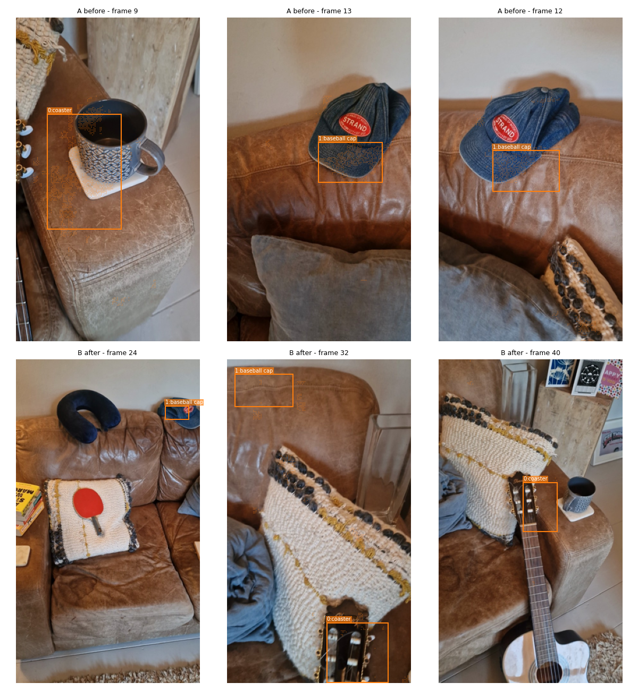
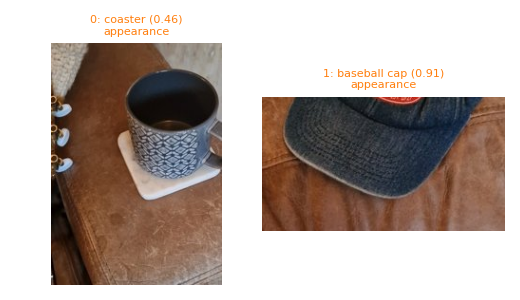
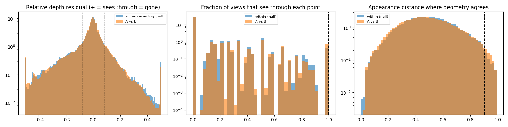

# p6_n24_lightBa_vs_lightAa

**scene01_light_before_a** (A, before) vs **scene01_light_after_a** (B, after) - pair type **change**, 24 frames per video, variant `n24`.

Distances are in cm, from a floor fit and an assumed phone height (scale 2.4679 m/unit, range [2.0109, 2.9249]).

| Measure | Value |
|---|---|
| Observed share (A / B) | 85.5% / 83.6% |
| Changed share of observed points (A / B) | 1.62% / 0.85% |
| Alignment residual across / within recordings | 0.0287 / 0.0275 |
| Thresholds (depth tau, see-through fraction, appearance) | 0.08199 / 1.0 / 0.9028 |
| Changes (moved / removed / added / appearance) | 0 / 0 / 0 / 2 |
| Reconstruction time | 23.5 s (GPU peak 9.41 GB) |

Heat maps (recording B): reachable 1%, approachable 30%, interactable 0%; surface uncertainty median 5.702 cm (90th pct 18.56); surface shift 99th pct 26.268 cm.

Scene report with simulator randomisation ranges: [scene_report.md](scene_report.md)

## Changes

- **0 appearance** coaster (p=0.464, 1959 pts, centroid +/- 0.023): The coaster looks different (turned over, deformed or swapped) but occupies the same place.
- **1 appearance** baseball cap (p=0.909, 1131 pts, centroid +/- 0.023): The baseball cap looks different (turned over, deformed or swapped) but occupies the same place.

Interactive 3D: download `viewer.html` and open it in a browser. Dense cloud: `cloud.ply` (colour by the `change` field); heat maps: `fields.ply`.
