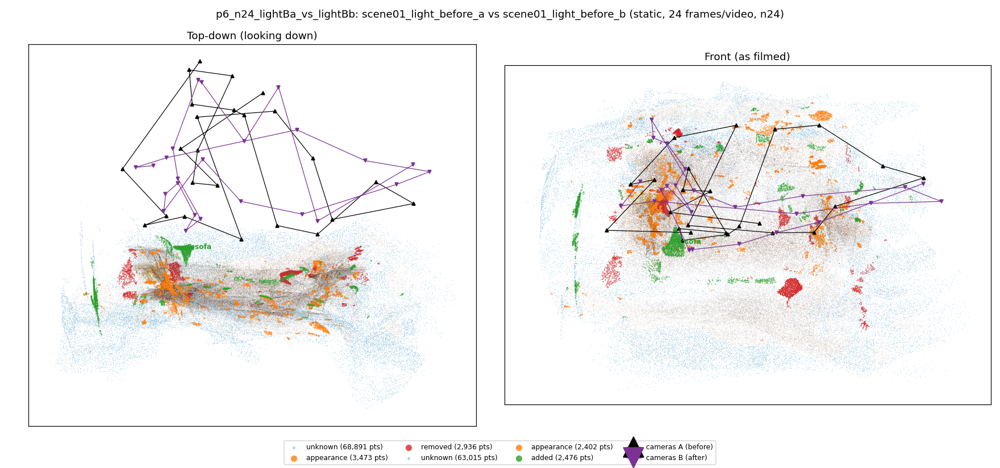
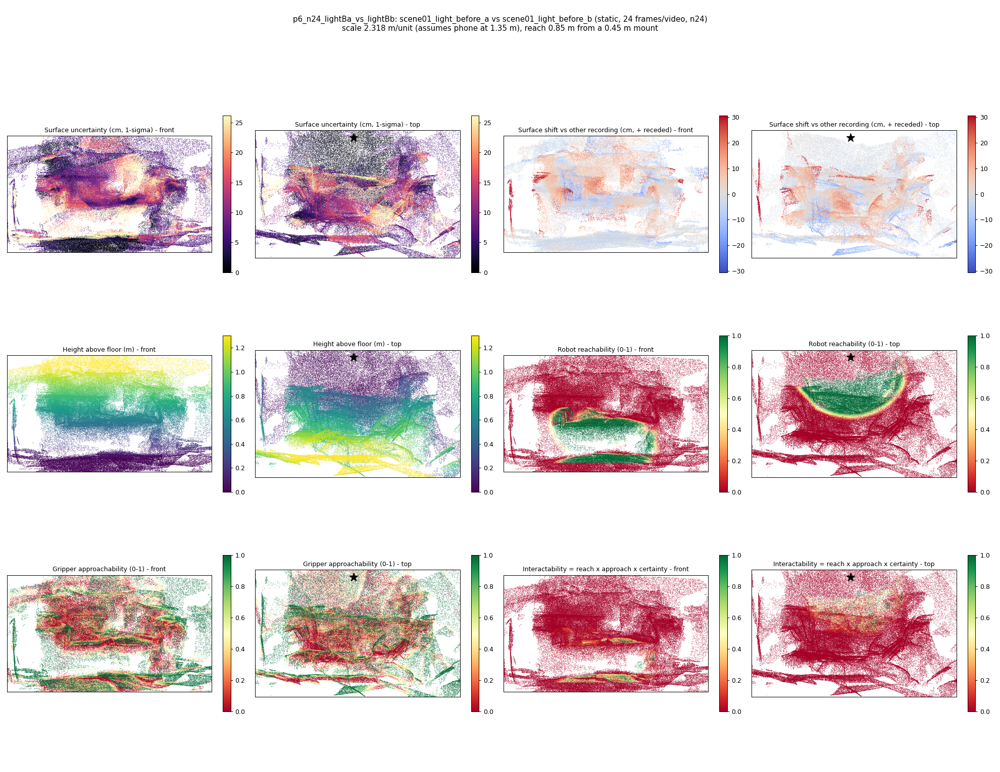
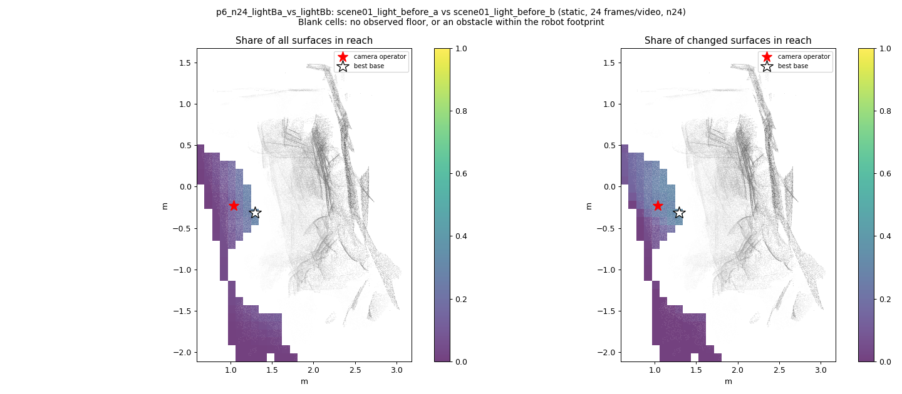
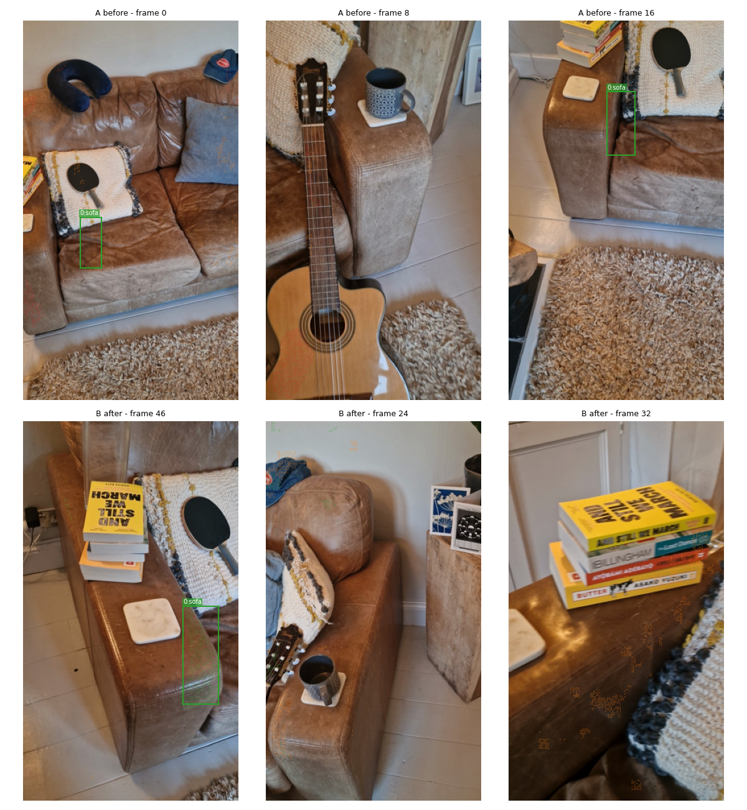
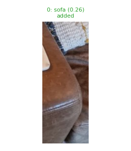
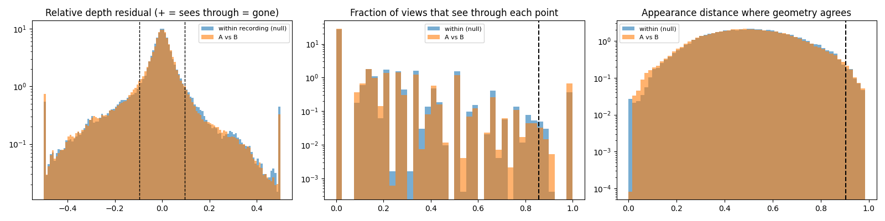

# p6_n24_lightBa_vs_lightBb

**scene01_light_before_a** (A, before) vs **scene01_light_before_b** (B, after) - pair type **static**, 24 frames per video, variant `n24`.

Distances are in cm, from a floor fit and an assumed phone height (scale 2.3182 m/unit, range [1.8889, 2.7475]).

| Measure | Value |
|---|---|
| Observed share (A / B) | 82.8% / 84.2% |
| Changed share of observed points (A / B) | 1.94% / 1.45% |
| Alignment residual across / within recordings | 0.0323 / 0.0316 |
| Thresholds (depth tau, see-through fraction, appearance) | 0.09505 / 0.85714 / 0.90283 |
| Changes (moved / removed / added / appearance) | 0 / 0 / 1 / 0 |
| Reconstruction time | 22.0 s (GPU peak 9.41 GB) |

Nothing was moved between these recordings, so every flagged point is a false change: **false-change rate 1.69%**.

Heat maps (recording B): reachable 18%, approachable 35%, interactable 2%; surface uncertainty median 5.992 cm (90th pct 20.088); surface shift 99th pct 30.518 cm.

Scene report with simulator randomisation ranges: [scene_report.md](scene_report.md)

## Changes

- **0 added** sofa (p=0.259, 852 pts, centroid +/- 0.026): A sofa appears in the second recording that was not there before.

Interactive 3D: download `viewer.html` and open it in a browser. Dense cloud: `cloud.ply` (colour by the `change` field); heat maps: `fields.ply`.
