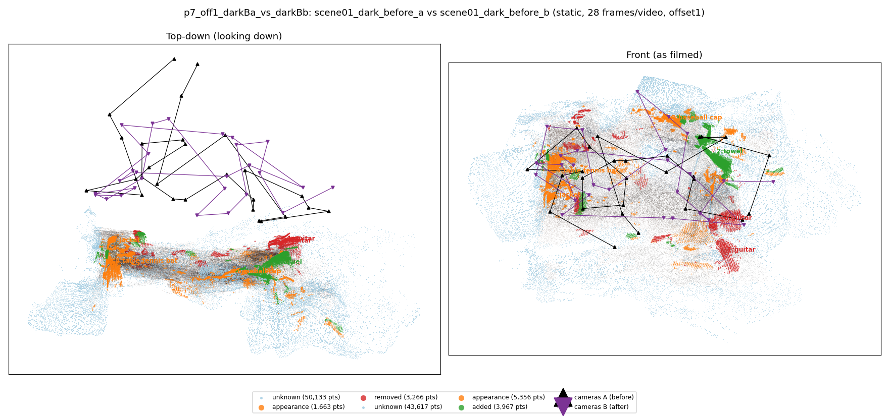
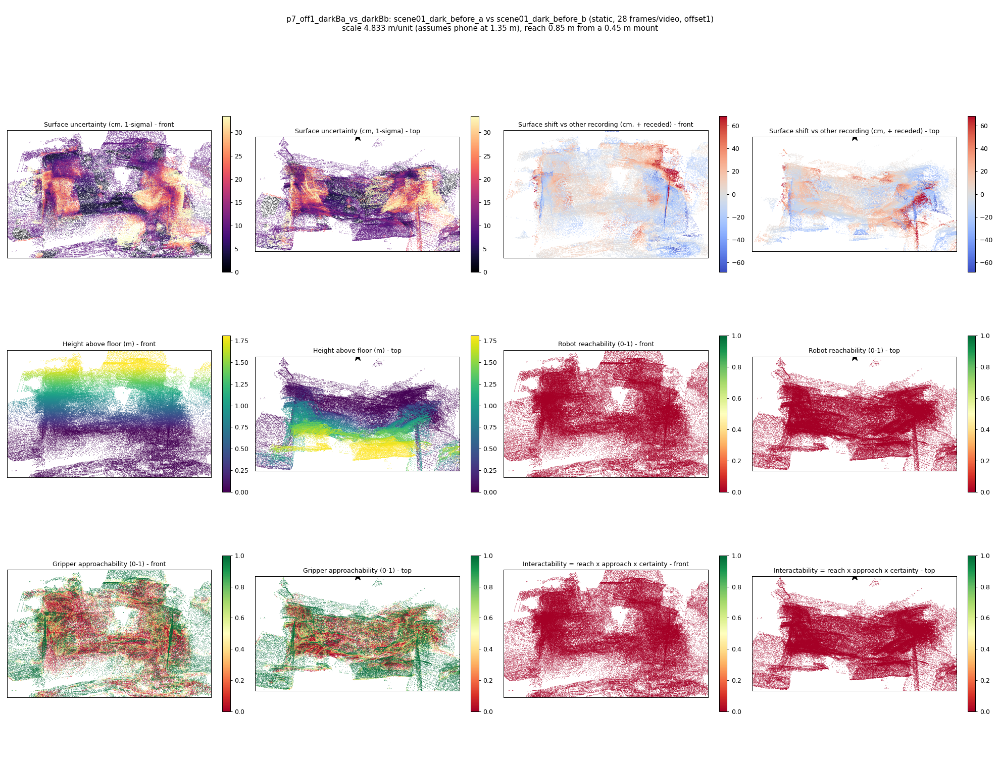

# p7_off1_darkBa_vs_darkBb

**scene01_dark_before_a** (A, before) vs **scene01_dark_before_b** (B, after) - pair type **static**, 28 frames per video, variant `offset1`.

Distances are in cm, from a floor fit and an assumed phone height (scale 4.833 m/unit, range [3.938, 5.7279]).

| Measure | Value |
|---|---|
| Observed share (A / B) | 83.8% / 86.2% |
| Changed share of observed points (A / B) | 1.90% / 3.43% |
| Alignment residual across / within recordings | 0.0483 / 0.0464 |
| Thresholds (depth tau, see-through fraction, appearance) | 0.13948 / 0.71429 / 0.90386 |
| Changes (moved / removed / added / appearance) | 0 / 2 / 1 / 3 |
| Reconstruction time | 25.8 s (GPU peak 9.57 GB) |

Nothing was moved between these recordings, so every flagged point is a false change: **false-change rate 2.67%**.

Heat maps (recording B): reachable 0%, approachable 38%, interactable 0%; surface uncertainty median 9.624 cm (90th pct 26.66); surface shift 99th pct 68.272 cm.

## Changes

- **2 added** towel (p=0.273, 2764 pts, centroid +/- 0.030): A towel appears in the second recording that was not there before.
- **4 appearance** table tennis bat (p=0.116, 1567 pts, centroid +/- 0.030): The table tennis bat looks different (turned over, deformed or swapped) but occupies the same place.
- **0 removed** guitar (p=0.973, 869 pts, centroid +/- 0.030): A guitar that was there in the first recording is no longer there.
- **3 appearance** baseball cap (p=0.729, 770 pts, centroid +/- 0.030): The baseball cap looks different (turned over, deformed or swapped) but occupies the same place.
- **5 appearance** jacket (p=0.095, 679 pts, centroid +/- 0.030): The jacket looks different (turned over, deformed or swapped) but occupies the same place.
- **1 removed** guitar (p=0.992, 618 pts, centroid +/- 0.030): A guitar that was there in the first recording is no longer there.
