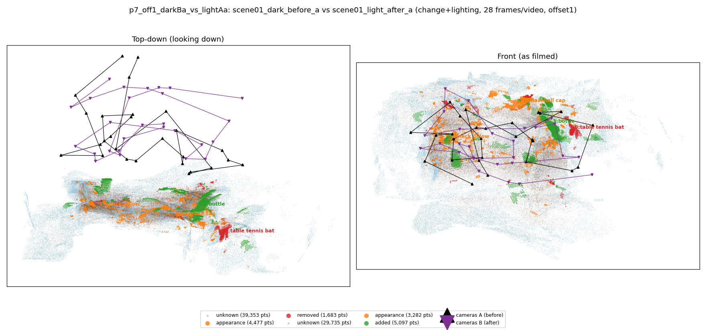
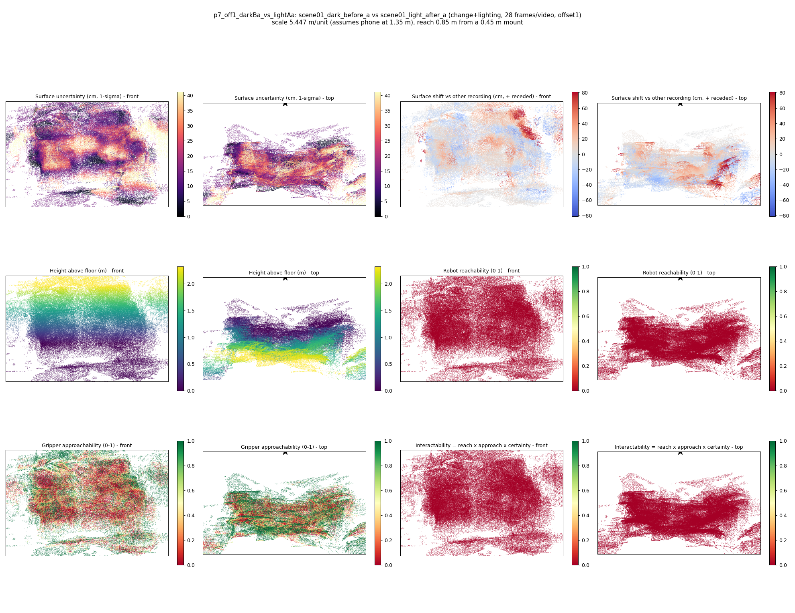

# p7_off1_darkBa_vs_lightAa

**scene01_dark_before_a** (A, before) vs **scene01_light_after_a** (B, after) - pair type **change+lighting**, 28 frames per video, variant `offset1`.

Distances are in cm, from a floor fit and an assumed phone height (scale 5.4466 m/unit, range [4.4379, 6.4552]).

| Measure | Value |
|---|---|
| Observed share (A / B) | 86.8% / 90.0% |
| Changed share of observed points (A / B) | 2.38% / 3.12% |
| Alignment residual across / within recordings | 0.0421 / 0.0407 |
| Thresholds (depth tau, see-through fraction, appearance) | 0.12232 / 0.75 / 0.89614 |
| Changes (moved / removed / added / appearance) | 0 / 1 / 1 / 2 |
| Reconstruction time | 25.7 s (GPU peak 9.57 GB) |

Heat maps (recording B): reachable 0%, approachable 34%, interactable 0%; surface uncertainty median 14.026 cm (90th pct 33.059); surface shift 99th pct 81.042 cm.

## Changes

- **3 added** bottle (p=0.122, 2920 pts, centroid +/- 0.029): A bottle appears in the second recording that was not there before.
- **2 appearance** baseball cap (p=0.522, 1527 pts, centroid +/- 0.029): The baseball cap looks different (turned over, deformed or swapped) but occupies the same place.
- **0 removed** table tennis bat (p=0.118, 914 pts, centroid +/- 0.029): A table tennis bat that was there in the first recording is no longer there.
- **1 appearance** neck pillow (p=0.211, 799 pts, centroid +/- 0.029): The neck pillow looks different (turned over, deformed or swapped) but occupies the same place.
