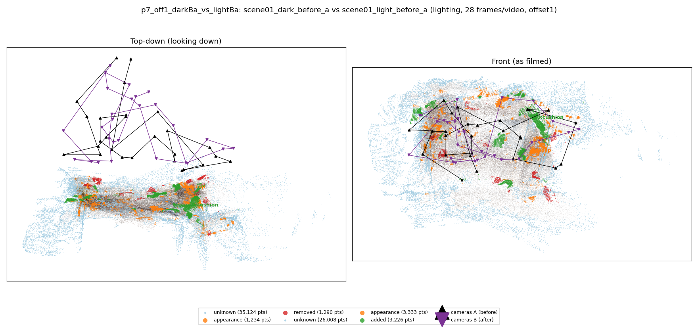
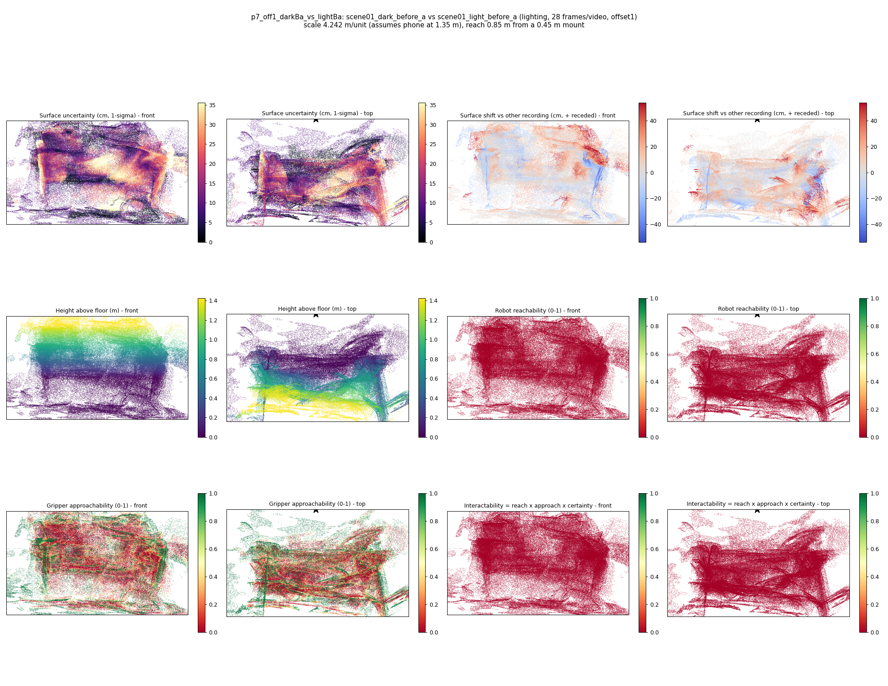

# p7_off1_darkBa_vs_lightBa

**scene01_dark_before_a** (A, before) vs **scene01_light_before_a** (B, after) - pair type **lighting**, 28 frames per video, variant `offset1`.

Distances are in cm, from a floor fit and an assumed phone height (scale 4.2422 m/unit, range [3.4566, 5.0278]).

| Measure | Value |
|---|---|
| Observed share (A / B) | 88.2% / 91.3% |
| Changed share of observed points (A / B) | 0.96% / 2.41% |
| Alignment residual across / within recordings | 0.0391 / 0.0389 |
| Thresholds (depth tau, see-through fraction, appearance) | 0.11646 / 0.75 / 0.90267 |
| Changes (moved / removed / added / appearance) | 0 / 0 / 1 / 1 |
| Reconstruction time | 25.7 s (GPU peak 9.57 GB) |

Nothing was moved between these recordings, so every flagged point is a false change: **false-change rate 1.69%**.

Heat maps (recording B): reachable 0%, approachable 28%, interactable 0%; surface uncertainty median 9.217 cm (90th pct 27.934); surface shift 99th pct 53.571 cm.

## Changes

- **0 added** cushion (p=0.141, 1106 pts, centroid +/- 0.026): A cushion appears in the second recording that was not there before.
- **1 appearance** cup (p=0.662, 638 pts, centroid +/- 0.026): The cup looks different (turned over, deformed or swapped) but occupies the same place.
