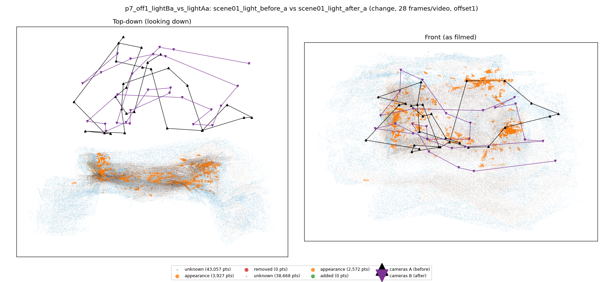
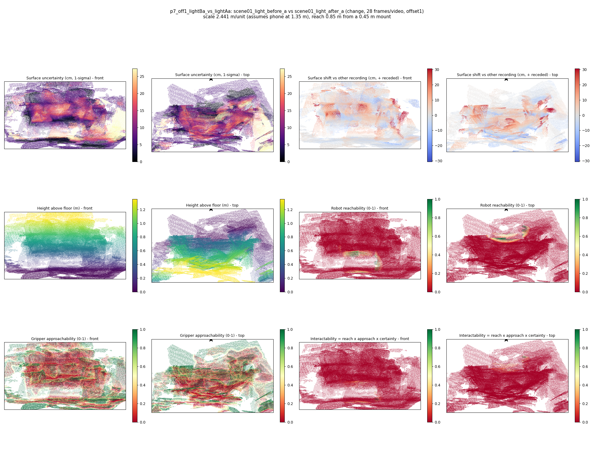

# p7_off1_lightBa_vs_lightAa

**scene01_light_before_a** (A, before) vs **scene01_light_after_a** (B, after) - pair type **change**, 28 frames per video, variant `offset1`.

Distances are in cm, from a floor fit and an assumed phone height (scale 2.4408 m/unit, range [1.9888, 2.8928]).

| Measure | Value |
|---|---|
| Observed share (A / B) | 85.5% / 87.0% |
| Changed share of observed points (A / B) | 1.54% / 0.99% |
| Alignment residual across / within recordings | 0.0287 / 0.0275 |
| Thresholds (depth tau, see-through fraction, appearance) | 0.08257 / 1.0 / 0.89722 |
| Changes (moved / removed / added / appearance) | 0 / 0 / 0 / 2 |
| Reconstruction time | 25.5 s (GPU peak 9.57 GB) |

Heat maps (recording B): reachable 1%, approachable 30%, interactable 0%; surface uncertainty median 6.822 cm (90th pct 20.129); surface shift 99th pct 30.453 cm.

## Changes

- **0 appearance** cup (p=0.563, 1201 pts, centroid +/- 0.023): The cup looks different (turned over, deformed or swapped) but occupies the same place.
- **1 appearance** baseball cap (p=0.811, 625 pts, centroid +/- 0.023): The baseball cap looks different (turned over, deformed or swapped) but occupies the same place.
