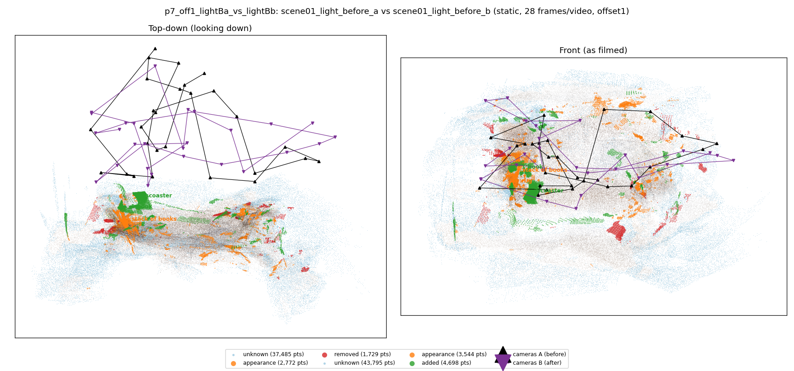
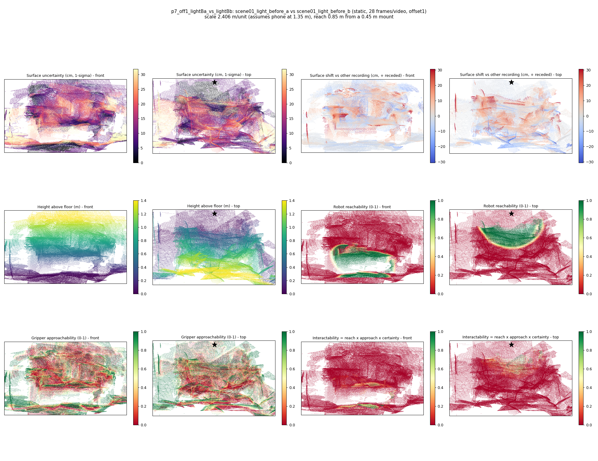

# p7_off1_lightBa_vs_lightBb

**scene01_light_before_a** (A, before) vs **scene01_light_before_b** (B, after) - pair type **static**, 28 frames per video, variant `offset1`.

Distances are in cm, from a floor fit and an assumed phone height (scale 2.4065 m/unit, range [1.9608, 2.8521]).

| Measure | Value |
|---|---|
| Observed share (A / B) | 87.4% / 85.3% |
| Changed share of observed points (A / B) | 1.73% / 3.25% |
| Alignment residual across / within recordings | 0.0401 / 0.0369 |
| Thresholds (depth tau, see-through fraction, appearance) | 0.1105 / 0.875 / 0.90503 |
| Changes (moved / removed / added / appearance) | 0 / 0 / 2 / 2 |
| Reconstruction time | 25.6 s (GPU peak 9.57 GB) |

Nothing was moved between these recordings, so every flagged point is a false change: **false-change rate 2.49%**.

Heat maps (recording B): reachable 15%, approachable 34%, interactable 1%; surface uncertainty median 10.952 cm (90th pct 26.971); surface shift 99th pct 30.446 cm.

## Changes

- **3 appearance** stack of books (p=0.906, 1735 pts, centroid +/- 0.029): The stack of books looks different (turned over, deformed or swapped) but occupies the same place.
- **2 added** coaster (p=0.51, 1713 pts, centroid +/- 0.029): A coaster appears in the second recording that was not there before.
- **1 added** book (p=0.705, 785 pts, centroid +/- 0.029): A book appears in the second recording that was not there before.
- **0 appearance** rug (p=0.151, 620 pts, centroid +/- 0.029): The rug looks different (turned over, deformed or swapped) but occupies the same place.
