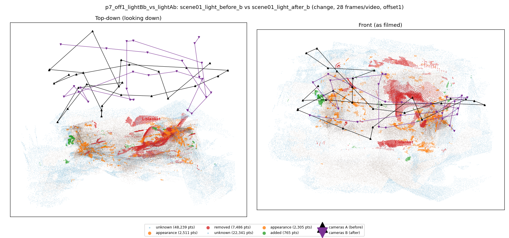
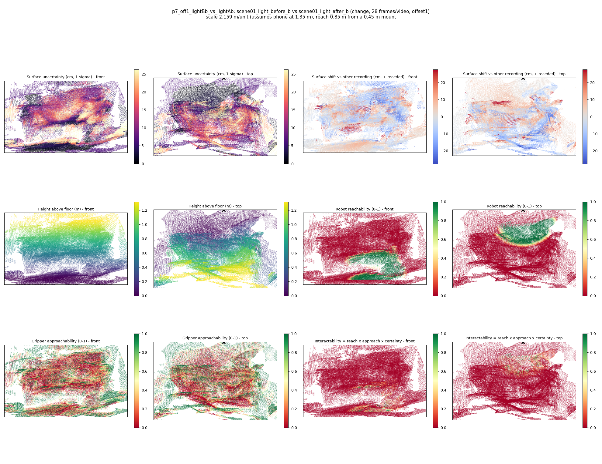

# p7_off1_lightBb_vs_lightAb

**scene01_light_before_b** (A, before) vs **scene01_light_after_b** (B, after) - pair type **change**, 28 frames per video, variant `offset1`.

Distances are in cm, from a floor fit and an assumed phone height (scale 2.1586 m/unit, range [1.7589, 2.5584]).

| Measure | Value |
|---|---|
| Observed share (A / B) | 83.8% / 92.5% |
| Changed share of observed points (A / B) | 4.01% / 1.12% |
| Alignment residual across / within recordings | 0.0589 / 0.0529 |
| Thresholds (depth tau, see-through fraction, appearance) | 0.15897 / 0.75 / 0.91455 |
| Changes (moved / removed / added / appearance) | 0 / 2 / 0 / 0 |
| Reconstruction time | 25.7 s (GPU peak 9.57 GB) |

Heat maps (recording B): reachable 12%, approachable 32%, interactable 1%; surface uncertainty median 7.504 cm (90th pct 22.333); surface shift 99th pct 27.623 cm.

## Changes

- **0 removed** sofa (p=0.392, 4596 pts, centroid +/- 0.047): A sofa that was there in the first recording is no longer there.
- **1 removed** blanket (p=0.09, 665 pts, centroid +/- 0.047): A blanket that was there in the first recording is no longer there.
