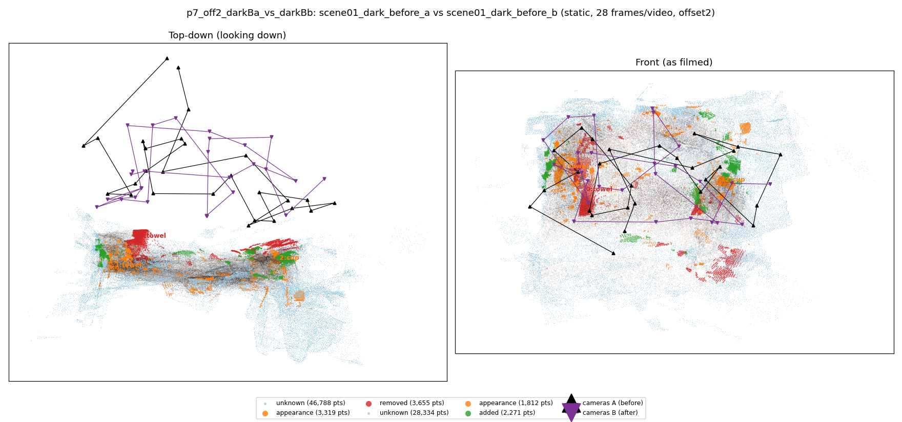
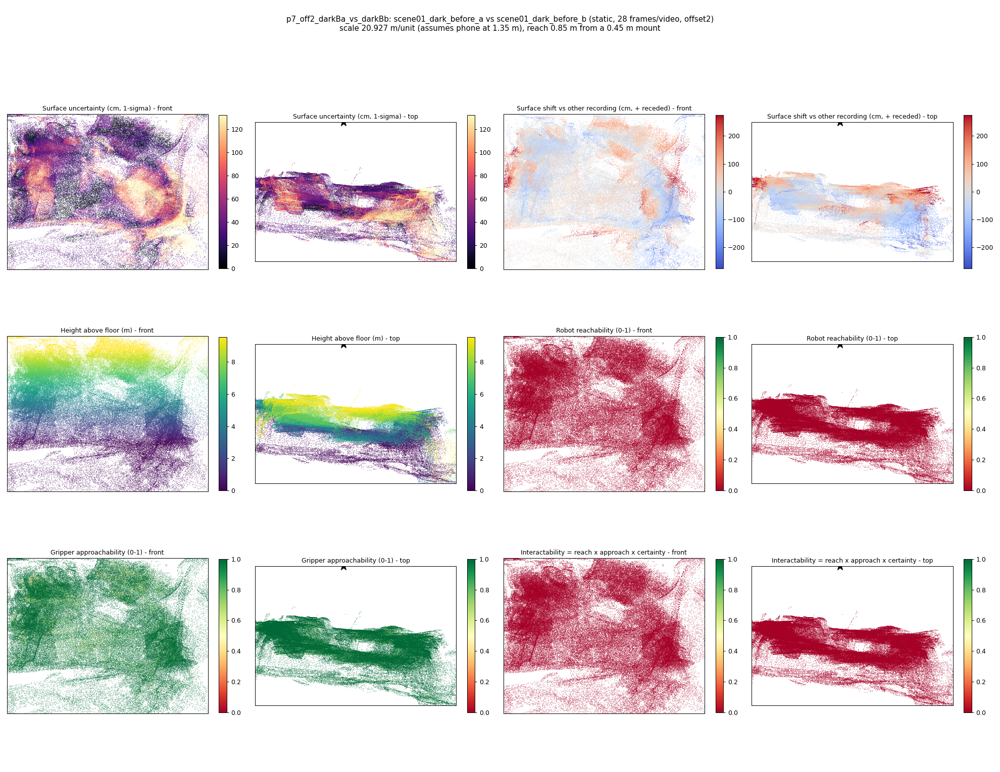

# p7_off2_darkBa_vs_darkBb

**scene01_dark_before_a** (A, before) vs **scene01_dark_before_b** (B, after) - pair type **static**, 28 frames per video, variant `offset2`.

Distances are in cm, from a floor fit and an assumed phone height (scale 20.9266 m/unit, range [17.0513, 24.8018]).

| Measure | Value |
|---|---|
| Observed share (A / B) | 84.6% / 90.6% |
| Changed share of observed points (A / B) | 2.72% / 1.49% |
| Alignment residual across / within recordings | 0.0488 / 0.0479 |
| Thresholds (depth tau, see-through fraction, appearance) | 0.14477 / 0.66667 / 0.89453 |
| Changes (moved / removed / added / appearance) | 0 / 1 / 0 / 2 |
| Reconstruction time | 25.8 s (GPU peak 9.57 GB) |

Nothing was moved between these recordings, so every flagged point is a false change: **false-change rate 2.10%**.

Heat maps (recording B): reachable 0%, approachable 94%, interactable 0%; surface uncertainty median 38.595 cm (90th pct 104.667); surface shift 99th pct 275.667 cm.

## Changes

- **0 removed** towel (p=0.238, 1783 pts, centroid +/- 0.031): A towel that was there in the first recording is no longer there.
- **2 appearance** cup (p=0.545, 1344 pts, centroid +/- 0.031): The cup looks different (turned over, deformed or swapped) but occupies the same place.
- **1 appearance** towel (p=0.146, 661 pts, centroid +/- 0.031): The towel looks different (turned over, deformed or swapped) but occupies the same place.
