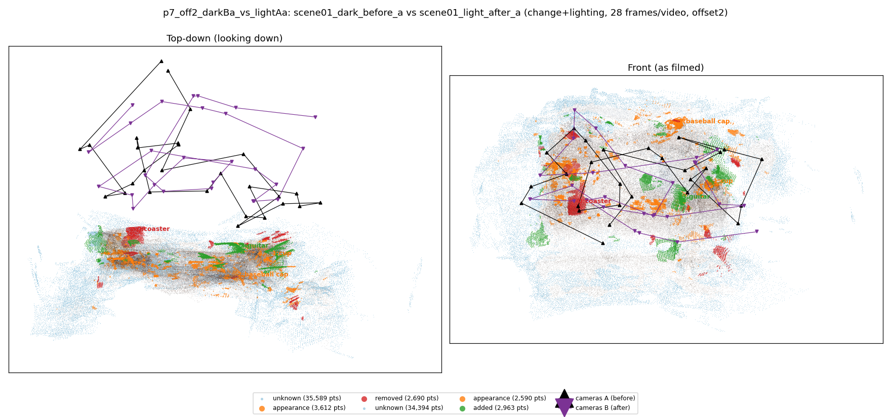
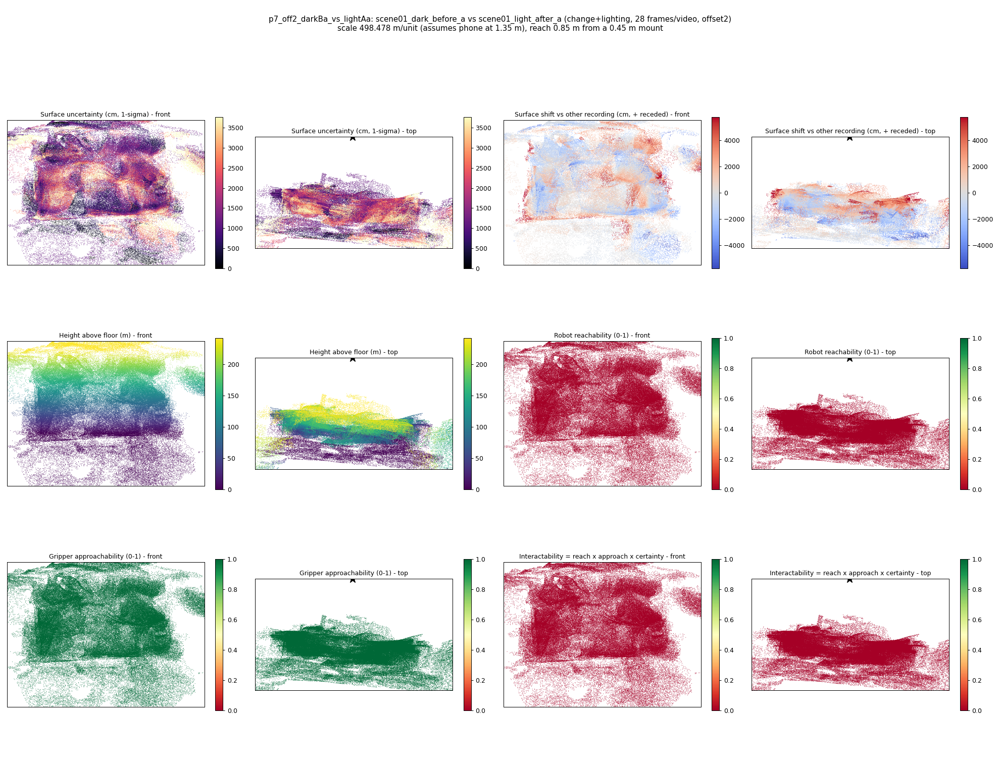

# p7_off2_darkBa_vs_lightAa

**scene01_dark_before_a** (A, before) vs **scene01_light_after_a** (B, after) - pair type **change+lighting**, 28 frames per video, variant `offset2`.

Distances are in cm, from a floor fit and an assumed phone height (scale 498.4785 m/unit, range [406.1677, 590.7893]).

| Measure | Value |
|---|---|
| Observed share (A / B) | 88.0% / 88.4% |
| Changed share of observed points (A / B) | 2.40% / 2.11% |
| Alignment residual across / within recordings | 0.0436 / 0.0441 |
| Thresholds (depth tau, see-through fraction, appearance) | 0.1318 / 0.75 / 0.90405 |
| Changes (moved / removed / added / appearance) | 0 / 1 / 1 / 2 |
| Reconstruction time | 25.8 s (GPU peak 9.57 GB) |

Heat maps (recording B): reachable 0%, approachable 100%, interactable 0%; surface uncertainty median 1154.598 cm (90th pct 2877.893); surface shift 99th pct 5734.527 cm.

## Changes

- **0 removed** coaster (p=0.32, 1255 pts, centroid +/- 0.030): A coaster that was there in the first recording is no longer there.
- **1 appearance** cup (p=0.709, 774 pts, centroid +/- 0.030): The cup looks different (turned over, deformed or swapped) but occupies the same place.
- **2 appearance** baseball cap (p=0.689, 671 pts, centroid +/- 0.030): The baseball cap looks different (turned over, deformed or swapped) but occupies the same place.
- **3 added** guitar (p=0.994, 617 pts, centroid +/- 0.030): A guitar appears in the second recording that was not there before.
