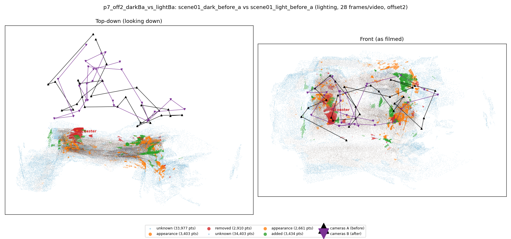
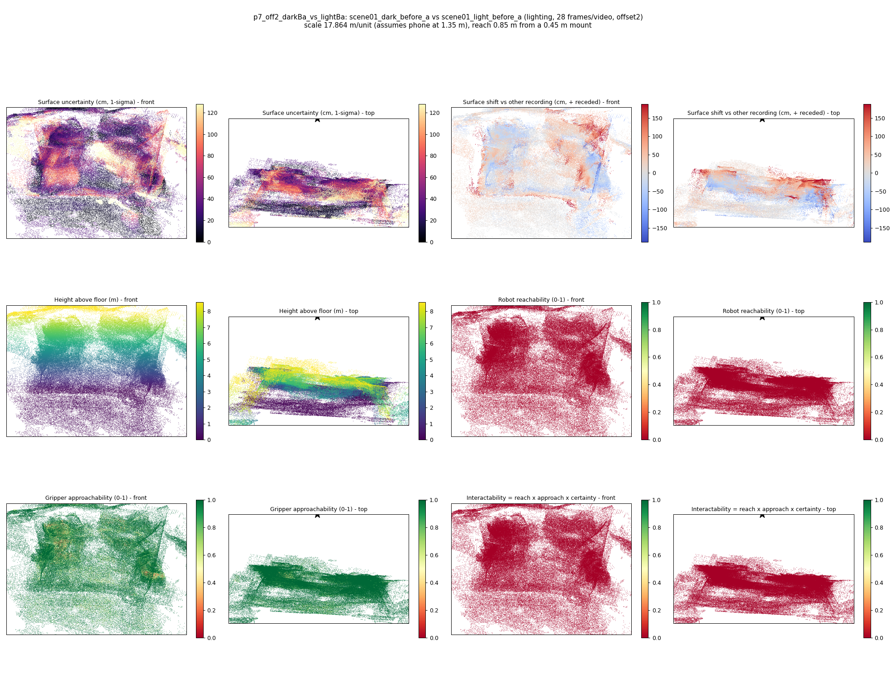

# p7_off2_darkBa_vs_lightBa

**scene01_dark_before_a** (A, before) vs **scene01_light_before_a** (B, after) - pair type **lighting**, 28 frames per video, variant `offset2`.

Distances are in cm, from a floor fit and an assumed phone height (scale 17.8641 m/unit, range [14.5559, 21.1723]).

| Measure | Value |
|---|---|
| Observed share (A / B) | 88.6% / 88.4% |
| Changed share of observed points (A / B) | 2.39% / 2.31% |
| Alignment residual across / within recordings | 0.0382 / 0.0382 |
| Thresholds (depth tau, see-through fraction, appearance) | 0.11522 / 0.75 / 0.89844 |
| Changes (moved / removed / added / appearance) | 0 / 1 / 1 / 1 |
| Reconstruction time | 25.6 s (GPU peak 9.57 GB) |

Nothing was moved between these recordings, so every flagged point is a false change: **false-change rate 2.35%**.

Heat maps (recording B): reachable 0%, approachable 88%, interactable 0%; surface uncertainty median 32.315 cm (90th pct 93.296); surface shift 99th pct 188.352 cm.

## Changes

- **0 removed** coaster (p=0.456, 2054 pts, centroid +/- 0.026): A coaster that was there in the first recording is no longer there.
- **2 added** sofa (p=0.273, 1648 pts, centroid +/- 0.026): A sofa appears in the second recording that was not there before.
- **1 appearance** guitar (p=0.991, 1042 pts, centroid +/- 0.026): The guitar looks different (turned over, deformed or swapped) but occupies the same place.
