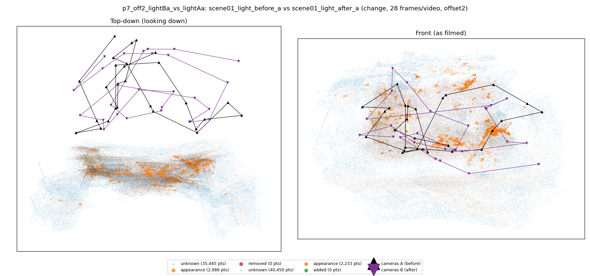
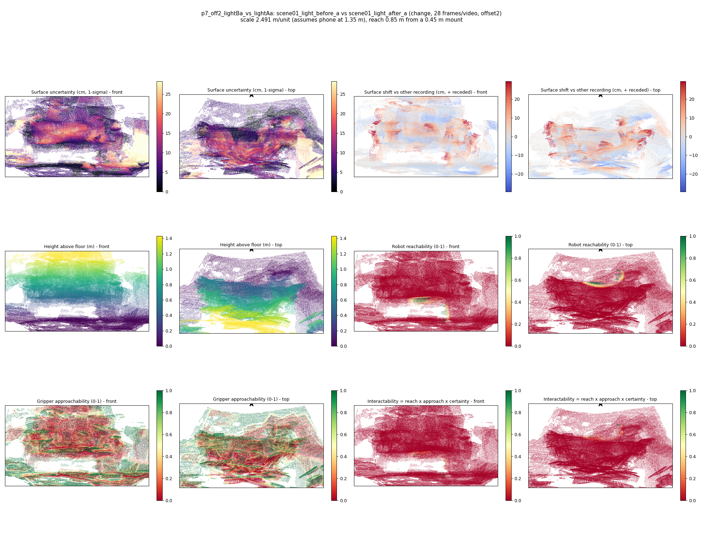

# p7_off2_lightBa_vs_lightAa

**scene01_light_before_a** (A, before) vs **scene01_light_after_a** (B, after) - pair type **change**, 28 frames per video, variant `offset2`.

Distances are in cm, from a floor fit and an assumed phone height (scale 2.4907 m/unit, range [2.0295, 2.952]).

| Measure | Value |
|---|---|
| Observed share (A / B) | 88.1% / 86.4% |
| Changed share of observed points (A / B) | 1.14% / 0.87% |
| Alignment residual across / within recordings | 0.0291 / 0.0299 |
| Thresholds (depth tau, see-through fraction, appearance) | 0.08957 / 1.0 / 0.89659 |
| Changes (moved / removed / added / appearance) | 0 / 0 / 0 / 1 |
| Reconstruction time | 25.8 s (GPU peak 9.57 GB) |

Heat maps (recording B): reachable 1%, approachable 32%, interactable 0%; surface uncertainty median 6.101 cm (90th pct 20.74); surface shift 99th pct 29.283 cm.

## Changes

- **0 appearance** cup (p=0.581, 1324 pts, centroid +/- 0.025): The cup looks different (turned over, deformed or swapped) but occupies the same place.
