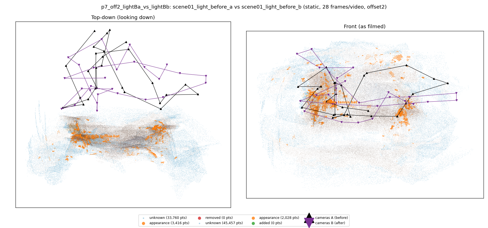
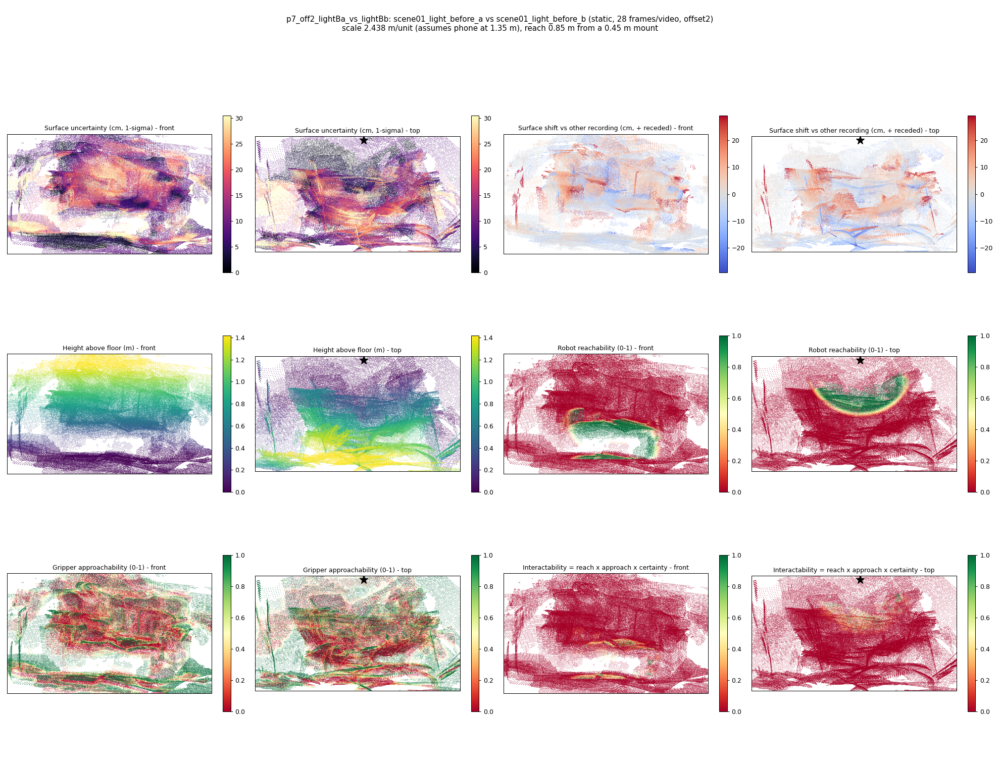

# p7_off2_lightBa_vs_lightBb

**scene01_light_before_a** (A, before) vs **scene01_light_before_b** (B, after) - pair type **static**, 28 frames per video, variant `offset2`.

Distances are in cm, from a floor fit and an assumed phone height (scale 2.4378 m/unit, range [1.9863, 2.8892]).

| Measure | Value |
|---|---|
| Observed share (A / B) | 88.7% / 84.7% |
| Changed share of observed points (A / B) | 1.29% / 0.80% |
| Alignment residual across / within recordings | 0.0376 / 0.0373 |
| Thresholds (depth tau, see-through fraction, appearance) | 0.11207 / 1.0 / 0.89522 |
| Changes (moved / removed / added / appearance) | 0 / 0 / 0 / 1 |
| Reconstruction time | 25.7 s (GPU peak 9.57 GB) |

Nothing was moved between these recordings, so every flagged point is a false change: **false-change rate 1.05%**.

Heat maps (recording B): reachable 8%, approachable 34%, interactable 1%; surface uncertainty median 9.614 cm (90th pct 25.633); surface shift 99th pct 29.174 cm.

## Changes

- **0 appearance** table tennis bat (p=0.782, 1622 pts, centroid +/- 0.031): The table tennis bat looks different (turned over, deformed or swapped) but occupies the same place.
