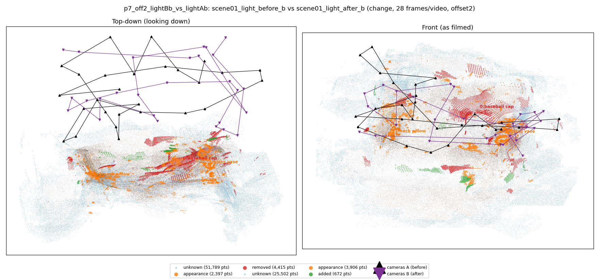
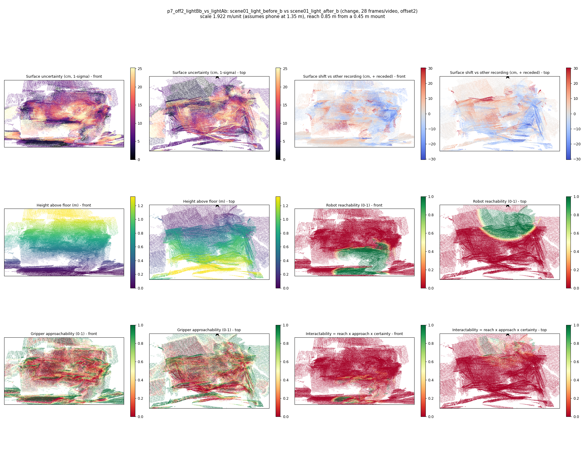

# p7_off2_lightBb_vs_lightAb

**scene01_light_before_b** (A, before) vs **scene01_light_after_b** (B, after) - pair type **change**, 28 frames per video, variant `offset2`.

Distances are in cm, from a floor fit and an assumed phone height (scale 1.9223 m/unit, range [1.5663, 2.2782]).

| Measure | Value |
|---|---|
| Observed share (A / B) | 82.6% / 91.4% |
| Changed share of observed points (A / B) | 2.77% / 1.68% |
| Alignment residual across / within recordings | 0.0549 / 0.0573 |
| Thresholds (depth tau, see-through fraction, appearance) | 0.1712 / 0.75 / 0.91133 |
| Changes (moved / removed / added / appearance) | 0 / 1 / 0 / 2 |
| Reconstruction time | 25.9 s (GPU peak 9.57 GB) |

Heat maps (recording B): reachable 17%, approachable 32%, interactable 2%; surface uncertainty median 7.94 cm (90th pct 22.228); surface shift 99th pct 30.34 cm.

## Changes

- **2 appearance** glass vase (p=0.78, 2179 pts, centroid +/- 0.058): The glass vase looks different (turned over, deformed or swapped) but occupies the same place.
- **0 removed** baseball cap (p=0.348, 1393 pts, centroid +/- 0.058): A baseball cap that was there in the first recording is no longer there.
- **1 appearance** neck pillow (p=0.252, 770 pts, centroid +/- 0.058): The neck pillow looks different (turned over, deformed or swapped) but occupies the same place.
