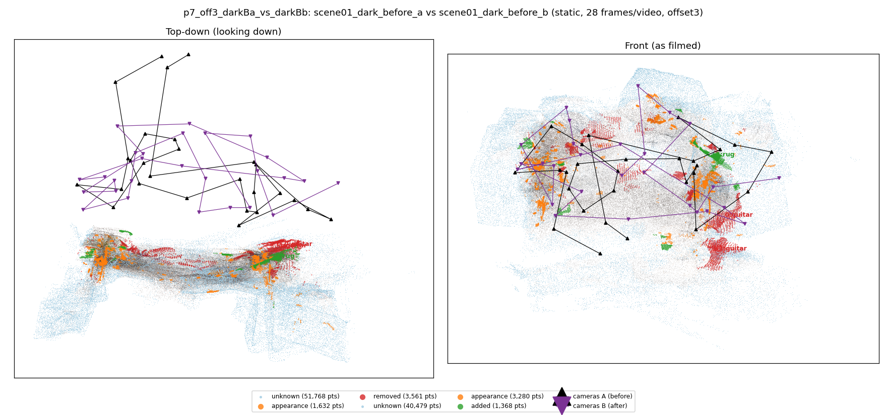
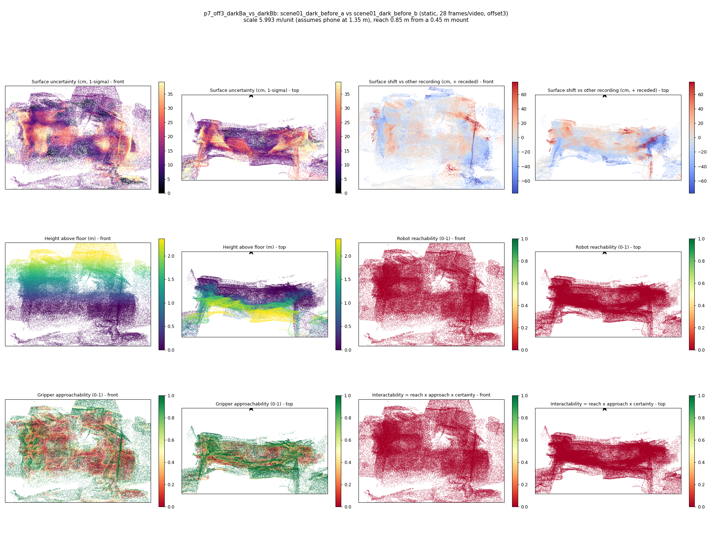

# p7_off3_darkBa_vs_darkBb

**scene01_dark_before_a** (A, before) vs **scene01_dark_before_b** (B, after) - pair type **static**, 28 frames per video, variant `offset3`.

Distances are in cm, from a floor fit and an assumed phone height (scale 5.9926 m/unit, range [4.8829, 7.1024]).

| Measure | Value |
|---|---|
| Observed share (A / B) | 83.3% / 87.2% |
| Changed share of observed points (A / B) | 2.02% / 1.69% |
| Alignment residual across / within recordings | 0.0503 / 0.048 |
| Thresholds (depth tau, see-through fraction, appearance) | 0.14339 / 0.71429 / 0.91186 |
| Changes (moved / removed / added / appearance) | 0 / 2 / 1 / 0 |
| Reconstruction time | 27.7 s (GPU peak 9.57 GB) |

Nothing was moved between these recordings, so every flagged point is a false change: **false-change rate 1.85%**.

Heat maps (recording B): reachable 0%, approachable 42%, interactable 0%; surface uncertainty median 13.403 cm (90th pct 31.269); surface shift 99th pct 77.202 cm.

## Changes

- **1 removed** guitar (p=0.994, 904 pts, centroid +/- 0.031): A guitar that was there in the first recording is no longer there.
- **2 added** rug (p=0.164, 702 pts, centroid +/- 0.031): A rug appears in the second recording that was not there before.
- **0 removed** guitar (p=0.937, 635 pts, centroid +/- 0.031): A guitar that was there in the first recording is no longer there.
