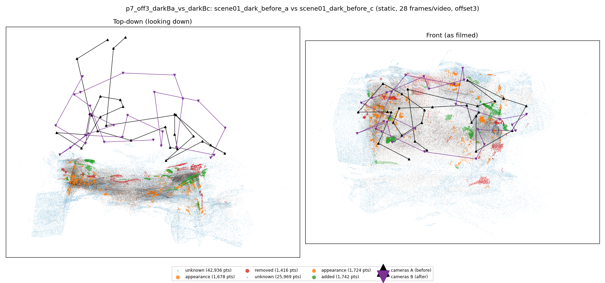
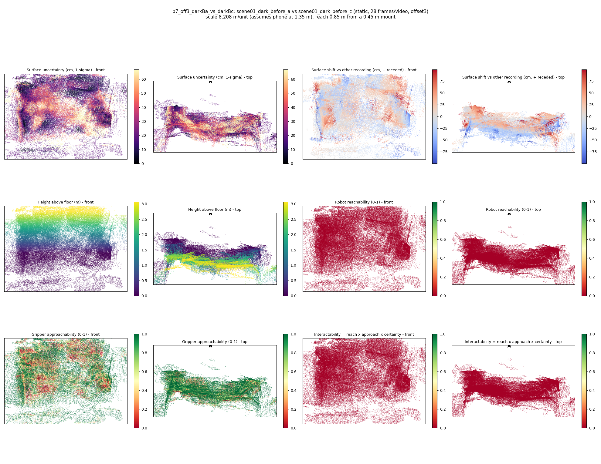

# p7_off3_darkBa_vs_darkBc

**scene01_dark_before_a** (A, before) vs **scene01_dark_before_c** (B, after) - pair type **static**, 28 frames per video, variant `offset3`.

Distances are in cm, from a floor fit and an assumed phone height (scale 8.2082 m/unit, range [6.6881, 9.7282]).

| Measure | Value |
|---|---|
| Observed share (A / B) | 85.9% / 91.4% |
| Changed share of observed points (A / B) | 1.19% / 1.25% |
| Alignment residual across / within recordings | 0.0513 / 0.049 |
| Thresholds (depth tau, see-through fraction, appearance) | 0.14707 / 0.66667 / 0.90625 |
| Changes (moved / removed / added / appearance) | 0 / 0 / 0 / 0 |
| Reconstruction time | 27.5 s (GPU peak 9.57 GB) |

Nothing was moved between these recordings, so every flagged point is a false change: **false-change rate 1.22%**.

Heat maps (recording B): reachable 0%, approachable 55%, interactable 0%; surface uncertainty median 20.007 cm (90th pct 52.461); surface shift 99th pct 99.885 cm.

## Changes

- none detected
