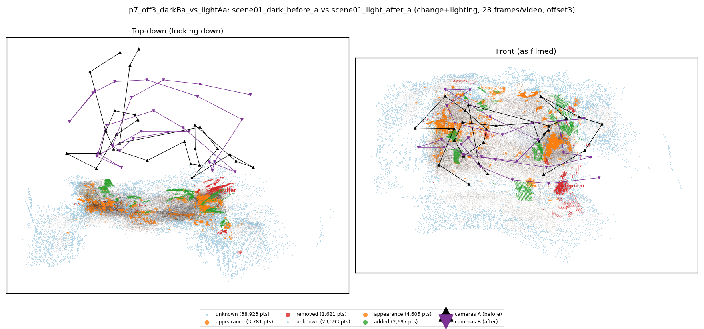
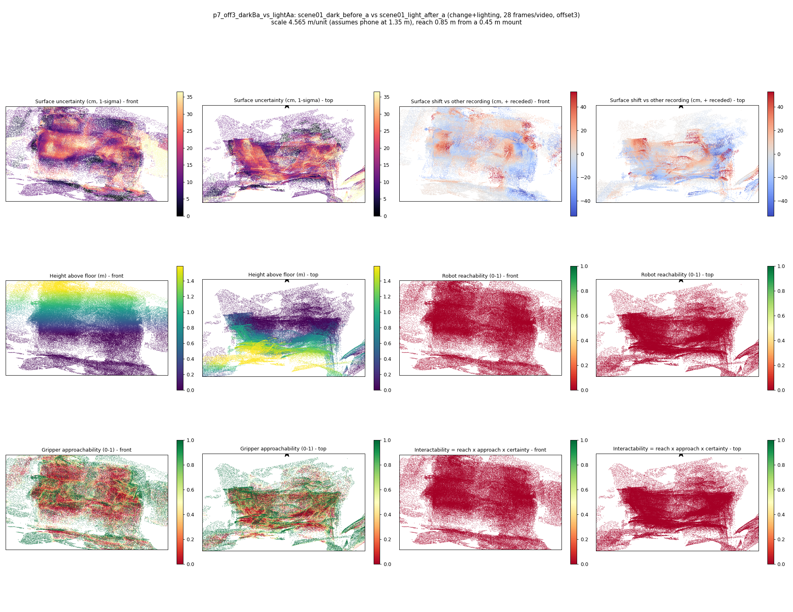

# p7_off3_darkBa_vs_lightAa

**scene01_dark_before_a** (A, before) vs **scene01_light_after_a** (B, after) - pair type **change+lighting**, 28 frames per video, variant `offset3`.

Distances are in cm, from a floor fit and an assumed phone height (scale 4.5649 m/unit, range [3.7195, 5.4102]).

| Measure | Value |
|---|---|
| Observed share (A / B) | 86.9% / 90.1% |
| Changed share of observed points (A / B) | 2.09% / 2.72% |
| Alignment residual across / within recordings | 0.0448 / 0.0421 |
| Thresholds (depth tau, see-through fraction, appearance) | 0.12589 / 0.75 / 0.91162 |
| Changes (moved / removed / added / appearance) | 0 / 1 / 0 / 2 |
| Reconstruction time | 27.1 s (GPU peak 9.57 GB) |

Heat maps (recording B): reachable 0%, approachable 34%, interactable 0%; surface uncertainty median 11.401 cm (90th pct 28.449); surface shift 99th pct 52.592 cm.

## Changes

- **2 appearance** cup (p=0.592, 2540 pts, centroid +/- 0.029): The cup looks different (turned over, deformed or swapped) but occupies the same place.
- **1 appearance** rug (p=0.4, 1344 pts, centroid +/- 0.029): The rug looks different (turned over, deformed or swapped) but occupies the same place.
- **0 removed** guitar (p=0.978, 770 pts, centroid +/- 0.029): A guitar that was there in the first recording is no longer there.
